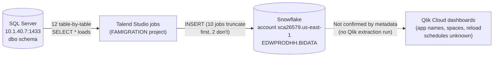

# System Architecture Document

## Overview

This platform moves operational data for a debt-collection agency (Harris & Harris, based on the job author's `@harriscollect.com` address) out of a source SQL Server database and into Snowflake, a cloud data warehouse, so it can be reported on. Twelve Talend jobs in the `FAMIGRATION` project each read one table from SQL Server (things like calls, clients, debtors, payments, letters, texts, emails, phone numbers, validation notices and voicemail-drop events) and load it into a matching table in Snowflake. From there, the data is intended to be consumed by BI/dashboarding tools such as Qlik — but the metadata collected for this documentation set covers only the Talend/SQL Server/Snowflake side; no Qlik Cloud metadata was available when this was written (see the note below), so the Snowflake-to-dashboard leg of the journey is described only in general terms, not from extracted fact.

> **Data-source caveat:** This document is built entirely from `full-documentation/output/talend_metadata.json`, extracted from the `FAMIGRATION` Talend Studio workspace (git repo `https://github.com/Harris-and-Harris/FAMigration.git`, branch `master`, commit `52a64335b34f6f0428f2c27702968599829f5159`, extracted 2026-09-16). **No `qlik_metadata.json` was present for this run** — the Qlik Cloud extractor (`src/qlik/qlik_cloud_extractor.py`) is opt-in and was not run, so nothing about Qlik apps, spaces, reload schedules, or data connections in this document is from real metadata; it is stated as unknown rather than guessed. Everything below reflects only what the Talend extraction actually captured — verify anything else with the team.

## Detail Table

| Item | Value |
|---|---|
| Talend project | FAMIGRATION |
| Total Talend jobs | 12 |
| Total database connections (defined in Talend) | 1 (`Frostlake_0.1`) |
| Total context (variable) groups | 1 (`Common_0.1`) |
| Total Qlik apps | Unable to determine from metadata — verify with team (no `qlik_metadata.json` was available) |

## Data Flow

Solid arrows are backed by the extracted Talend metadata; the dashed arrow to Qlik is the platform's known intended purpose (a BI/reporting layer reading from the warehouse) but is not confirmed by any extracted metadata — it should be verified with the team or by running the Qlik extractor.

## Glossary

| Term | Plain-English meaning |
|---|---|
| Talend Studio | The desktop tool used to design each data-loading job (a "job" is one unit of work — read a table, optionally transform it, write it somewhere). |
| Job | A single Talend program made of connected components; here, each job loads one source table into one Snowflake table. |
| Component | A single step/box inside a job, e.g. "read from SQL Server" or "write to Snowflake." |
| Context group / context variable | A named, reusable setting (like a file path or password) that a job can reference instead of hardcoding the value — `Common_0.1` is the one context group in this project, holding the SSL keystore path. |
| Database connection (Talend) | A reusable, named set of connection details (server, port, credentials) that jobs can point to — one is defined here (`Frostlake_0.1`), though its detail fields were empty in the extracted metadata. |
| Snowflake warehouse | The compute cluster Snowflake spins up to run a query or load — this project uses `COMPUTE_WH`. |
| tableAction (Snowflake load setting) | Controls what happens to the target table before new rows are loaded — leave it alone, create it if missing, or empty it first. |
| Reload task (Qlik) | In Qlik Cloud, the scheduled job that refreshes an app's data. Not present in this documentation set — no Qlik metadata was extracted. |
| Space (Qlik) | In Qlik Cloud, a shared folder-like container that controls who can see and edit an app. Not present in this documentation set — no Qlik metadata was extracted. |
