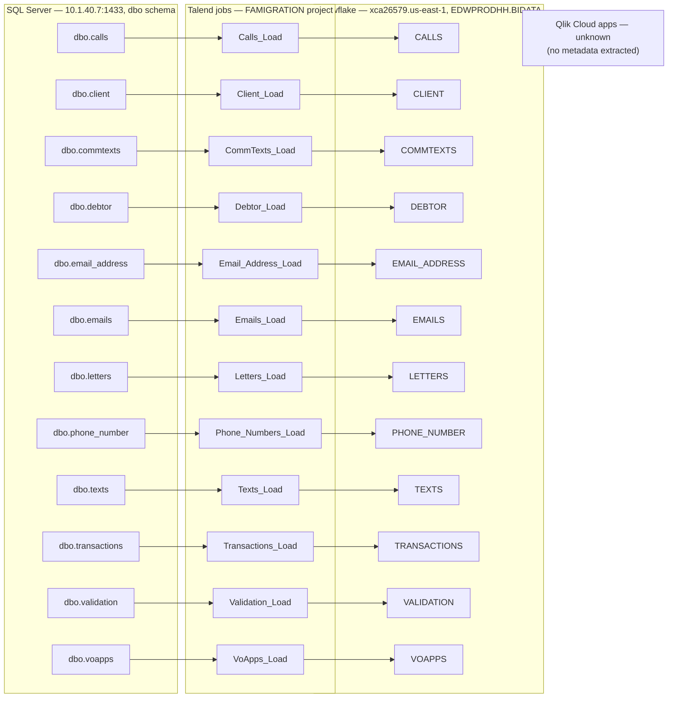

# Data Lineage Map

## Overview

This document traces where each piece of data comes from and where it ends up, one hop at a time: source table → Talend job → Snowflake table → (intended) Qlik app. Every job in the FAMIGRATION project follows the exact same shape — one SQL Server source table, one Talend job, one Snowflake target table — so the trace below is a simple, repeated pattern rather than a branching pipeline. Read each row of the table as one straight-line trace; the "Gaps" section at the end lists the one part of the chain that could not be confirmed from the available metadata.

## Trace

**Walkthrough, hop by hop:**

1. **SQL Server → Talend.** Each Talend job connects to the same SQL Server instance (`10.1.40.7:1433`, `dbo` schema) as service account `svc_talend`, and runs one unfiltered `SELECT *`-style query against a single table (see the per-job pages for the exact query and column list).
2. **Talend → Snowflake.** The job either passes the rows straight through (11 of the 12 jobs) or through a 1:1 column mapping step with no logic (`Calls_Load` only), then writes them into a same-named table (uppercased) in the `EDWPRODHH.BIDATA` schema of Snowflake account `xca26579.us-east-1`, using the `COMPUTE_WH` warehouse and `DATALOADER` role. Ten of the twelve jobs empty (`TRUNCATE`) the target table first; `Calls_Load` and `Client_Load` do not (see `06_dependency_matrix.md` and their individual job pages for why that matters).
3. **Snowflake → Qlik.** This is the platform's presumed final step — a Qlik Cloud app reading from these Snowflake tables to build a dashboard — but it is **not confirmed by any extracted metadata** for this documentation set.

## Gaps

- **Qlik layer: unable to determine from metadata — verify with team.** No `qlik_metadata.json` was available when this documentation was generated (the Qlik Cloud extractor is opt-in and was not run for this workspace). This means: which Qlik app(s), if any, read from `EDWPRODHH.BIDATA`; which specific Snowflake tables/columns each app's load script pulls from; the reload schedule; and who owns/can see the app are all unknown from metadata. Re-run `src/qlik/qlik_cloud_extractor.py` and regenerate this documentation to close this gap.
- **How each job is triggered/scheduled: unable to determine from metadata — verify with team.** The Talend Studio metadata extracted here has no visibility into how these 12 jobs are actually scheduled to run in production (that lives in Talend Cloud Management Console, a separate opt-in extractor that also wasn't run for this documentation set).
- **Whether `Frostlake_0.1` is the connection actually used at runtime: unable to determine from metadata.** A database connection named `Frostlake_0.1` is defined at the project level, but its host/port/database/schema fields are all empty in the extracted metadata, and none of the 12 jobs' components reference it by name — each job's `tMSSqlInput` component has its own host/port/credentials typed in directly instead (see `06_dependency_matrix.md`).
