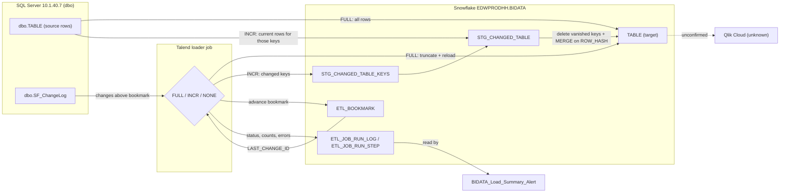

# Data Lineage Map

## Overview

This document traces where each piece of data comes from and where it ends up: SQL Server source table → Talend job → Snowflake `EDWPRODHH.BIDATA` table → (intended) Qlik app. Each of the 24 active loaders still maps exactly one source table to exactly one target table, so the trace is a set of straight lines rather than a branching pipeline. What changed is *how* each line is travelled: a loader now consults a shared change feed and a bookmark table and, on incremental runs, passes through two staging tables before reaching the target. Read the table below as one row per straight-line trace; the diagram shows the shared control path every loader uses. The seven retired jobs are listed separately because they write to tables that are now owned by the incremental loaders.

## Trace

### Active loaders (24)

| Source table (SQL Server `dbo`) | Talend job | Snowflake table (`EDWPRODHH.BIDATA`) | Merge key | FULL style |
|---|---|---|---|---|
| account | [Account_Load](talend/FAMIGRATION/job_Account_Load.md) | ACCOUNT | ACCOUNTID | Batched |
| account_tag | [Account_Tag_Load](talend/FAMIGRATION/job_Account_Tag_Load.md) | ACCOUNT_TAG | ACCOUNT_TAG_ID | Batched |
| calls | [Calls_Load](talend/FAMIGRATION/job_Calls_Load.md) | CALLS | ARLOGID | Batched |
| client | [Client_Load](talend/FAMIGRATION/job_Client_Load.md) | CLIENT | CLIENT_IDX | Single-pass |
| consumer | [Consumer_Load](talend/FAMIGRATION/job_Consumer_Load.md) | CONSUMER | CONSUMERID | Batched |
| consumer_tag | [Consumer_Tag_Load](talend/FAMIGRATION/job_Consumer_Tag_Load.md) | CONSUMER_TAG | CONSUMER_TAG_ID | Batched |
| creditor_transaction | [Creditor_Transaction_Load](talend/FAMIGRATION/job_Creditor_Transaction_Load.md) | CREDITOR_TRANSACTION | CREDITOR_TRANSACTION_ID | Single-pass |
| email_address | [Email_Address_Load](talend/FAMIGRATION/job_Email_Address_Load.md) | EMAIL_ADDRESS | CONSUMERID (delete + re-insert, no MERGE) | Single-pass |
| notice_account | [Notice_Account_Load](talend/FAMIGRATION/job_Notice_Account_Load.md) | NOTICE_ACCOUNT | NOTICE_ACCOUNT_ID | Batched |
| notice_email | [Notice_Email_Load](talend/FAMIGRATION/job_Notice_Email_Load.md) | NOTICE_EMAIL | NOTICEID | Single-pass |
| notice_letter | [Notice_letter_Load](talend/FAMIGRATION/job_Notice_letter_Load.md) | NOTICE_LETTER | NOTICEID | Batched |
| notice_text | [Notice_Text_Load](talend/FAMIGRATION/job_Notice_Text_Load.md) | NOTICE_TEXT | NOTICEID | Batched |
| notice_validation | [Notice_Validation_Load](talend/FAMIGRATION/job_Notice_Validation_Load.md) | NOTICE_VALIDATION | NOTICEID | Batched |
| payment_schedule_account | [Payment_Schecule_Account_Load](talend/FAMIGRATION/job_Payment_Schecule_Account_Load.md) | PAYMENT_SCHEDULE_ACCOUNT | PAYMENT_SCHEDULE_ACCOUNT_ID | Single-pass |
| payment_schedule_instance | [Payment_Schedule_Instance_Load](talend/FAMIGRATION/job_Payment_Schedule_Instance_Load.md) | PAYMENT_SCHEDULE_INSTANCE | PAYMENT_SCHEDULE_INSTANCE_ID | Batched |
| payment_schedule_summary | [Payment_Schecule_Summary_Load](talend/FAMIGRATION/job_Payment_Schecule_Summary_Load.md) | PAYMENT_SCHEDULE_SUMMARY | PAYMENT_SCHEDULE_ID | Single-pass |
| phone_number | [Phone_Numbers_Load](talend/FAMIGRATION/job_Phone_Numbers_Load.md) | PHONE_NUMBER | PHONE_ID | Batched |
| tbl_enotice_email_resp | [Tbl_Enotice_Email_Resp_Load](talend/FAMIGRATION/job_Tbl_Enotice_Email_Resp_Load.md) | TBL_ENOTICE_EMAIL_RESP | ID | Single-pass |
| tbl_enotice_to_fand | [Tbl_Enotice_To_Fand_Load](talend/FAMIGRATION/job_Tbl_Enotice_To_Fand_Load.md) | TBL_ENOTICE_TO_FAND | RECON_STATUS_ID | Single-pass |
| tbl_fa_consumer_texting_ack_3p_hist | [Tbl_Fa_Consumer_Texting_Ack_3p_Hist_Load](talend/FAMIGRATION/job_Tbl_Fa_Consumer_Texting_Ack_3p_Hist_Load.md) | TBL_FA_CONSUMER_TEXTING_ACK_3P_HIST | TEXT_ID | Batched |
| tbl_fa_consumer_texting_resp_3p_hist | [Tbl_Fa_Consumer_Texting_Resp_3p_Hist_Load](talend/FAMIGRATION/job_Tbl_Fa_Consumer_Texting_Resp_3p_Hist_Load.md) | TBL_FA_CONSUMER_TEXTING_RESP_3P_HIST | RESPONSE_ID | Single-pass |
| transactions | [Transactions_Load](talend/FAMIGRATION/job_Transactions_Load.md) | TRANSACTIONS | TRANS_ID | Batched |
| vmdrops | [Vmdrops_Load](talend/FAMIGRATION/job_Vmdrops_Load.md) | VMDROPS | ARLOGID | Single-pass |
| voapps | [VoApps_Load](talend/FAMIGRATION/job_VoApps_Load.md) | VOAPPS | VOAPPS_ID | Single-pass |

### Shared control path (every active loader)

**Walkthrough, hop by hop:**

1. **SQL Server → Talend.** Each loader connects to `10.1.40.7:1433` (`dbo` schema). It always reads `dbo.SF_ChangeLog` for changes above its bookmark. On FULL it reads the whole source table (in key-range batches for the 13 batched loaders); on INCR it reads only the rows whose keys appear in the change log.
2. **Talend → Snowflake staging (INCR only).** Changed keys go to `STG_CHANGED_<TABLE>_KEYS` and their current rows to `STG_CHANGED_<TABLE>`; both are emptied at the start of each INCR run.
3. **Staging → target (INCR) or source → target (FULL).** INCR applies a delete-then-MERGE in one transaction. FULL truncates and reloads the target directly.
4. **Bookmark and run log.** On success the job advances `ETL_BOOKMARK.LAST_CHANGE_ID` to the highest change applied; status, row counts and any error go to `ETL_JOB_RUN_LOG` / `ETL_JOB_RUN_STEP`.
5. **Run log → alert email.** `BIDATA_Load_Summary_Alert` reads the bookmark and run-log tables and emails a summary of the last `LOOKBACK_HOURS` (default 24).
6. **Snowflake → Qlik.** Presumed, **not confirmed** by any extracted metadata.

### Retired jobs (`Older_Inactive_Jobs`)

| Source table | Talend job | Snowflake table | Notes |
|---|---|---|---|
| account | [Account_Load_Copy](talend/FAMIGRATION/job_Account_Load_Copy.md) | ACCOUNT | Simple truncate-and-reload copy; would overwrite `ACCOUNT` outside the bookmark framework if run. |
| commtexts | [CommTexts_Load](talend/FAMIGRATION/job_CommTexts_Load.md) | COMMTEXTS | Table not in `ETL_BOOKMARK`. |
| debtor | [Debtor_Load](talend/FAMIGRATION/job_Debtor_Load.md) | DEBTOR | Table not in `ETL_BOOKMARK`. |
| emails | [Emails_Load](talend/FAMIGRATION/job_Emails_Load.md) | EMAILS | Table not in `ETL_BOOKMARK`. |
| letters | [Letters_Load](talend/FAMIGRATION/job_Letters_Load.md) | LETTERS | Table not in `ETL_BOOKMARK`. |
| texts | [Texts_Load](talend/FAMIGRATION/job_Texts_Load.md) | TEXTS | Table not in `ETL_BOOKMARK`. |
| validation | [Validation_Load](talend/FAMIGRATION/job_Validation_Load.md) | VALIDATION | Table not in `ETL_BOOKMARK`. |

## Gaps

- **How `dbo.SF_ChangeLog` is populated: unable to determine from metadata — verify with team.** Every incremental decision depends on it, but nothing in the Talend project writes to it. It is presumably maintained by triggers, Change Tracking/CDC, or another process on the SQL Server side.
- **Whether the source `ROW_HASH` is computed on SQL Server or in Talend:** the loaders read `ROW_HASH` as a source column, which suggests it is computed in the source query or a SQL Server view; confirm with the team.
- **Qlik layer: unable to determine from metadata — verify with team.** No `qlik_metadata.json` was available, so which Qlik apps read these tables, and how often they reload, is unknown.
- **Scheduling/ordering: unable to determine from metadata — verify with team.** No job calls another (no `tRunJob` anywhere in the project), so run order, frequency, and when `BIDATA_Load_Summary_Alert` runs relative to the loaders all live in an external scheduler (likely Talend Cloud Management Console) that was not extracted.
- **What downstream consumers do with the retired tables** (`COMMTEXTS`, `DEBTOR`, `EMAILS`, `LETTERS`, `TEXTS`, `VALIDATION`): they are no longer loaded by an active job, so their data will go stale if anything still reads them.
- **`Frostlake_0.1` connection:** defined at project level with all detail fields empty and not referenced by any job; every job types its connection details in directly instead.
