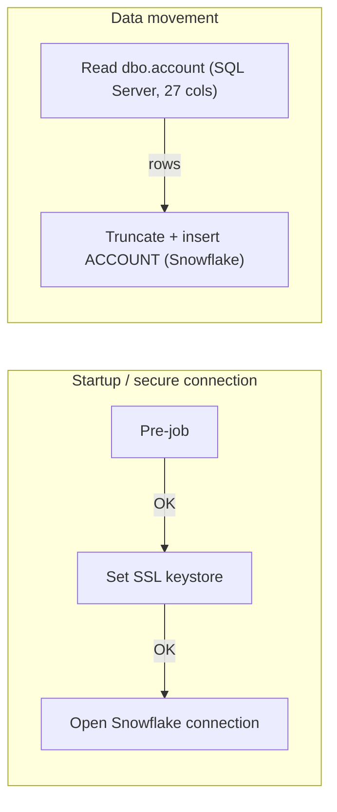

# Talend Job: Account_Load_Copy

> **Status: Inactive.** This job now lives in the Talend repository folder `Older_Inactive_Jobs` (moved on branch feature/bidata_incremental_changes) and appears to be retired from the active BIDATA load. Verify with the team before scheduling or editing it.

## Overview

`Account_Load_Copy` appears to be a copy of `Account_Load` taken before `Account_Load` was rebuilt for incremental loading. It is a simple full-reload job: it reads every row of the `account` table from the source SQL Server database (27 columns, no filter) and writes it into the `ACCOUNT` table in Snowflake (`EDWPRODHH.BIDATA`), emptying the target first. It has no job description or purpose text in its metadata, and nothing in the repository calls it.

## Detail Table

| Field | Value |
|---|---|
| Job name | Account_Load_Copy |
| Version | 0.1 |
| Project | FAMIGRATION |
| Author | atilve@harriscollect.com |
| Created | 2026-09-21T15:08:46.335+0530 |
| Last Modified | 2026-10-28T19:57:24.351+0530 |

## Step-by-Step Data Flow

1. **Startup**: `tPrejob_1` runs first. Then `tSetKeystore_1` runs. It points at the `keystorePath` context variable for its truststore and at a hard-coded client keystore path. After that, `tDBConnection_1` opens a Snowflake connection, but the write step does not use it (see Issues Observed).
2. **Read**: `tDBInput_1` (`tMSSqlInput`) connects to SQL Server at `10.1.40.7:1433`, database name `snowflake`, as login `svc_talend`. It runs a `SELECT` of 27 columns from `dbo.account`, from `DEBTOR_IDX` and `ACCOUNTID` through `EXTRACT_DTTM`, with no `WHERE` clause.
3. **Write**: `tDBOutput_1` (`SnowflakeOutput`) receives the rows directly and writes them to `EDWPRODHH.BIDATA.ACCOUNT` on account `xca26579.us-east-1`, using warehouse `COMPUTE_WH` and role `DATALOADER`. Because `tableAction` = `TRUNCATE`, the table is emptied before the insert.

## Settings

### Source: `tDBInput_1` (`tMSSqlInput`)

| Setting | Value | What it means |
|---|---|---|
| HOST / PORT | 10.1.40.7 / 1433 | The SQL Server the data is read from. |
| DBNAME | snowflake | The source SQL Server database name, despite what the name suggests. |
| DB_SCHEMA / TABLE | dbo / account | The source table. |
| USER | svc_talend | The SQL Server login. |
| PASS | ***REDACTED*** | The SQL Server password (redacted). |

### Target: `tDBOutput_1` (`SnowflakeOutput`)

| Setting | Value | What it means |
|---|---|---|
| account / warehouse / role | xca26579.us-east-1 / COMPUTE_WH / DATALOADER | The Snowflake account, the compute warehouse and the role used for the load. |
| database / dbSchema / tableName | EDWPRODHH / BIDATA / ACCOUNT | The target table. |
| tableAction | TRUNCATE | The target table is emptied before loading. |
| dataAction | INSERT | Rows are inserted with a plain insert, not an upsert. |
| upsertKeyColumn | DEBTOR_IDX | This key would only be used for an upsert, so it has no effect here. |
| dieOnError | false | A row that fails to load does not stop the job. |
| shareConnection | false | The component opens its own Snowflake connection instead of reusing `tDBConnection_1`. |

## Dependencies & Configuration

- **Other jobs**: none. No `tRunJob` component, and no other repository item references `Account_Load_Copy`.
- **Context variables**: `keystorePath` comes from the `Common` context group.
- **Comparison with `Account_Load`** (current metadata):

| Aspect | Account_Load_Copy | Account_Load |
|---|---|---|
| Components | 5 | 30 |
| Load style | Full reload every run | Incremental from `SF_ChangeLog` using `ETL_BOOKMARK`, with a batched full-load path |
| Source columns | 27 | 28 (adds `ROW_HASH`, read as hex text) |
| Target `tableAction` | TRUNCATE | NONE (the truncate is done in a separate "Start load + truncate" step) |
| Staging tables | none | `STG_CHANGED_ACCOUNT`, `STG_CHANGED_ACCOUNT_KEYS` |
| Run logging | none | Writes to `ETL_JOB_RUN_LOG` (run start, step progress, run end) |
| Pre/post job | Pre-job only | Pre-job and post-job |

## Glossary

| Component type | What it does |
|---|---|
| tMSSqlInput | Reads rows from a Microsoft SQL Server table with a SQL query. |
| SnowflakeOutput | Writes rows into a Snowflake table. |
| SnowflakeConnection | Opens a Snowflake connection that other steps can reuse. |
| tSetKeystore | Sets the SSL/TLS truststore and keystore the job uses for encrypted connections. |
| tPrejob | A marker that runs before the rest of the job. |

## Issues Observed

- **Risk if run by mistake.** This job truncates `EDWPRODHH.BIDATA.ACCOUNT`, which is the same table the active `Account_Load` maintains. It does not load `ROW_HASH`, does not update `ETL_BOOKMARK` and does not write to `ETL_JOB_RUN_LOG`. Running it would therefore replace the table outside the incremental framework. Unable to determine from metadata how the next incremental `Account_Load` run would behave afterwards — verify with team. Consider deleting this job or disabling any Task that uses it.
- **No documentation in metadata.** The purpose and description fields are empty, and the author (`atilve@harriscollect.com`) differs from the author of `Account_Load`.
- **Hardcoded connection details.** The source host, port and login are typed into the component instead of coming from context variables.
- **Unused connection and upsert key.** `tDBConnection_1` is not used by the write step (`shareConnection` = false). `upsertKeyColumn` has no effect because `dataAction` is `INSERT`.
- **Truststore options appear disabled.** On `tSetKeystore_1`, `SET_TRUSTSTORE` and `SET_TRUSTSTORE_KEYSTORE` are `false`. Its hard-coded keystore path is `C:/Users/svc_talend_prd/ssl/keystore.p12`, but the `keystorePath` default is `C:/Users/svc_talend_prd/.ssl/keystore.p12`. Whether this step has any effect is unable to determine from metadata — verify with team.
