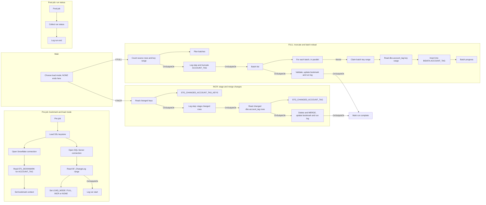

# Talend Job: Account_Tag_Load

## Overview

`Account_Tag_Load` is one of the incremental loader jobs in the FAMIGRATION project. It keeps the Snowflake table `EDWPRODHH.BIDATA.ACCOUNT_TAG` in step with the account tag table (one row per tag attached to a debtor account `ACCOUNTID`, with the tag's type, value and code and its `START_DATE` / `END_DATE` validity window), read from the SQL Server table `dbo.account_tag`. Instead of reloading everything on every run, the job keeps a bookmark (the last processed `change_id`) in `BIDATA.ETL_BOOKMARK` and asks the SQL Server change log `dbo.SF_ChangeLog` what has changed for `account_tag` since then. It then picks one of three load modes: **FULL** when there is no bookmark yet (`LAST_CHANGE_ID` = 0) or when the change log contains a full-reload marker (`change_operation = 'F'`) in the new range; **INCR** when there are new change-log rows but no full-reload marker; and **NONE** when nothing has changed. A FULL load empties `ACCOUNT_TAG` and reloads it in parallel key-range batches, then validates the result; an INCR load stages only the changed keys and rows and applies them with one delete + `MERGE` (insert new keys, update rows whose `ROW_HASH` differs, delete keys that no longer exist in the source). Every run is recorded step by step in `BIDATA.ETL_JOB_RUN_LOG` and `BIDATA.ETL_JOB_RUN_STEP`, and the bookmark is only advanced in the same transaction that commits the final data step.

## Detail Table

| Field | Value |
|---|---|
| Job name | Account_Tag_Load |
| Version | 0.1 |
| Project | FAMIGRATION |
| Job type | Standard |
| Author | rshaikh@harriscollect.com |
| Created | 2026-09-18T17:28:11.883+0530 |
| Last Modified | 2026-10-26T08:22:24.989+0530 |

## Step-by-Step Data Flow

**Pre-job: read the bookmark and decide the load mode**

1. **Secure connections**: `tPrejob_1` starts the job and `tSetKeystore_1` sets up the PKCS12 SSL keystore/truststore. It then opens two shared connections: `tDBConnection_1` (Snowflake account `xca26579.us-east-1`, database `EDWPRODHH`, schema `BIDATA`, warehouse `COMPUTE_WH`, role `DATALOADER`, auto-commit on) and `tDBConnection_2` (SQL Server `10.1.40.7:1433`, schema `dbo`, login `svc_talend`, auto-commit off).
2. **Read the bookmark**: `tDBInput_2` reads `LAST_CHANGE_ID` and `LAST_RUN_DTTM` from `EDWPRODHH.BIDATA.ETL_BOOKMARK` where `TABLE_NAME = 'ACCOUNT_TAG'`. `tJavaRow_1` ("Set bookmark context") copies them into the context variables `LAST_CHANGE_ID` and `LAST_RUN_DTTM`. If the bookmark row is missing, or `LAST_CHANGE_ID` is null, `LAST_CHANGE_ID` ends up as 0.
3. **Measure the change log**: `tDBInput_3` ("SF_ChangeLog range") queries `dbo.SF_ChangeLog` for `target_table = 'account_tag'` and `change_id` greater than the bookmark, returning the number of change rows (`CHANGE_COUNT`), the highest `change_id` (`MAX_CHANGE_ID`) and the highest `change_id` flagged as a full reload (`change_operation = 'F'`, returned as `FULL_CHANGE_ID`).
4. **Choose the load mode**: `tJavaRow_2` ("Set load mode") fixes this run's upper bound `context.MAX_CHANGE_ID` (the bookmark itself when there are no new rows) and sets `context.LOAD_MODE`:
   - `FULL` if `LAST_CHANGE_ID` = 0 (first run / no bookmark) **or** a full-reload marker (`F`) is in the range;
   - `NONE` if there are no new change-log rows;
   - `INCR` otherwise.
   It also stores the change-row count in `globalMap` as `CHANGE_LOG_ROWS`.
5. **Open the run log**: `tDBRow_3` ("Log run start") inserts a `RUNNING` row into `ETL_JOB_RUN_LOG` (Talend `pid`, job name, table `ACCOUNT_TAG`, load mode, change-id range, change-log row count, and the current target row count as `TARGET_ROWS_BEFORE`), records step 1 "Check changes" as `DONE` in `ETL_JOB_RUN_STEP`, and opens step 2 ("Count source" for FULL, "Stage changed keys" for INCR, "Nothing to load" for NONE).

**Main: branch on the load mode** (`tJava_1` "Choose load mode")

6. **NONE**: `tJava_1` prints that there is nothing to load and sets `RUN_COMPLETED = true`. Neither `If` branch fires, so the job goes straight to the post-job. The bookmark is not touched.

7. **FULL branch** (`If "FULL".equals(context.LOAD_MODE)`):
   1. `tDBInput_6` ("Count source rows") reads `COUNT_BIG(*)`, `MIN(ACCOUNT_TAG_ID)` and `MAX(ACCOUNT_TAG_ID)` from `dbo.account_tag`.
   2. `tJavaRow_3` ("Plan batches") computes the number of batches = ceil(rows / `BATCH_SIZE`) and splits the `ACCOUNT_TAG_ID` range into equal-width key ranges (`KEY_STEP`). It also creates a thread-safe batch counter (`NEXT_BATCH`) and a per-thread key-range holder (`BATCH_RANGE`) so batches can run in parallel.
   3. `tDBRow_5` ("Start load + truncate") closes step 2, opens step 3 "Load target" with `ROWS_TOTAL` / `BATCHES_TOTAL`, and then runs `TRUNCATE TABLE EDWPRODHH.BIDATA."ACCOUNT_TAG"`.
   4. `tDBInput_7` ("Batch list") generates one row per batch on SQL Server (a number list built from `sys.all_objects`), and `tFlowToIterate_1` ("For each batch") loops over those rows with **parallel execution enabled** (`context.PARALLEL_BATCHES` threads).
   5. In each iteration `tJava_4` ("Claim batch") takes the next batch number from the shared counter and stores that batch's `ACCOUNT_TAG_ID` range for the current thread; `tDBInput_1` reads all 11 columns of `dbo.account_tag` where `ACCOUNT_TAG_ID` is in that range (`ROW_HASH` converted to a 64-character hex string); `tDBOutput_1` inserts the rows into `BIDATA.ACCOUNT_TAG` on its own Snowflake connection; and `tDBRow_6` ("Batch progress") increments `BATCH_NO` and refreshes `ROWS_DONE` (current target row count) in `ETL_JOB_RUN_LOG`.
   6. When all batches are done, `tDBRow_2` ("Update bookmark + run log") runs a Snowflake script that first writes the loaded row count to the run log and then **validates** the load. It raises an error if (a) fewer batches finished than planned, (b) the target holds fewer than 99.5% of the source rows counted in step 7.1, or (c) `ACCOUNT_TAG_ID` is not unique in the target. If all checks pass it closes step 3, opens step 4 "Update bookmark", and in one transaction sets `ETL_BOOKMARK.LAST_CHANGE_ID = MAX_CHANGE_ID` (plus `LAST_RUN_DTTM` / `UPDATED_DTTM`), fills `SOURCE_ROWS`, `ROWS_INSERTED`, `ROWS_DELETED` (= rows before the truncate) and `TARGET_ROWS_AFTER` in the run log, and closes step 4.
   7. `tJava_3` ("Mark run complete") sets `RUN_COMPLETED = true`.

8. **INCR branch** (`If "INCR".equals(context.LOAD_MODE)`):
   1. `tDBInput_4` ("Changed keys") reads the distinct non-null `key_value`s from `dbo.SF_ChangeLog` for `account_tag` with `change_id` in the range (`LAST_CHANGE_ID`, `MAX_CHANGE_ID`], and `tDBOutput_3` writes them to `BIDATA.STG_CHANGED_ACCOUNT_TAG_KEYS` (table truncated first).
   2. `tDBRow_8` ("Step: stage changed rows") closes step 2, opens step 3 "Stage changed rows" and records the number of changed keys as `ROWS_TOTAL`.
   3. `tDBInput_5` ("Changed ACCOUNT_TAG rows") reads the current version of every `dbo.account_tag` row whose `ACCOUNT_TAG_ID` appears in the same change-log range, and `tDBOutput_2` writes them to `BIDATA.STG_CHANGED_ACCOUNT_TAG` (table truncated first). Keys that were deleted in the source produce no row here.
   4. `tDBRow_1` ("Merge changes + bookmark") closes step 3, opens step 4 "Merge into target", and then in **one transaction**: counts the rows to insert / update / leave unchanged; deletes from `ACCOUNT_TAG` every staged key that no longer exists in the source; `MERGE`s `STG_CHANGED_ACCOUNT_TAG` into `ACCOUNT_TAG` on `ACCOUNT_TAG_ID` (update only when `ROW_HASH IS DISTINCT FROM` the target's, insert when the key is new); advances `ETL_BOOKMARK.LAST_CHANGE_ID` to `MAX_CHANGE_ID`; writes `CHANGED_KEYS`, `SOURCE_ROWS`, `ROWS_INSERTED`, `ROWS_UPDATED`, `ROWS_UNCHANGED`, `ROWS_DELETED` and `TARGET_ROWS_AFTER` to the run log; and closes step 4. Any error rolls the whole transaction back.
   5. `tJava_3` ("Mark run complete") sets `RUN_COMPLETED = true`.

**Post-job: close the run log**

9. `tPostjob_1` then `tJava_2` ("Collect run status") sets `RUN_STATUS` to `SUCCESS` only if `RUN_COMPLETED` was set, otherwise `FAILED`. It takes the first component error message found in `globalMap` (or the generic "Run did not reach its last step"), trims it to 4,000 characters and escapes it for SQL.
10. `tDBRow_4` ("Log run end") marks any still-`RUNNING` step as `DONE` or `FAILED`, and sets the run-log row's `STATUS`, `ERROR_MESSAGE`, `END_DTTM`, `DURATION_SEC` and (on success) `CURRENT_STEP = 'Finished'`.

## Settings

### Shared connection: Snowflake `BIDATA` (component `tDBConnection_1`, type `SnowflakeConnection`)

| Setting | Value | What it means |
|---|---|---|
| configuration.account | xca26579.us-east-1 | The Snowflake account identifier (region-qualified). |
| configuration.database / dbSchema | EDWPRODHH / BIDATA | Database and schema holding the target, staging and control tables. |
| configuration.warehouse | COMPUTE_WH | The Snowflake virtual warehouse used for all queries. |
| configuration.role | DATALOADER | The Snowflake role the service account assumes. |
| configuration.autoCommit | true | Each statement commits on its own; the control scripts use explicit `BEGIN TRANSACTION` / `COMMIT` where several changes must succeed together. |
| Authentication (type, user, key alias, grant type) | ***REDACTED*** | Credentials are redacted in the extracted metadata. |
| Used by | tDBInput_2, tDBRow_1/2/3/4/5/6/8, tDBOutput_2, tDBOutput_3 | Every Snowflake step except the FULL batch writer `tDBOutput_1` reuses this connection. |

### Shared connection: SQL Server `BIDATA` (component `tDBConnection_2`, type `tMSSqlConnection`)

| Setting | Value | What it means |
|---|---|---|
| HOST / PORT | 10.1.40.7 / 1433 | The source SQL Server and its default port. |
| DBNAME | snowflake | The source database on that server (despite the name, this is SQL Server; it holds both the change log and the source tables). |
| SCHEMA_DB | dbo | Source schema. |
| USER / PASS | svc_talend / ***REDACTED*** | The SQL Server login; the password is redacted. |
| PROPERTIES | `trustServerCertificate=True` | Extra JDBC option: accept the server's TLS certificate without validating it. |
| ENCODING | ISO-8859-15 | Character set used when reading text columns. |
| AUTO_COMMIT | false | Reads run without auto-commit. |
| Used by | tDBInput_3, tDBInput_4, tDBInput_5, tDBInput_6, tDBInput_7 | Every SQL Server read except the FULL batch reader `tDBInput_1` reuses this connection. |

### Control read: bookmark (component `tDBInput_2`, type `SnowflakeInput`)

| Setting | Value | What it means |
|---|---|---|
| sqlQuery | `SELECT LAST_CHANGE_ID, LAST_RUN_DTTM FROM EDWPRODHH.BIDATA.ETL_BOOKMARK WHERE TABLE_NAME = 'ACCOUNT_TAG'` (both cast to text) | Reads where the previous successful run stopped. |
| USE_EXISTING_CONNECTION | true (tDBConnection_1) | Reuses the shared Snowflake connection. |

### Control read: change-log range (component `tDBInput_3`, type `tMSSqlInput`)

| Setting | Value | What it means |
|---|---|---|
| TABLE | SF_ChangeLog | The SQL Server change log recording which keys changed in which source table. |
| QUERY | `COUNT(*)`, `MAX(change_id)`, and `MAX(change_id)` where `change_operation = 'F'`, for `target_table = 'account_tag' AND change_id > LAST_CHANGE_ID` | Tells the job how many changes there are, how far to read, and whether a full reload was requested. |
| USE_EXISTING_CONNECTION | true (tDBConnection_2) | Reuses the shared SQL Server connection. |

### FULL source: batch reader (component `tDBInput_1`, type `tMSSqlInput`)

| Setting | Value | What it means |
|---|---|---|
| TABLE | account_tag | The source table. |
| QUERY | Selects `ACCOUNTID`, `ACCOUNT_TAG_ID`, `TAG_TYPE_ID`, `TAG_TYPE`, `TAG_VALUE`, `TAG_CODE`, `START_DATE`, `END_DATE`, `SYSTEM_SOURCE`, `EXTRACT_DTTM`, `ROW_HASH` from `dbo.account_tag` where `ACCOUNT_TAG_ID` is BETWEEN the current thread's batch range | One key-range slice of the table per iteration; `ROW_HASH` is returned as hex text via `CONVERT(VARCHAR(64), ROW_HASH, 2)`. |
| Connection | Own connection (no `USE_EXISTING_CONNECTION`) to 10.1.40.7:1433, database `snowflake`, as `svc_talend` (password ***REDACTED***) | Each parallel thread opens its own source connection. |
| PROPERTIES | `trustServerCertificate=True` | Extra JDBC option: accept the server's TLS certificate without validating it. |

### FULL target: `BIDATA.ACCOUNT_TAG` (component `tDBOutput_1`, type `SnowflakeOutput`)

| Setting | Value | What it means |
|---|---|---|
| configuration.dataSet.tableName | ACCOUNT_TAG | The Snowflake table this job maintains. |
| configuration.snowflakeOutputCommonConfig.tableAction | NONE | The component does not create or clear the table itself; the truncate is done earlier by `tDBRow_5`. |
| configuration.snowflakeOutputCommonConfig.dataAction | INSERT | Rows are appended batch by batch. |
| configuration.snowflakeOutputCommonConfig.upsertKeyColumn | ACCOUNTID | Only used for upserts; inert here because `dataAction` is `INSERT`. |
| configuration.dieOnError | true | Any rejected row aborts the job. |
| configuration.snowflakeOutputCommonConfig.convertColumnsAndTableToUppercase | true | Column and table names are upper-cased to match Snowflake. |
| Connection | Own connection to xca26579.us-east-1 / EDWPRODHH.BIDATA / COMPUTE_WH / DATALOADER (credentials ***REDACTED***) | Not the shared `tDBConnection_1`, so the parallel batches each write on their own connection. |

### INCR staging targets (components `tDBOutput_3` and `tDBOutput_2`, type `SnowflakeOutput`)

| Setting | Value | What it means |
|---|---|---|
| tDBOutput_3 tableName | STG_CHANGED_ACCOUNT_TAG_KEYS | Holds the distinct changed keys (`KEY_VALUE`) for this run. |
| tDBOutput_2 tableName | STG_CHANGED_ACCOUNT_TAG | Holds the current source version of every changed row (same layout as `ACCOUNT_TAG`). |
| tableAction | TRUNCATE (both) | Each staging table is emptied before this run's rows are written. |
| dataAction | INSERT (both) | Straight insert. |
| upsertKeyColumn | `KEY_VALUE` / `ACCOUNTID` | Inert (insert only). |
| dieOnError | true (both) | Any rejected row aborts the job. |
| USE_EXISTING_CONNECTION | true (tDBConnection_1) | Reuse the shared Snowflake connection. |

### Control scripts (type `SnowflakeRow`)

| Component | Label | What the SQL does | dieOnError |
|---|---|---|---|
| tDBRow_3 | Log run start | Inserts the `RUNNING` run-log row (mode, change-id range, `TARGET_ROWS_BEFORE`), step 1 (`DONE`) and step 2 (`RUNNING`). | true |
| tDBRow_5 | Start load + truncate | FULL: closes step 2, opens step 3 "Load target" with row/batch totals, then `TRUNCATE TABLE BIDATA."ACCOUNT_TAG"`. | true |
| tDBRow_6 | Batch progress | FULL, once per batch: `BATCH_NO + 1` and `ROWS_DONE` = current target row count. | false |
| tDBRow_2 | Update bookmark + run log | FULL: validation (all batches done; target at least 99.5% of source count; `ACCOUNT_TAG_ID` unique), then in one transaction the bookmark and run-log counts. | true |
| tDBRow_8 | Step: stage changed rows | INCR: closes step 2, opens step 3, records the changed-key count as `ROWS_TOTAL`. | true |
| tDBRow_1 | Merge changes + bookmark | INCR: in one transaction, delete vanished keys, `MERGE` on `ACCOUNT_TAG_ID` with `ROW_HASH` change detection, bookmark and run-log counts; rollback on any error. | true |
| tDBRow_4 | Log run end | Post-job: final `STATUS`, `ERROR_MESSAGE`, end time and duration in the run log and step log. | false |

## Dependencies & Configuration

**Other jobs**: none observed. There is no `tRunJob` component and no cross-job trigger in the extracted metadata. How and when the job is scheduled is not visible in the metadata; verify with the team (e.g. Talend Management Console).

**Upstream feed**: `dbo.SF_ChangeLog` on the SQL Server must contain one row per changed key (`target_table`, `key_value`, `change_id`, `change_operation`) for `account_tag`. What populates it is outside this job; the BIDATA DDL script refers to it as the Frost `snowflake.dbo.SF_ChangeLog`. Unable to determine the writer from metadata; verify with the team.

**Control and staging tables (Snowflake `EDWPRODHH.BIDATA`)**, created by `Snowflake_BIDATA_Schema_Change.sql`:

| Table | Read / Written | Purpose |
|---|---|---|
| ETL_BOOKMARK | Read in the pre-job; updated by `tDBRow_1` / `tDBRow_2` | One row per table (`TABLE_NAME = 'ACCOUNT_TAG'`, seeded by the DDL script with `LAST_CHANGE_ID = 0`) holding the last applied `change_id`. |
| ETL_JOB_RUN_LOG | Inserted by `tDBRow_3`; updated by `tDBRow_5/6/8/1/2/4` | One row per run: mode, status, change-id range, row counts, batch progress, error message. |
| ETL_JOB_RUN_STEP | Inserted / updated by every control script | One row per step of a run with timing, rows processed and detail. |
| STG_CHANGED_ACCOUNT_TAG_KEYS | Truncated and written by `tDBOutput_3` (INCR) | Transient table of changed keys. |
| STG_CHANGED_ACCOUNT_TAG | Truncated and written by `tDBOutput_2` (INCR) | Transient copy of the changed source rows. |
| ACCOUNT_TAG | Truncated and reloaded (FULL) or merged (INCR) | The business table itself; must have a `ROW_HASH` column (added by the DDL script). |

**Context variables** (job-level context `Default`, defined in the job's `.item` source; the extracted metadata lists no shared context group for this job):

| Variable | Type | Default | Why it is used |
|---|---|---|---|
| keystorePath | String | C:/Users/svc_talend_prd/.ssl/keystore.p12 | Truststore file used by `tSetKeystore_1`. |
| LAST_CHANGE_ID | Long | 0 | Bookmark loaded from `ETL_BOOKMARK`; 0 forces a FULL load. |
| LAST_RUN_DTTM | Date | 1900-01-01 00:00:00 | Time of the last successful run (printed to the log only). |
| MAX_CHANGE_ID | Long | 0 | Upper bound of this run's change-log range; becomes the new bookmark. |
| LOAD_MODE | String | FULL | `FULL`, `INCR` or `NONE`, set by `tJavaRow_2`. |
| BATCH_SIZE | Integer | 5000000 | Target rows per FULL-load batch (used to compute the number of key-range batches). |
| PARALLEL_BATCHES | Integer | 4 | Number of FULL-load batches run at the same time (parallel iterate on `tFlowToIterate_1`). |

The Talend built-ins `pid` and `jobName` identify every run-log and step-log row.

## Glossary

| Component type | What it does |
|---|---|
| tPrejob / tPostjob | Run before / after the main job (the post-job runs even if the main part fails); used here for setup and run logging. |
| tSetKeystore | Configures the SSL/TLS keystore and truststore used for encrypted connections. |
| SnowflakeConnection | Opens a Snowflake connection that other components can share. |
| tMSSqlConnection | Opens a SQL Server connection that other components can share. |
| SnowflakeInput | Runs a query against Snowflake and returns rows. |
| tMSSqlInput | Runs a query against Microsoft SQL Server and returns rows. |
| SnowflakeOutput | Writes rows into a Snowflake table (insert or upsert, optionally truncating or creating the table first). |
| SnowflakeRow | Executes a SQL statement or Snowflake Scripting block without returning rows. |
| tJavaRow | Runs custom Java code for each row passing through. |
| tJava | Runs a piece of custom Java code once. |
| tFlowToIterate | Turns each incoming row into one loop iteration (run in parallel here). |

## Issues Observed

- **FULL load empties the live table first.** `tDBRow_5` runs `TRUNCATE TABLE BIDATA."ACCOUNT_TAG"` before the batches start, and `tDBOutput_1` writes batch by batch on its own connection. Until the last batch finishes, readers of `ACCOUNT_TAG` (e.g. reporting) see an empty or partial table. If the run fails part-way the table stays partial until the next successful FULL run (the bookmark is not advanced, so the next run is FULL again).
- **Validation tolerates a small shortfall.** `tDBRow_2` only fails when the target has fewer than 99.5% of the source rows counted before the load (`rows_loaded < rows_total * 99.5 / 100`), so up to 0.5% of rows could be missing and the run is still recorded as `SUCCESS`. Confirm this tolerance is intended.
- **Bookmark is only ever updated, never inserted.** `tDBRow_1` and `tDBRow_2` use `UPDATE ETL_BOOKMARK ... WHERE TABLE_NAME = 'ACCOUNT_TAG'`. If the seed row created by the DDL script is missing, the update affects 0 rows, `LAST_CHANGE_ID` stays 0 and every run is FULL.
- **No run-log row if the pre-job fails.** The run-log row is created by `tDBRow_3` at the end of the pre-job. If the keystore setup, bookmark read or change-log read fails first, `tDBRow_4` (post-job) updates no rows, so the failure is visible only in the Talend log, not in `ETL_JOB_RUN_LOG`.
- **Keystore path inconsistency.** The truststore path comes from `context.keystorePath` (default `C:/Users/svc_talend_prd/.ssl/keystore.p12`), but the keystore path in `tSetKeystore_1` is hardcoded as `C:/Users/svc_talend_prd/ssl/keystore.p12` (no leading dot). Whether the keystore setting is actually used depends on the client-authentication option, which is redacted in the metadata; verify with the team.
- **Hardcoded connection details and certificate trust.** Host `10.1.40.7`, login `svc_talend`, and the Snowflake account/warehouse/role are typed into the components rather than taken from context variables, and every SQL Server connection uses `trustServerCertificate=True` (the server certificate is not validated).
- **Leftover or unused settings.** `tDBInput_7` returns `KEY_FROM` / `KEY_TO` per batch, but `tJava_4` ignores them and recomputes the range from the shared counter (the rows only drive the number of iterations). The output components carry an inert `upsertKeyColumn` (`ACCOUNTID` on `ACCOUNT_TAG`), and their unused LOOKUP/MERGE schemas are labelled `account` (copied from another job, visible in the `.item` source). In `tDBRow_3`, `STEPS_TOTAL` is computed as `FULL ? 4 : 4`, so both branches give 4.
- **Parallel batch connections.** `tFlowToIterate_1` runs `PARALLEL_BATCHES` (default 4) iterations at once, and each opens its own SQL Server and Snowflake connection. Whether both servers are sized for this concurrency is not described in the metadata; verify with the team.
