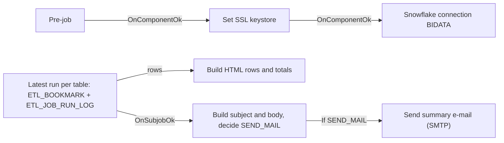

# Talend Job: BIDATA_Load_Summary_Alert

## Overview

`BIDATA_Load_Summary_Alert` is a monitoring job in the `process/misc` folder. Its metadata purpose is "E-mail summary of the BIDATA load runs", and its description is "Latest run per BIDATA table from ETL_JOB_RUN_LOG, sent as an HTML e-mail". It does not move any data. It is a read-only report over the run-tracking tables in Snowflake.

How it works:

- It reads the list of tables from `EDWPRODHH.BIDATA.ETL_BOOKMARK`, which has one row per BIDATA table.
- For each table, it finds the most recent run in `EDWPRODHH.BIDATA.ETL_JOB_RUN_LOG` within the last `LOOKBACK_HOURS` hours (default 24).
- It builds a colour-coded HTML table with each table's status, start time, duration, row counts and any error message, plus a totals row and a summary line.
- It sends the result by SMTP to a configured recipient list.
- The subject starts with `[ACTION NEEDED]` when any table failed, did not run, or is still running.
- With `SEND_ONLY_ON_ISSUES` = `true`, the e-mail is suppressed when everything succeeded.

The tables it reads (`ETL_BOOKMARK`, `ETL_JOB_RUN_LOG`) are created and seeded by `BIDATA_Schema_Deploy`. They are filled in by the incremental `*_Load` jobs.

## Detail Table

| Field | Value |
|---|---|
| Job name | BIDATA_Load_Summary_Alert |
| Version | 0.1 |
| Project | FAMIGRATION |
| Author | jmach@harriscollect.com |
| Created | 2026-10-28T18:26:28.000+0530 |
| Last Modified | 2026-10-28T20:10:26.060+0530 |

## Step-by-Step Data Flow

1. **Startup.** `tPrejob_1` runs `tSetKeystore_1`, then `tDBConnection_1`.
   - `tSetKeystore_1` uses PKCS12 stores. The truststore path is `context.keystorePath`. The keystore path is hard-coded.
   - `tDBConnection_1` (label "BIDATA") opens a Snowflake connection to account `xca26579.us-east-1`, database `EDWPRODHH`, schema `BIDATA`, warehouse `COMPUTE_WH`, role `DATALOADER`. Auto-commit is on.
2. **Read the latest run per table.** `tDBInput_1` ("Latest run per table", `SnowflakeInput`) reuses `tDBConnection_1` and runs one query:
   - **Window:** a CTE (`last_run`) ranks `ETL_JOB_RUN_LOG` rows per `TABLE_NAME` by `START_DTTM` (newest first). It keeps only runs started within the last `context.LOOKBACK_HOURS` hours of `CURRENT_TIMESTAMP()`.
   - **Join:** `ETL_BOOKMARK` is left-joined to the newest run (`RN = 1`). A table with no run in the window still appears, with status `NO RUN`.
   - **Display columns:** it returns 17 string columns. These are formatted for display: start time as `YYYY-MM-DD HH24:MI`, duration in minutes, thousands-separated counts (`ROWS_TOTAL`, `ROWS_DONE`, `ROWS_INSERTED`, `ROWS_UPDATED`, `ROWS_DELETED`, `TARGET_ROWS` from `TARGET_ROWS_AFTER`), and the first 300 characters of `ERROR_MESSAGE`.
   - **Raw columns for totals:** `END_TXT`, `ROWS_TOTAL_NUM`, `ROWS_DONE_NUM`, `DURATION_SEC_NUM`. For a run with no end time, the end time and duration use the current time.
   - **Order:** `FAILED` first, then `NO RUN`, then `RUNNING`, then the rest. Ties are sorted by table name.
3. **Build table rows.** `tJavaRow_1` ("Build table rows") runs once per row:
   - It counts statuses into `CNT_OK` (`SUCCESS`), `CNT_NORUN` (`NO RUN`), `CNT_RUNNING` (`RUNNING`) and `CNT_FAILED` (any other value).
   - It appends one HTML `<tr>` to `MAIL_ROWS`, with special characters HTML-escaped. The row background is green (`#E2EFDA`) for success, yellow (`#FFF2CC`) for running and orange (`#FCE4D6`) otherwise.
   - It adds up total rows, rows applied and run seconds.
   - It tracks the earliest start (`MAIL_FIRST_START`) and the latest end (`MAIL_LAST_END`) to work out the "load window".
4. **Build the e-mail.** When the read subjob finishes, `tJava_1` ("Build e-mail") prepares the message:
   - **Subject:** `[ACTION NEEDED] ` (only if there are issues) + `BIDATA load summary <yyyy-MM-dd>: N succeeded, N failed, N not run` + `, N still running` (only if any are running).
   - **Issues** = failed + not run + running. It also counts as an issue when no rows came back from `ETL_BOOKMARK` at all.
   - **Body:**
     - An intro line.
     - A counts line.
     - A totals line: total rows / changed keys, rows applied, run time across all jobs (shown in hours if 3600 seconds or more), and the load window from first start to last finish in minutes.
     - The table, with a header row, the per-table rows and a TOTAL row.
     - A footnote explaining FULL and INCR row semantics.
     - If no tables came back, a red warning to check `ETL_BOOKMARK` replaces the table.
   - It sets `SEND_MAIL = !context.SEND_ONLY_ON_ISSUES || issues > 0` and prints the subject to the job log. The printed line ends with "(not sent: no issues)" when the e-mail is suppressed.
5. **Send.** A `RUN_IF` link with condition `Boolean.TRUE.equals(globalMap.get("SEND_MAIL"))` triggers `tSendMail_1` ("Send summary"). It sends an HTML e-mail (`text/html`, ISO-8859-15) through `harriscollect-com.mail.protection.outlook.com:25`:
   - From: `svc_analytics@harriscollect.com`
   - To: `context.emailRecipients`
   - Cc: `context.emailCC`
   - Die on error: true

## Settings

### Context variables (defined in the job)

| Setting | Value | What it means |
|---|---|---|
| LOOKBACK_HOURS | 24 (Integer) | Only runs started in the last N hours are reported. Older runs count as `NO RUN`. |
| SEND_ONLY_ON_ISSUES | false (Boolean) | If `true`, the e-mail is sent only when a table failed, did not run, or is still running. With `false`, it is sent on every execution. |
| emailRecipients | configured recipient list | The "To" addresses, separated by `;`. The default is a single individual's address, not a distribution list. |
| emailCC | (empty) | Optional Cc addresses. |
| keystorePath | `C:/Users/svc_talend_prd/.ssl/keystore.p12` (from the `Common` context group) | The truststore path used by `tSetKeystore_1`. |

### Snowflake connection (`tDBConnection_1`, `SnowflakeConnection`, reused by `tDBInput_1`)

| Setting | Value | What it means |
|---|---|---|
| account | xca26579.us-east-1 | The Snowflake account identifier. |
| database / dbSchema | EDWPRODHH / BIDATA | The default database and schema. |
| warehouse | COMPUTE_WH | The compute warehouse. |
| role | DATALOADER | The role the service account uses. |
| authentication (type, user, key alias, grant type) | ***REDACTED*** | Login details, redacted by the extractor. |
| autoCommit / loginTimeout | true / 15 | Auto-commit is on. Login times out after 15 seconds. |

### E-mail (`tSendMail_1`)

| Setting | Value | What it means |
|---|---|---|
| SMTP_HOST / SMTP_PORT | harriscollect-com.mail.protection.outlook.com / 25 | The mail server and port used to send the e-mail. |
| SSL / STARTTLS | false / false | Neither SSL nor STARTTLS is turned on for the SMTP session. |
| AUTH_MODE / AUTH_USERNAME / AUTH_PASSWORD | ***REDACTED*** | SMTP authentication settings, redacted. |
| FROM | svc_analytics@harriscollect.com | The service sender address. |
| TO / CC | context.emailRecipients / context.emailCC | The recipients, taken from context variables. |
| SUBJECT / MESSAGE | `globalMap` `MAIL_SUBJECT` / `MAIL_BODY` | Built by `tJava_1`. |
| TEXT_SUBTYPE / ENCODING | html / ISO-8859-15 | The message is sent as HTML. |
| IMPORTANCE | Normal | Normal priority, even for `[ACTION NEEDED]` messages. |
| DIE_ON_ERROR | true | The job fails if the e-mail cannot be sent. |

## Dependencies & Configuration

- **Upstream data**: this job depends on objects created by `BIDATA_Schema_Deploy`:
  - `ETL_BOOKMARK`, the list of tables. Its seed list has 24 tables.
  - `ETL_JOB_RUN_LOG`, including the columns added later: `ROWS_TOTAL`, `ROWS_DONE` and others.
  - The incremental `*_Load` jobs (for example `Account_Load`) write the run-log rows that this job reports on.
- **Called jobs**: none. There is no `tRunJob`, and nothing else in the repository calls this job.
- **Schedule**: not visible in the Studio metadata. Unable to determine from metadata — verify with team. The default 24-hour lookback suggests a daily run after the load window.

## Glossary

| Term / component | What it does |
|---|---|
| tPrejob | Runs before the main subjobs. Used here to set up SSL and the connection. |
| tSetKeystore | Sets the SSL/TLS truststore and keystore for the JVM. |
| SnowflakeConnection | Opens a shared Snowflake connection. |
| SnowflakeInput | Runs a SELECT on Snowflake and streams the rows. |
| tJavaRow | Custom Java that runs once per row. |
| tJava | Custom Java that runs once per subjob. |
| tSendMail | Sends an e-mail through an SMTP server. |
| RUN_IF | A conditional trigger. The next component runs only if the Java condition is true. |
| ETL_BOOKMARK | One row per BIDATA table, holding the last applied `SF_ChangeLog` change id. Here it is used as the list of tables. |
| ETL_JOB_RUN_LOG | One row per `*_Load` run, with status, timings and row counts. |
| FULL / INCR | The load modes recorded in the run log: full reload, or incremental from `SF_ChangeLog`. |

## Issues Observed

- **Default recipient is a person.** `emailRecipients` defaults to one individual's address. A shared distribution list would make the alert more resilient. Change it in the context or in the deployed Task.
- **Unencrypted SMTP settings.** The e-mail goes to port 25 with `SSL` and `STARTTLS` both `false`. The message contains table names, row counts and up to 300 characters of error text. Verify that this transport meets policy.
- **Alert sent on every run by default.** `SEND_ONLY_ON_ISSUES` = `false`, so a "success" e-mail is sent every time. This is intended for a daily summary, but it may cause alert fatigue.
- **Tables outside `ETL_BOOKMARK` are invisible.** Only tables with a bookmark row are reported. A load that runs for a table not seeded there will not appear.
- **Unknown statuses count as failed.** Any status other than `SUCCESS`, `NO RUN` or `RUNNING` (including an empty one) is counted as failed. This is a safe default.
- **Stale `RUNNING` rows.** If a `*_Load` job crashes before its post-job updates the log, the run stays `RUNNING`. Its duration keeps growing up to the current time, and it is reported as "still running" until a newer run replaces it.
- **Keystore path mismatch.** On `tSetKeystore_1`, `SET_TRUSTSTORE` and `SET_TRUSTSTORE_KEYSTORE` are `false`. The hard-coded keystore is `C:/Users/svc_talend_prd/ssl/keystore.p12`, but the `keystorePath` default is `C:/Users/svc_talend_prd/.ssl/keystore.p12`. Whether this step has any effect is unable to determine from metadata — verify with team.
- **Date in subject.** The date in the subject comes from the Talend server's local clock (`TalendDate.getCurrentDate()`). The lookback window uses Snowflake's `CURRENT_TIMESTAMP()`. If the two are in different time zones, the date may not match the reported window.
