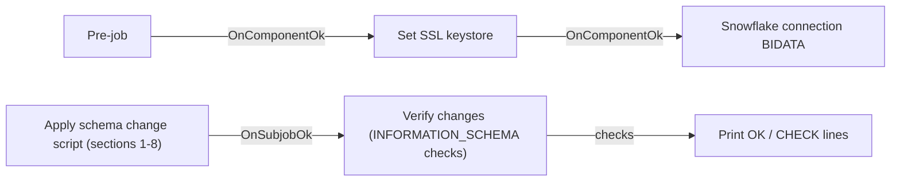

# Talend Job: BIDATA_Schema_Deploy

## Overview

`BIDATA_Schema_Deploy` is a one-off deployment job in the `process/misc` folder. Its metadata purpose is "One-off: apply the BIDATA schema change script". Its description is "Runs Snowflake_BIDATA_Schema_Change.sql sections 1-8 as the TALEND service account".

The job runs one Snowflake Scripting block (`BEGIN ... END;`) against `EDWPRODHH.BIDATA`. This block prepares the schema for the new incremental `*_Load` jobs:

- It adds a `ROW_HASH` column to all 24 BIDATA target tables. A table that does not have the column yet is **truncated** first.
- It adds two new columns and changes two column types.
- It creates and seeds the `ETL_BOOKMARK` bookmark table.
- It creates 48 transient staging tables.
- It creates the run-log tables `ETL_JOB_RUN_LOG` and `ETL_JOB_RUN_STEP`.

After that, it runs a verification query and prints one OK/CHECK line per check to the job log.

The SQL block in the job matches the `EXECUTE IMMEDIATE $$ ... $$` block in `Snowflake_BIDATA_Schema_Change.sql` character for character, after whitespace is normalised. The script's header says it should be run once, but that it is safe to re-run.

## Detail Table

| Field | Value |
|---|---|
| Job name | BIDATA_Schema_Deploy |
| Version | 0.1 |
| Project | FAMIGRATION |
| Author | jmach@harriscollect.com |
| Created | 2026-10-25T21:16:31.000+0530 |
| Last Modified | 2026-10-28T19:56:40.043+0530 |

## Step-by-Step Data Flow

1. **Startup.** `tPrejob_1` runs `tSetKeystore_1` and then `tDBConnection_1`. `tDBConnection_1` (label "BIDATA", `SnowflakeConnection`) connects to account `xca26579.us-east-1`, database `EDWPRODHH`, schema `BIDATA`, warehouse `COMPUTE_WH` and role `DATALOADER`, with auto-commit on. All table names in the script are unqualified, so they resolve against this default schema.
2. **Apply the schema change.** `tDBRow_1` ("Apply BIDATA schema change (whole script)", `SnowflakeRow`, `dieOnError` = true) reuses the connection and runs the block. The block runs top to bottom and stops at the first error. It has eight sections:
   1. **ROW_HASH on 24 tables.** For each table, the script checks `INFORMATION_SCHEMA.COLUMNS`. If `ROW_HASH` is missing, it runs `TRUNCATE TABLE` and then `ALTER TABLE ... ADD COLUMN ROW_HASH BINARY(32)`.
      - The 24 tables are: `ACCOUNT`, `ACCOUNT_TAG`, `CALLS`, `CLIENT`, `CONSUMER`, `CONSUMER_TAG`, `CREDITOR_TRANSACTION`, `EMAIL_ADDRESS`, `NOTICE_ACCOUNT`, `NOTICE_EMAIL`, `NOTICE_LETTER`, `NOTICE_TEXT`, `NOTICE_VALIDATION`, `PAYMENT_SCHEDULE_ACCOUNT`, `PAYMENT_SCHEDULE_INSTANCE`, `PAYMENT_SCHEDULE_SUMMARY`, `PHONE_NUMBER`, `TBL_ENOTICE_EMAIL_RESP`, `TBL_ENOTICE_TO_FAND`, `TBL_FA_CONSUMER_TEXTING_ACK_3P_HIST`, `TBL_FA_CONSUMER_TEXTING_RESP_3P_HIST`, `TRANSACTIONS`, `VMDROPS` and `VOAPPS`.
      - The script comment says a truncated table is reloaded in full by its next `*_Load` run, because its bookmark is 0.
   2. **`NOTICE_ACCOUNT.NOTICE_ACCOUNT_ID`.** Adds a `NUMBER(38,0)` column if it does not exist.
   3. **`VOAPPS.SOURCE_FILE_DATE`.** Adds a `DATE` column if it does not exist. It is nullable on purpose. The comment notes it is NOT NULL in the source.
   4. **`TBL_FA_CONSUMER_TEXTING_RESP_3P_HIST.RESPONSE_ID`.** Changes the type to `NUMBER(38,0)`, the equivalent of INT to BIGINT.
   5. **`TRANSACTIONS.TRANS_DATE` from DATE to `TIMESTAMP_NTZ(3)`.** This runs only while the column is still a DATE. It adds `TRANS_DATE_NEW`, copies the data with `UPDATE`, drops the old column and renames the new one. If an earlier run stopped after the drop, it only finishes the rename.
   6. **`ETL_BOOKMARK`.** Creates the table if it does not exist. Columns: `TABLE_NAME` (primary key), `LAST_CHANGE_ID` (default 0), `LAST_RUN_DTTM`, `UPDATED_DTTM`. It then `MERGE`s one seed row per table (the same 24 names), with `LAST_CHANGE_ID` = 0. Rows that already exist are left as they are.
   7. **Staging tables.** Creates 24 `CREATE TRANSIENT TABLE IF NOT EXISTS STG_CHANGED_<TABLE> LIKE <TABLE>` copies, plus 24 `STG_CHANGED_<TABLE>_KEYS (KEY_VALUE NUMBER(38,0))` tables. That makes 48 in total.
   8. **Run log.**
      - Creates `ETL_JOB_RUN_LOG` with 21 columns. These include the run ID (autoincrement primary key), the Talend PID, job and table names, load mode (FULL/INCR/NONE), status (RUNNING/SUCCESS/FAILED), timings, change-id range and row counts.
      - Adds 9 progress columns if they do not exist: `CURRENT_STEP`, `STEP_NO`, `STEPS_TOTAL`, `STEP_START_DTTM`, `ROWS_TOTAL`, `ROWS_DONE`, `BATCH_NO`, `BATCHES_TOTAL` and `PROGRESS_DTTM`.
      - Creates `ETL_JOB_RUN_STEP`, with one row per step of a run.
3. **Verify.** When step 2 succeeds, `tDBInput_1` ("Verify changes", `SnowflakeInput`, reusing the connection) runs a `UNION ALL` query that returns `CHECK_NAME`, `RESULT` and `EXPECTED` for each check:

   | Check | Expected value |
   |---|---|
   | Tables with `ROW_HASH`, excluding `STG%`/`ETL%` | 24 |
   | `NOTICE_ACCOUNT.NOTICE_ACCOUNT_ID` exists | 1 |
   | `VOAPPS.SOURCE_FILE_DATE` exists | 1 |
   | `RESPONSE_ID` type | `NUMBER(38)` |
   | `TRANS_DATE` type | `TIMESTAMP_NTZ` |
   | `ETL_BOOKMARK` rows | 24 |
   | `STG_CHANGED_%` tables | 48 |
   | `ETL_JOB_RUN_LOG` columns | 30 |
   | `ETL_JOB_RUN_STEP` exists | 1 |

4. **Print.** `tJavaRow_1` ("Print checks") prints `OK` or `CHECK` followed by each check's result to standard output. It does not fail the job when a check does not match.

## Settings

| Setting | Value | What it means |
|---|---|---|
| account | xca26579.us-east-1 | The Snowflake account. |
| database / dbSchema | EDWPRODHH / BIDATA | The database and schema the unqualified table names in the script resolve against. |
| warehouse / role | COMPUTE_WH / DATALOADER | The compute warehouse and the role. The role must be allowed to ALTER, TRUNCATE and CREATE in BIDATA. The `.sql` file notes "or a role that owns the BIDATA tables". |
| authentication (type, user, key alias, grant type) | ***REDACTED*** | Service-account login details, redacted. |
| autoCommit | true | Each statement commits on its own. |
| tDBRow_1 `dieOnError` | true | The job stops if the script fails. |
| tDBRow_1 / tDBInput_1 `USE_EXISTING_CONNECTION` | true (`tDBConnection_1`) | Both steps share the one connection, so they share its default database and schema. |
| tDBRow_1 `commitEvery` | 10000 | A component default. It has no practical effect on a single script statement. |
| keystorePath (context, `Common` group) | `C:/Users/svc_talend_prd/.ssl/keystore.p12` | The truststore path used by `tSetKeystore_1`. |

## Dependencies & Configuration

- **Script source**: `Snowflake_BIDATA_Schema_Change.sql` at the repository root. The script's header names this job as the alternative to running the script in a Snowflake worksheet.
- **Downstream consumers**:
  - The incremental `*_Load` jobs (for example `Account_Load`) need `ROW_HASH`, `ETL_BOOKMARK`, `STG_CHANGED_*` and `ETL_JOB_RUN_LOG`/`ETL_JOB_RUN_STEP`.
  - `BIDATA_Load_Summary_Alert` reads `ETL_BOOKMARK` and `ETL_JOB_RUN_LOG`.
- **Order**: run this job before the first incremental load. The script comment notes that section 7 must come after section 1 so the staging copies include `ROW_HASH`.
- **Called jobs / schedule**: no `tRunJob`, and nothing in the repository calls this job. It is intended to be run manually once. Whether it was run in production, and when, is unable to determine from metadata — verify with team.

## Glossary

| Term / component | What it does |
|---|---|
| SnowflakeRow | Runs a SQL statement or script on Snowflake without returning rows. |
| SnowflakeInput | Runs a SELECT and streams the result rows. |
| Snowflake Scripting block | A `BEGIN ... END;` procedural block with variables (`LET`) and `IF`, run as one statement. |
| ROW_HASH | A 32-byte hash of each source row. The incremental merge compares it to detect changed rows. |
| ETL_BOOKMARK | One row per table, holding the last applied `SF_ChangeLog` change id (the incremental starting point). |
| STG_CHANGED_<TABLE> / _KEYS | Transient staging tables for changed rows and changed key values. Each `*_Load` run truncates and reloads them. |
| Transient table | A Snowflake table without Fail-safe storage. Cheaper storage for throw-away data. |
| INFORMATION_SCHEMA | Snowflake's system views describing tables and columns. Used here for the idempotency checks. |

## Issues Observed

- **Destructive on first run.** Section 1 truncates every one of the 24 tables that does not yet have `ROW_HASH`. BIDATA consumers see empty tables until each `*_Load` job completes its full reload. Schedule the run in a maintenance window and tell report owners in advance.
- **Verification query ends in an unclosed comment.** The `tDBInput_1` SQL ends with `/* ---------- Live progress (run any time`. That is the start of the next section of the `.sql` file, copied in without its closing `*/`. Snowflake may reject the query with a syntax error. In that case the verification would fail after the schema change itself had already been applied. Verify with team.
- **Checks do not fail the job.** A mismatched check is only printed as `CHECK` to standard output. The job still ends successfully, so someone has to read the log.
- **Non-atomic multi-statement change.** With auto-commit on and DDL in the block, a failure part-way leaves the schema partly changed. The script is designed so a re-run is safe (section 5 handles a half-finished column swap). Re-running is the recovery path.
- **Large `UPDATE` on `TRANSACTIONS`.** Section 5 rewrites `TRANS_DATE` for every row. This may take a long time and use significant warehouse credits on a large table.
- **Table list hard-coded in several places.** The 24 table names appear in sections 1, 6 and 7, and the expected counts (24, 48, 30) are hard-coded in the verification query. Adding a table means editing all of them in step.
- **Privileges.** The job runs as role `DATALOADER`. ALTER and TRUNCATE require ownership or matching privileges on each table. Whether `DATALOADER` has them is unable to determine from metadata — verify with team.
- **Keystore path mismatch.** On `tSetKeystore_1`, `SET_TRUSTSTORE` and `SET_TRUSTSTORE_KEYSTORE` are `false`. The hard-coded keystore is `C:/Users/svc_talend_prd/ssl/keystore.p12`, but the `keystorePath` default is `C:/Users/svc_talend_prd/.ssl/keystore.p12`. Whether this step has any effect is unable to determine from metadata — verify with team.
