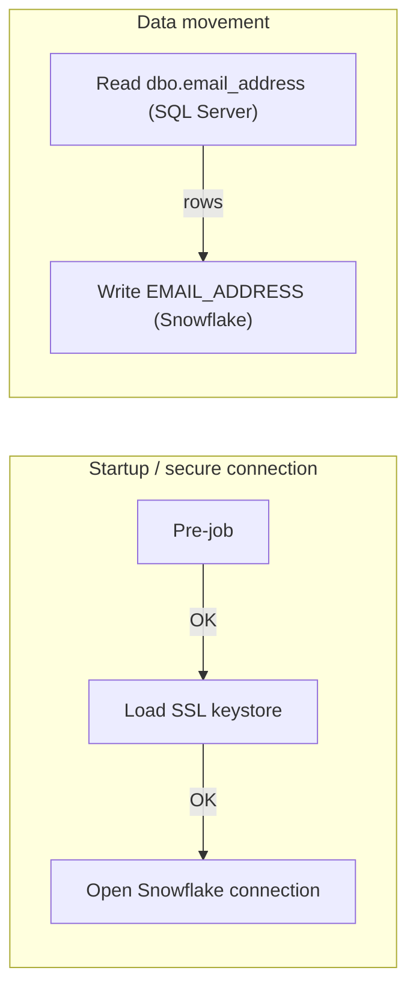

# Talend Job: Email_Address_Load

## Overview

`Email_Address_Load` is one of twelve near-identical loader jobs in the FAMIGRATION project. It copies debtor email addresses from the `email_address` table in the source SQL Server database into the `EMAIL_ADDRESS` table in the Snowflake data warehouse. In practice it holds each email address on file for a debtor, whether it is currently active, its source, and its authorization/opt-in status for correspondence. The job reads the full table with a single SQL query (no filtering), and writes it to Snowflake, where it becomes available to downstream reporting tools such as Qlik.

## Detail Table

| Field | Value |
|---|---|
| Job name | Email_Address_Load |
| Version | 0.1 |
| Project | FAMIGRATION |
| Author | jmach@harriscollect.com |
| Created | 2026-08-10T12:34:00.945-0500 |
| Last Modified | 2026-08-10T13:19:04.364-0500 |

## Step-by-Step Data Flow

1. **Startup** — `tPrejob_1` marks the start of the job, then `tSetKeystore_1` loads the SSL keystore file named in the `keystorePath` context variable, so the job can trust the certificate Snowflake presents. `tDBConnection_1` then opens a connection to Snowflake using that trust configuration (this connection component is defined in the job but, per the extracted metadata, the actual data-writing step below opens its own separate Snowflake connection rather than reusing it — see Issues Observed).
2. **Read** — `tDBInput_1` connects to SQL Server at `10.1.40.7:1433` and runs a `SELECT` against `dbo.email_address` (10 columns), pulling every row and column with no filtering or joins.
3. **Write** — `tDBOutput_1` takes the rows read in step 2 directly (no transformation step in this job) and writes them into the `EMAIL_ADDRESS` table in the `EDWPRODHH.BIDATA` schema of the `xca26579.us-east-1` Snowflake account, using the `COMPUTE_WH` warehouse and the `DATALOADER` role. The target table is emptied before the new rows are loaded, so each run fully replaces the previous day's data.

## Settings

### Source: SQL Server table `dbo.email_address` (component `tDBInput_1`, type `tMSSqlInput`)

| Setting | Value | What it means |
|---|---|---|
| HOST | 10.1.40.7 | The network address of the SQL Server machine the source data is read from. |
| PORT | 1433 | The network port SQL Server listens on (1433 is the SQL Server default). |
| DB_SCHEMA | dbo | The schema inside the source database that owns the table (`dbo` is SQL Server's default schema). |
| DBNAME | snowflake | The name Talend was told to use for the source database connection. Despite the name, this is the SQL Server source, not Snowflake — see Issues Observed. |
| USER | svc_talend | The SQL Server login Talend authenticates as to read the source table. |
| TABLE | email_address | The specific source table this job reads from. |
| PASS | ***REDACTED*** | The SQL Server password — captured by the extractor as redacted, never in plain text. |

### Target: Snowflake table `EMAIL_ADDRESS` (component `tDBOutput_1`, type `SnowflakeOutput`)

| Setting | Value | What it means |
|---|---|---|
| configuration.dataSet.dataStore.account | xca26579.us-east-1 | The Snowflake account identifier (region-qualified) the job connects to. |
| configuration.dataSet.dataStore.warehouse | COMPUTE_WH | The Snowflake virtual warehouse (compute cluster) used to run the load. |
| configuration.dataSet.dataStore.database | EDWPRODHH | The Snowflake database the target table lives in. |
| configuration.dataSet.dataStore.dbSchema | BIDATA | The schema inside that Snowflake database the target table lives in. |
| configuration.dataSet.dataStore.role | DATALOADER | The Snowflake role the job's service account assumes for this load. |
| configuration.dataSet.tableName | EMAIL_ADDRESS | The Snowflake table this job writes to. |
| configuration.snowflakeOutputCommonConfig.tableAction | TRUNCATE | What happens to the target table before loading: create it if missing, empty it first, or leave it as-is. |
| configuration.snowflakeOutputCommonConfig.dataAction | INSERT | How rows are written: a straight insert, versus an update-or-insert (upsert) keyed on a column. |
| configuration.snowflakeOutputCommonConfig.upsertKeyColumn | DEBTOR_IDX | The column that would be used to match existing rows if the load were doing an upsert. |
| configuration.dieOnError | false | Whether the whole job aborts the moment a single row fails to load. |
| configuration.dataSet.dataStore.shareConnection | false | Whether this component reuses another open Snowflake connection in the job instead of opening its own. |

## Dependencies & Configuration

**Other jobs**: none observed. The extracted metadata shows no `tRunJob` component and no cross-job triggers for `Email_Address_Load` — it runs standalone, on its own trigger/schedule (not visible in the Talend Studio metadata extracted here; verify with the team or Talend Cloud Management Console if this job is deployed as a scheduled Task).

**Context variables**: `keystorePath` (from the `Common_0.1` context group) points to the SSL certificate keystore file (`.p12`) that `tSetKeystore_1` loads before the job opens its Snowflake connection. It lets the job's Snowflake JDBC connection trust the certificate chain it's presented, which is why every job in this project depends on it even though none of them talk to each other.

## Glossary

| Component type | What it does |
|---|---|
| tMSSqlInput | Reads rows out of a Microsoft SQL Server table using a SQL query. |
| SnowflakeOutput | Writes rows into a table in Snowflake, the cloud data warehouse. |
| SnowflakeConnection | Opens a connection to the Snowflake cloud data warehouse that later steps can use. |
| tSetKeystore | Configures the SSL/TLS certificate store the job uses to make encrypted connections trustworthy. |
| tPrejob | A marker that runs before anything else in the job — used to sequence startup steps. |

## Issues Observed

- **Hardcoded connection details.** The source host (`10.1.40.7`), port (`1433`), and SQL Server login (`svc_talend`) are typed directly into this job's component settings rather than coming from a context variable — the same is true in all 12 jobs in this project. If the source server ever moves, every job has to be edited individually.
- **Misleading connection name.** The source SQL Server connection's `DBNAME` setting is literally `"snowflake"`, even though this component (`tMSSqlInput`) reads from SQL Server, not Snowflake. This is confusing for anyone reading the job cold and worth renaming.
- **Unused upsert setting.** An `upsertKeyColumn` (`DEBTOR_IDX`) is configured, but `dataAction` is set to `INSERT`, not `UPSERT` — so this key is currently inert. It's either a leftover from an earlier design or a sign the load mode should be revisited.
- **Separate Snowflake connection per component.** `shareConnection` is `false`, and the job also defines a standalone `tDBConnection_1` (Snowflake) component that isn't wired into the actual read/write flow shown in the extracted connections — the data-writing step opens its own connection instead. `tDBConnection_1` appears to only gate the SSL keystore setup step; verify with the team whether it's still needed.
