# Talend Job: Email_Address_Load

## Overview

`Email_Address_Load` copies consumer e-mail addresses, linked to debtor, account, packet and consumer (e-mail address, status, authorisation status/date, opt-in flag/date, effective date, address source, active and correspondence flags) from the SQL Server table `dbo.email_address` (database `snowflake` on `10.1.40.7`) into the Snowflake table `EDWPRODHH.BIDATA.EMAIL_ADDRESS`. It is a change-driven loader: at start-up it reads its bookmark (`LAST_CHANGE_ID`) from `BIDATA.ETL_BOOKMARK` and looks at the SQL Server change log `dbo.SF_ChangeLog` for rows with `target_table = 'email_address'` above that bookmark. It runs a **FULL** load (truncate the target and reload all 18 columns of every source row) when the bookmark is 0 (first run) or the change range contains a full-load marker (`change_operation = 'F'`); **NONE** (nothing loaded) when there are no new change-log rows; otherwise **INCR**, where only the changed keys are staged in Snowflake and a single transaction deletes every target row for the changed `CONSUMERID` values and re-inserts the current source rows for those consumers (a delete-and-replace by consumer, not a row-level merge). In both FULL and INCR modes the bookmark is advanced to the highest change id seen, and every run is recorded in `BIDATA.ETL_JOB_RUN_LOG` and `BIDATA.ETL_JOB_RUN_STEP`.

## Detail Table

| Field | Value |
|---|---|
| Job name | Email_Address_Load |
| Version | 0.1 |
| Project | FAMIGRATION |
| Author | jmach@harriscollect.com |
| Created | 2026-08-10T12:34:00.945-0500 |
| Last Modified | 2026-10-26T19:05:28.595+0530 |

## Step-by-Step Data Flow

**Pre-job (always runs first)**

1. **Secure connections** — `tPrejob_1` starts `tSetKeystore_1`, which sets the SSL truststore to the file in context variable `keystorePath` and a client keystore at a fixed path (client authentication is switched on). It then opens two shared connections that every later step reuses: `tDBConnection_1` (Snowflake, account `xca26579.us-east-1`, `EDWPRODHH.BIDATA`, warehouse `COMPUTE_WH`, role `DATALOADER`) and `tDBConnection_2` (SQL Server `10.1.40.7:1433`, database `snowflake`, schema `dbo`).
2. **Read the bookmark** — `tDBInput_2` selects `LAST_CHANGE_ID` and `LAST_RUN_DTTM` from `EDWPRODHH.BIDATA.ETL_BOOKMARK` where `TABLE_NAME = 'EMAIL_ADDRESS'`. `tJavaRow_1` copies them into context variables (a null `LAST_CHANGE_ID` becomes 0). If no bookmark row exists, the context defaults apply (`LAST_CHANGE_ID = 0`, `LAST_RUN_DTTM = 1900-01-01 00:00:00`).
3. **Measure the change range** — `tDBInput_3` queries `dbo.SF_ChangeLog` for `target_table = 'email_address'` and `change_id > LAST_CHANGE_ID`, returning the number of change rows, the highest `change_id`, and the highest `change_id` of any full-load marker (`change_operation = 'F'`).
4. **Choose the load mode** — `tJavaRow_2` sets `MAX_CHANGE_ID` (falls back to `LAST_CHANGE_ID` when there are no rows) and `LOAD_MODE`:
   - `FULL` if `LAST_CHANGE_ID` is 0 or a full-load marker is in the range;
   - `NONE` if there are no change rows;
   - `INCR` otherwise.
   It also stores the change-row count in `globalMap` as `CHANGE_LOG_ROWS`.
5. **Log run start** — `tDBRow_3` inserts a `RUNNING` row into `ETL_JOB_RUN_LOG` (Talend pid, job name, `EMAIL_ADDRESS`, load mode, from/to change id, change-log rows, `TARGET_ROWS_BEFORE` = current row count of `EMAIL_ADDRESS`, and `STEPS_TOTAL` = 2 for NONE, 3 for FULL, 4 for INCR). It writes step 1 "Check changes" as `DONE` in `ETL_JOB_RUN_STEP` and opens step 2 as `RUNNING` ("Load target", "Stage changed keys" or "Nothing to load").

**Main job — branch on load mode**

6. **Branch** — `tJava_1` runs first. If the mode is `NONE` it prints a message and sets `RUN_COMPLETED = true`; nothing else runs in the main job. Its two Run-If links start the FULL path when `"FULL".equals(context.LOAD_MODE)` and the INCR path when `"INCR".equals(context.LOAD_MODE)`.

*FULL path*

7. **Reload the whole table** — `tDBInput_1` reads every row of `dbo.email_address` (18 columns, `ROW_HASH` converted to 64-character hex text with `CONVERT(VARCHAR(64), ROW_HASH, 2)`; no filter). `tDBOutput_1` truncates `EDWPRODHH.BIDATA.EMAIL_ADDRESS` and inserts the rows.
8. **Advance the bookmark** — `tDBRow_2` closes step 2 with the number of rows read, opens step 3 "Update bookmark", and then, in one transaction, sets `ETL_BOOKMARK.LAST_CHANGE_ID = MAX_CHANGE_ID` for `EMAIL_ADDRESS`, records the counts in `ETL_JOB_RUN_LOG` (`SOURCE_ROWS`, `ROWS_INSERTED`, `ROWS_DONE` = rows read; `ROWS_DELETED` = `TARGET_ROWS_BEFORE`; `TARGET_ROWS_AFTER` = new row count) and closes step 3. Any error rolls the transaction back and re-raises.

*INCR path*

9. **Stage changed keys** — `tDBInput_4` selects the distinct non-null `key_value`s from `dbo.SF_ChangeLog` for `email_address` with `LAST_CHANGE_ID < change_id <= MAX_CHANGE_ID`. `tDBOutput_3` truncates `BIDATA.STG_CHANGED_EMAIL_ADDRESS_KEYS` and inserts them. `tDBRow_8` then closes step 2 with the key count and opens step 3 "Stage changed rows".
10. **Stage changed rows** — `tDBInput_5` reads the current source rows of `dbo.email_address` whose `CONSUMERID` is in that same change-log range. `tDBOutput_2` truncates `BIDATA.STG_CHANGED_EMAIL_ADDRESS` and inserts them. A key that was deleted in the source therefore appears in the keys table but not in the rows table.
11. **Apply the changes** — `tDBRow_1` ("Apply changes + bookmark") closes step 3, opens step 4 (logged as "Merge into target"), and runs one Snowflake transaction that:
    - counts changed keys and staged rows;
    - deletes **all** `EMAIL_ADDRESS` rows whose `CONSUMERID` is in `STG_CHANGED_EMAIL_ADDRESS_KEYS`;
    - inserts every row from `STG_CHANGED_EMAIL_ADDRESS` (no `MERGE` and no `ROW_HASH` comparison), so each changed consumer's e-mail rows are replaced as a set;
    - sets the bookmark to `MAX_CHANGE_ID`, writes inserted/deleted counts to `ETL_JOB_RUN_LOG`, and closes step 4.
    Any error rolls back the target change, the bookmark and the counts together.
12. **Mark complete** — after either path's final step succeeds, `tJava_3` sets `RUN_COMPLETED = true`.

**Post-job (always runs, even after a failure)**

13. **Work out the run status** — `tJava_2` sets `RUN_STATUS` to `SUCCESS` only if `RUN_COMPLETED` is true, otherwise `FAILED`. It takes the first `*_ERROR_MESSAGE` entry it finds in `globalMap` as the error text (or "Run did not reach its last step"), truncates it to 4,000 characters and escapes it for SQL.
14. **Log run end** — `tDBRow_4` sets the open `RUNNING` step to `DONE` or `FAILED` with the error message, and updates the `ETL_JOB_RUN_LOG` row with the status, error message, end time, duration and (on success) `CURRENT_STEP = 'Finished'`.

```mermaid
graph LR
    subgraph Prejob["Pre-job: connect, bookmark, choose mode"]
        tPrejob_1["Pre-job"] --> tSetKeystore_1["Set SSL truststore and keystore"]
        tSetKeystore_1 --> tDBConnection_1["Open Snowflake connection"]
        tSetKeystore_1 --> tDBConnection_2["Open SQL Server connection"]
        tDBConnection_1 --> tDBInput_2["Read ETL_BOOKMARK for EMAIL_ADDRESS"]
        tDBInput_2 --> tJavaRow_1["Set LAST_CHANGE_ID context"]
        tDBConnection_2 --> tDBInput_3["Count SF_ChangeLog rows for email_address"]
        tDBInput_3 --> tJavaRow_2["Set LOAD_MODE FULL / INCR / NONE"]
        tJavaRow_2 --> tDBRow_3["Log run start in ETL_JOB_RUN_LOG"]
    end
    subgraph Main["Main job"]
        tJava_1["Choose load mode (NONE stops here)"]
    end
    subgraph Full["FULL path"]
        tDBInput_1["Read all of dbo.email_address"] --> tDBOutput_1["Truncate + insert EMAIL_ADDRESS"]
        tDBOutput_1 --> tDBRow_2["Advance bookmark + log counts"]
    end
    subgraph Incr["INCR path"]
        tDBInput_4["Read changed keys from SF_ChangeLog"] --> tDBOutput_3["Load STG_CHANGED_EMAIL_ADDRESS_KEYS"]
        tDBOutput_3 --> tDBRow_8["Log step: stage changed rows"]
        tDBRow_8 --> tDBInput_5["Read changed rows of dbo.email_address"]
        tDBInput_5 --> tDBOutput_2["Load STG_CHANGED_EMAIL_ADDRESS"]
        tDBOutput_2 --> tDBRow_1["Delete by CONSUMERID + insert into EMAIL_ADDRESS, advance bookmark"]
    end
    subgraph Postjob["Post-job: close the run log"]
        tPostjob_1["Post-job"] --> tJava_2["Collect run status"]
        tJava_2 --> tDBRow_4["Log run end SUCCESS / FAILED"]
    end
    tDBRow_3 -.-> tJava_1
    tJava_1 -->|"If FULL"| tDBInput_1
    tJava_1 -->|"If INCR"| tDBInput_4
    tDBRow_2 --> tJava_3["Mark run complete"]
    tDBRow_1 --> tJava_3
    tJava_3 -.-> tPostjob_1
```

Dotted arrows show Talend's fixed ordering (pre-job, then main job, then post-job), not explicit links in the job.

## Settings

### Source: SQL Server table `dbo.email_address` — full read (component `tDBInput_1`, type `tMSSqlInput`)

| Setting | Value | What it means |
|---|---|---|
| USE_EXISTING_CONNECTION / CONNECTION | true / `tDBConnection_2` | Reuses the shared SQL Server connection opened in the pre-job. |
| HOST / PORT | 10.1.40.7 / 1433 | The SQL Server machine and port the data is read from. |
| DBNAME / DB_SCHEMA | snowflake / dbo | The source database and schema. Despite the name, `snowflake` is a SQL Server database. |
| USER / PASS | svc_talend / ***REDACTED*** | The SQL Server login used by the job. |
| TABLE | email_address | The source table. |
| QUERY | `SELECT <18 columns> FROM dbo.email_address` | Reads every row with no filter. `ROW_HASH` is returned as hex text so it can be loaded into Snowflake's `BINARY(32)` column. |
| PROPERTIES | trustServerCertificate=True | The SQL Server TLS certificate is accepted without validation. |
| TRIM_ALL_COLUMN | true | Leading and trailing spaces are trimmed from every column. |
| ENCODING | ISO-8859-15 | Character set used to read the source text. |

`tDBInput_5` ("Changed EMAIL_ADDRESS rows") uses the same connection and column list, adding `WHERE CONSUMERID IN (SELECT key_value FROM dbo.SF_ChangeLog WHERE target_table = 'email_address' AND change_id > LAST_CHANGE_ID AND change_id <= MAX_CHANGE_ID)`.

### Source: change log `dbo.SF_ChangeLog` (components `tDBInput_3` and `tDBInput_4`, type `tMSSqlInput`)

| Setting | Value | What it means |
|---|---|---|
| tDBInput_3 QUERY | `COUNT(*)`, `MAX(change_id)`, `MAX(change_id)` where `change_operation = 'F'`, for `target_table = 'email_address' AND change_id > LAST_CHANGE_ID` | Sizes the new change range and detects a full-load marker; the result decides the load mode. |
| tDBInput_4 QUERY | `SELECT DISTINCT key_value` for `target_table = 'email_address'`, non-null keys, `LAST_CHANGE_ID < change_id <= MAX_CHANGE_ID` | The keys changed in this run (INCR only). The upper bound fixes the range so changes logged during the run wait for the next run. |
| CONNECTION | `tDBConnection_2` | Both reuse the shared SQL Server connection. |

### Source: bookmark `BIDATA.ETL_BOOKMARK` (component `tDBInput_2`, type `SnowflakeInput`)

| Setting | Value | What it means |
|---|---|---|
| configuration.dataSet.sqlQuery | `SELECT TO_VARCHAR(LAST_CHANGE_ID), TO_VARCHAR(LAST_RUN_DTTM, ...) FROM EDWPRODHH.BIDATA.ETL_BOOKMARK WHERE TABLE_NAME = 'EMAIL_ADDRESS'` | Reads this table's bookmark. |
| CONNECTION | `tDBConnection_1` | Reuses the shared Snowflake connection. |

### Target: Snowflake table `EMAIL_ADDRESS` — FULL load (component `tDBOutput_1`, type `SnowflakeOutput`)

| Setting | Value | What it means |
|---|---|---|
| configuration.dataSet.dataStore.account | xca26579.us-east-1 | The Snowflake account (region-qualified). |
| database / dbSchema | EDWPRODHH / BIDATA | Where the target table lives. |
| warehouse / role | COMPUTE_WH / DATALOADER | Compute warehouse and Snowflake role used for the load. |
| Authentication settings | ***REDACTED*** | Captured by the extractor as redacted. |
| configuration.dataSet.tableName | EMAIL_ADDRESS | The target table. |
| configuration.snowflakeOutputCommonConfig.tableAction | TRUNCATE | The target is emptied before the rows are written. |
| configuration.snowflakeOutputCommonConfig.dataAction | INSERT | Rows are inserted as they are; no upsert. |
| configuration.snowflakeOutputCommonConfig.upsertKeyColumn | DEBTOR_IDX | Only used for upserts, so it has no effect here. |
| configuration.dieOnError | true | The job stops on the first write error. |
| configuration.dataSet.dataStore.autoCommit | true | Each write is committed as it happens; the truncate and insert are not one transaction with the bookmark update. |
| CONNECTION | `tDBConnection_1` | Reuses the shared Snowflake connection. |

### Staging targets: `STG_CHANGED_EMAIL_ADDRESS_KEYS` and `STG_CHANGED_EMAIL_ADDRESS` — INCR load (components `tDBOutput_3` and `tDBOutput_2`, type `SnowflakeOutput`)

| Setting | Value | What it means |
|---|---|---|
| tableName | STG_CHANGED_EMAIL_ADDRESS_KEYS / STG_CHANGED_EMAIL_ADDRESS | Transient staging tables created by `Snowflake_BIDATA_Schema_Change.sql` (`KEY_VALUE NUMBER(38,0)` and `LIKE EMAIL_ADDRESS`). |
| tableAction / dataAction | TRUNCATE / INSERT | Each INCR run replaces the staging contents. |
| upsertKeyColumn | KEY_VALUE / DEBTOR_IDX | Not used, because `dataAction` is INSERT. |
| dieOnError | true | The job stops on the first write error. |

### Snowflake SQL steps (type `SnowflakeRow`)

| Component | Label | What it does |
|---|---|---|
| tDBRow_3 | Log run start | Inserts the `RUNNING` row in `ETL_JOB_RUN_LOG`, writes step 1 and opens step 2 in `ETL_JOB_RUN_STEP`. |
| tDBRow_2 | Update bookmark + run log | FULL only. One transaction: bookmark to `MAX_CHANGE_ID`, run-log counts, step 3 closed. |
| tDBRow_8 | Step: stage changed rows | INCR only. Closes step 2 and opens step 3; sets `ROWS_TOTAL` to the changed-key count. |
| tDBRow_1 | Apply changes + bookmark | INCR only. One transaction: delete all rows for changed `CONSUMERID`s, insert staged rows, bookmark, run-log counts, step 4 closed. |
| tDBRow_4 | Log run end | Post-job. Closes the open step and sets the final run status, error message and duration. `dieOnError` is false here, so a logging failure does not mask the original error. |

All five reuse `tDBConnection_1`. Every step except `tDBRow_4` has `dieOnError = true`.

## Dependencies & Configuration

**Other jobs**: none observed. No job in the extracted project contains a `tRunJob`, and this job calls no other job. How it is scheduled is not in the metadata — unable to determine from metadata; verify with the team (for example in Talend Management Console).

**Upstream source objects** (SQL Server `10.1.40.7`, database `snowflake`):
- `dbo.email_address` — the source data, including a `ROW_HASH` column.
- `dbo.SF_ChangeLog` — the change log (`change_id`, `target_table`, `key_value`, `change_operation`). Something upstream must write rows for `target_table = 'email_address'`, including an `'F'` row to force a full reload; what populates it is not in this job's metadata — verify with the team.

**Snowflake control tables** (`EDWPRODHH.BIDATA`, created by `Snowflake_BIDATA_Schema_Change.sql`):

| Table | Read / Written | Purpose |
|---|---|---|
| ETL_BOOKMARK | Read (pre-job), updated (FULL/INCR) | One row per table; `LAST_CHANGE_ID` is the last `SF_ChangeLog.change_id` applied to `EMAIL_ADDRESS`. The DDL seeds a `EMAIL_ADDRESS` row with 0. |
| ETL_JOB_RUN_LOG | Inserted (pre-job), updated (each step, post-job) | One row per run: mode, change range, row counts, status, error, duration. |
| ETL_JOB_RUN_STEP | Inserted and updated per step | One row per step of the run, with timings and row counts. |
| STG_CHANGED_EMAIL_ADDRESS_KEYS | Truncated and loaded (INCR) | Distinct changed keys for this run. |
| STG_CHANGED_EMAIL_ADDRESS | Truncated and loaded (INCR) | Current source rows for those keys. |

**Context variables** (defined in the job's `Default` context; the extracted metadata's `context_groups` list is empty, so names and defaults below are from the `.item` source file):

| Variable | Default | Why it is used |
|---|---|---|
| keystorePath | C:/Users/svc_talend_prd/.ssl/keystore.p12 | Truststore file for `tSetKeystore_1` (linked to a repository context). |
| LAST_CHANGE_ID | 0 | Bookmark read from `ETL_BOOKMARK`; lower bound of the change range. 0 forces a FULL load. |
| LAST_RUN_DTTM | 1900-01-01 00:00:00 | Last run time from `ETL_BOOKMARK`; only printed, not used in any query. |
| MAX_CHANGE_ID | 0 | Upper bound of this run's change range; written back to the bookmark. |
| LOAD_MODE | FULL | Set in the pre-job to FULL, INCR or NONE; drives the Run-If branches and the run log. |

`globalMap` keys used across steps: `CHANGE_LOG_ROWS`, `RUN_COMPLETED`, `RUN_STATUS`, `RUN_ERROR_SQL`, plus Talend's row counters `tDBInput_1_NB_LINE`, `tDBInput_4_NB_LINE` and `tDBInput_5_NB_LINE`.

## Glossary

| Component type | What it does |
|---|---|
| tPrejob / tPostjob | Markers for steps that run before the main job and after it (the post-job runs even if the job failed). |
| tSetKeystore | Sets the SSL/TLS truststore and keystore the job's connections use. |
| SnowflakeConnection | Opens one Snowflake connection that other Snowflake components reuse. |
| tMSSqlConnection | Opens one SQL Server connection that other SQL Server components reuse. |
| tMSSqlInput | Runs a query against SQL Server and passes the rows on. |
| SnowflakeInput | Runs a query against Snowflake and passes the rows on. |
| SnowflakeOutput | Writes rows into a Snowflake table, optionally truncating it first. |
| SnowflakeRow | Runs a SQL statement or Snowflake Scripting block that returns no rows. |
| tJavaRow | Runs custom Java code for each incoming row (used here to set context variables). |
| tJava | Runs a block of custom Java code once. |

## Issues Observed

- **A failed FULL load leaves `EMAIL_ADDRESS` empty or partial.** `tDBOutput_1` truncates and inserts with `autoCommit = true`, separately from the `tDBRow_2` transaction that advances the bookmark. If the insert fails, reports see an incomplete table until a later run succeeds. Because the bookmark is not advanced, the next run should choose FULL again (bookmark still 0 or the `'F'` marker still in range), so the data recovers on the next good run.
- **Keystore path mismatch.** The truststore comes from `context.keystorePath` (default `C:/Users/svc_talend_prd/.ssl/keystore.p12`), but the client keystore is hard-coded to `C:/Users/svc_talend_prd/ssl/keystore.p12` (`ssl` without the dot), with client authentication on. Verify with the team that both paths exist on the runtime host.
- **The incremental step does not use `ROW_HASH` and leaves some counts empty.** Unlike the other loaders, `tDBRow_1` deletes and re-inserts every row for a changed `CONSUMERID`, so unchanged rows are rewritten. It never sets `ROWS_UPDATED` or `ROWS_UNCHANGED` in `ETL_JOB_RUN_LOG`, so those columns stay null for INCR runs of this job.
- **Label and logged step name differ.** `tDBRow_1` is labelled "Apply changes + bookmark", but the step it writes to `ETL_JOB_RUN_STEP` is "Merge into target".
- **The upsert key does not match the change key.** `tDBOutput_1` and `tDBOutput_2` set `upsertKeyColumn = DEBTOR_IDX`, but changes are tracked by `CONSUMERID`. It has no effect (`dataAction = INSERT`), but it is misleading.
- **Missing bookmark row fails silently.** If `ETL_BOOKMARK` has no `EMAIL_ADDRESS` row, `tJavaRow_1` never runs, so `LAST_CHANGE_ID` stays 0 and every run is FULL. The bookmark `UPDATE ... WHERE TABLE_NAME = 'EMAIL_ADDRESS'` then changes no rows and raises no error. The schema script seeds the row, which avoids this only if the script has been run.
- **Concurrent runs would conflict.** Staging table names are fixed (`STG_CHANGED_EMAIL_ADDRESS`, `..._KEYS`) and are truncated on each INCR run, so two overlapping runs of this job would overwrite each other's staging data. Whether overlap is prevented by the scheduler is unable to determine from metadata — verify with the team.
- **The reported error may be arbitrary.** `tJava_2` reports the first `*_ERROR_MESSAGE` it meets while iterating `globalMap` (a hash map with no fixed order), so if several components failed, the one written to `ETL_JOB_RUN_LOG.ERROR_MESSAGE` is not necessarily the first failure.
- **Hard-coded connection details.** The SQL Server host `10.1.40.7`, login `svc_talend` and database name `snowflake` are typed into the components rather than coming from context variables, and `trustServerCertificate=True` turns off SQL Server certificate validation.
- **SQL built by string concatenation.** The Snowflake scripts insert `pid`, `jobName` and context values directly into the SQL text. These values come from Talend and the bookmark table rather than from users, so the risk is low, but bind variables would be safer.
