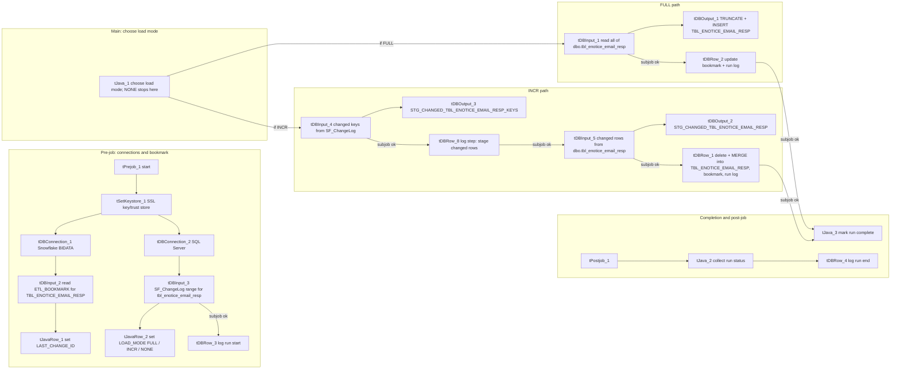

# Talend Job: Tbl_Enotice_Email_Resp_Load

## Overview

`Tbl_Enotice_Email_Resp_Load` keeps the Snowflake table `EDWPRODHH.BIDATA.TBL_ENOTICE_EMAIL_RESP` in step with the SQL Server table `snowflake.dbo.tbl_enotice_email_resp` (server `10.1.40.7`). The table holds email replies received in response to electronic notices (e-notices). Judging by its column names each row links a notice (`NOTICE_ID`) and consumer (`CONSUMER_NUMBER`) to the reply's sender, subject, body and date, plus the run that captured it (`RUN_ID`, `INSERT_DATE`). Instead of copying the whole table every time, the job reads a per-table bookmark from `BIDATA.ETL_BOOKMARK` and looks in the SQL Server change log `dbo.SF_ChangeLog` for entries for `tbl_enotice_email_resp` newer than that bookmark. It then picks one of three load modes: **FULL** when the bookmark is still 0 (first run) or any new change-log entry carries the full-reload marker `change_operation = 'F'`; **NONE** when there are no new change-log entries; otherwise **INCR**. FULL empties `TBL_ENOTICE_EMAIL_RESP` and reloads every source row. INCR stages only the changed keys and their current source rows. Then, in a single Snowflake transaction, it deletes rows that no longer exist at source, inserts new rows, updates only rows whose `ROW_HASH` changed (matching on `ID`), and advances the bookmark. Every run, in any mode, is recorded in `BIDATA.ETL_JOB_RUN_LOG` (one row per run) and `BIDATA.ETL_JOB_RUN_STEP` (one row per step).

## Detail Table

| Field | Value |
|---|---|
| Job name | Tbl_Enotice_Email_Resp_Load |
| Version | 0.1 |
| Project | FAMIGRATION |
| Author | atilve@harriscollect.com |
| Created | 2026-09-22T15:53:22.003+0530 |
| Last Modified | 2026-10-27T11:44:04.963+0530 |

## Step-by-Step Data Flow

1. **Startup (pre-job)** — `tPrejob_1` runs first and triggers `tSetKeystore_1`. That component sets up the SSL trust store (path from the `keystorePath` context variable) and key store (a fixed path; see Issues Observed). It then opens two shared connections that every later step reuses: `tDBConnection_1` to Snowflake (account `xca26579.us-east-1`, database `EDWPRODHH`, schema `BIDATA`, warehouse `COMPUTE_WH`, role `DATALOADER`) and `tDBConnection_2` to SQL Server (`10.1.40.7:1433`, database `snowflake`, login `svc_talend`).
2. **Read the bookmark** — as soon as the Snowflake connection opens, `tDBInput_2` reads `LAST_CHANGE_ID` and `LAST_RUN_DTTM` from `EDWPRODHH.BIDATA.ETL_BOOKMARK` for `TABLE_NAME = 'TBL_ENOTICE_EMAIL_RESP'`. `tJavaRow_1` copies them into the context variables of the same names (a missing id becomes 0) and prints them to the log. If no bookmark row exists, the context defaults stay in place (`LAST_CHANGE_ID = 0`).
3. **Measure the new change-log range** — once the SQL Server connection is open, `tDBInput_3` queries `dbo.SF_ChangeLog` for rows with `target_table = 'tbl_enotice_email_resp'` and a `change_id` above the bookmark. It returns the row count, the highest `change_id`, and the highest `change_id` whose `change_operation` is `'F'`.
4. **Choose the load mode** — `tJavaRow_2` fixes the end of this run's range: `MAX_CHANGE_ID` is the highest change id found, or the old bookmark if none was found. It then sets `LOAD_MODE`: `FULL` if the bookmark is 0 or a full-reload marker was found, `NONE` if there were no change rows, otherwise `INCR`. The change-row count is kept in `globalMap` as `CHANGE_LOG_ROWS`.
5. **Log the run start** — when that subjob finishes, `tDBRow_3` inserts a `RUNNING` row into `ETL_JOB_RUN_LOG`. The row records the load mode, the steps planned (2 for NONE, 3 for FULL, 4 for INCR), the from/to change id, the change-log row count, and the current row count of `TBL_ENOTICE_EMAIL_RESP` as `TARGET_ROWS_BEFORE`. It also records step 1 *Check changes* as done in `ETL_JOB_RUN_STEP` and opens step 2 (*Load target*, *Stage changed keys* or *Nothing to load*).
6. **Branch** — the main subjob starts at `tJava_1`. For `NONE` it prints a message, flags the run as completed, and nothing else runs. Two *Run If* links send the job down the FULL path (`"FULL".equals(context.LOAD_MODE)`) or the INCR path (`"INCR".equals(context.LOAD_MODE)`).
7. **FULL path** — `tDBInput_1` reads every row of `dbo.tbl_enotice_email_resp` (12 columns; the binary `ROW_HASH` is converted to 64-character hex text). `tDBOutput_1` truncates `TBL_ENOTICE_EMAIL_RESP` and writes the rows into it. `tDBRow_2` then closes step 2 and opens step 3 *Update bookmark*. In one transaction it moves the bookmark to `MAX_CHANGE_ID` (and `LAST_RUN_DTTM` to now), writes the row counts to the run log, and closes step 3. Rows read are reported as inserted, and the previous target row count as deleted.
8. **INCR path, part 1: stage changed keys** — `tDBInput_4` lists the distinct non-null `key_value`s in `SF_ChangeLog` for `tbl_enotice_email_resp` with a `change_id` above the bookmark and up to `MAX_CHANGE_ID`. `tDBOutput_3` truncates `STG_CHANGED_TBL_ENOTICE_EMAIL_RESP_KEYS` and inserts them. `tDBRow_8` closes step 2, opens step 3 *Stage changed rows*, and records the key count as `ROWS_TOTAL`.
9. **INCR path, part 2: stage changed rows** — `tDBInput_5` reads the current source rows of `dbo.tbl_enotice_email_resp` whose `ID` appears in the same change-log range. `tDBOutput_2` truncates `STG_CHANGED_TBL_ENOTICE_EMAIL_RESP` and inserts them. A key whose source row has since been deleted produces no row here.
10. **INCR path, part 3: apply** — `tDBRow_1` closes step 3 and opens step 4 *Merge into target*. Then, in one Snowflake transaction, it: counts the staged keys and rows and works out how many rows will be inserted, updated or left unchanged; deletes from `TBL_ENOTICE_EMAIL_RESP` every staged key that has no staged row (deleted at source); runs a `MERGE` on `ID` that updates all columns only when `ROW_HASH` differs and inserts unmatched rows; moves the bookmark to `MAX_CHANGE_ID`; writes the inserted/updated/unchanged/deleted counts and `TARGET_ROWS_AFTER` to the run log; and closes step 4. Any error rolls the whole transaction back and is re-raised.
11. **Mark completion** — after `tDBRow_2` (FULL) or `tDBRow_1` (INCR) succeeds, `tJava_3` sets the `RUN_COMPLETED` flag.
12. **Finish (post-job)** — `tPostjob_1` always runs. `tJava_2` sets `RUN_STATUS` to `SUCCESS` only if `RUN_COMPLETED` is set, and to `FAILED` otherwise. It keeps the first `*_ERROR_MESSAGE` it finds in `globalMap`, cut to 4,000 characters and escaped for SQL. `tDBRow_4` closes any step still `RUNNING` as `DONE` or `FAILED`, and finalises the `ETL_JOB_RUN_LOG` row with the status, error message, end time and duration.

## Settings

### Shared connections (`tDBConnection_1` SnowflakeConnection, `tDBConnection_2` tMSSqlConnection)

| Setting | Value | What it means |
|---|---|---|
| Snowflake account | xca26579.us-east-1 | The Snowflake account (region-qualified) every Snowflake step uses. |
| Snowflake database / schema | EDWPRODHH / BIDATA | Where the target, staging and control tables live. |
| Snowflake warehouse | COMPUTE_WH | Compute cluster that runs the loads and SQL scripts. |
| Snowflake role | DATALOADER | Role the service account assumes. |
| Snowflake authentication settings | ***REDACTED*** | User id, auth type and key alias are redacted by the extractor. |
| autoCommit | true | Each statement commits on its own unless the SQL script opens its own transaction (the bookmark and merge scripts do). |
| SQL Server HOST / PORT | 10.1.40.7 / 1433 | The source SQL Server instance. |
| SQL Server DBNAME / schema | snowflake / dbo | The source database really is named `snowflake`; the schema-change script calls the source "Frost MSSQL snowflake.dbo.*". It is not the Snowflake warehouse. |
| SQL Server USER / PASS | svc_talend / ***REDACTED*** | Login used to read the source and the change log. |
| PROPERTIES | trustServerCertificate=True | The SQL Server driver accepts the server's TLS certificate without validating it. |
| Property type | REPOSITORY | Both connections come from shared repository metadata, so these details are maintained centrally, not per job. |

### Source: `dbo.tbl_enotice_email_resp` (components `tDBInput_1` FULL read and `tDBInput_5` INCR read, type `tMSSqlInput`)

| Setting | Value | What it means |
|---|---|---|
| USE_EXISTING_CONNECTION / CONNECTION | true / tDBConnection_2 | Reuses the shared SQL Server connection. |
| TABLE | tbl_enotice_email_resp | Source table. |
| QUERY (tDBInput_1) | `SELECT <12 columns> FROM dbo.tbl_enotice_email_resp` | Reads every row. `ROW_HASH` is selected as `CONVERT(VARCHAR(64), ROW_HASH, 2)` (hex text) so Snowflake can load it into its `BINARY(32)` column. |
| QUERY (tDBInput_5) | Same columns, plus `WHERE ID IN (SELECT key_value FROM dbo.SF_ChangeLog WHERE target_table = 'tbl_enotice_email_resp' AND change_id > LAST_CHANGE_ID AND change_id <= MAX_CHANGE_ID)` | Reads only rows whose key appears in this run's change-log range. |
| TRIM_ALL_COLUMN | false | Text values are passed through exactly as stored in SQL Server. |
| SET_QUERY_TIMEOUT | false | No query timeout is applied, so the `QUERY_TIMEOUT_IN_SECONDS = 30` value is unused. |
| ENCODING | ISO-8859-15 | Character set used when reading text. |

Columns read (12): `ID`, `NOTICE_ID`, `CONSUMER_NUMBER`, `EMAIL_FROM`, `EMAIL_SUBJECT`, `EMAIL_BODY`, `EMAIL_DATE`, `RUN_ID`, `INSERT_DATE`, `SYSTEM_SOURCE`, `EXTRACT_DTTM`, `ROW_HASH`.

### Change log: `dbo.SF_ChangeLog` (components `tDBInput_3` and `tDBInput_4`, type `tMSSqlInput`)

| Setting | Value | What it means |
|---|---|---|
| QUERY (tDBInput_3) | `COUNT(*)`, `MAX(change_id)`, `MAX(CASE WHEN change_operation = 'F' THEN change_id END)` where `target_table = 'tbl_enotice_email_resp' AND change_id > LAST_CHANGE_ID` | Measures what is new since the bookmark and whether a full reload was requested. |
| QUERY (tDBInput_4) | `SELECT DISTINCT key_value` where `target_table = 'tbl_enotice_email_resp'`, `key_value IS NOT NULL`, `change_id` above LAST_CHANGE_ID and up to MAX_CHANGE_ID | The keys touched in this run's range. |
| Range upper bound | MAX_CHANGE_ID | Fixed once, by `tJavaRow_2`. Change-log rows that arrive during the run are left for the next run. |

### Bookmark read: `ETL_BOOKMARK` (component `tDBInput_2`, type `SnowflakeInput`)

| Setting | Value | What it means |
|---|---|---|
| sqlQuery | `SELECT TO_VARCHAR(LAST_CHANGE_ID), TO_VARCHAR(LAST_RUN_DTTM, 'YYYY-MM-DD HH24:MI:SS.FF3') FROM EDWPRODHH.BIDATA.ETL_BOOKMARK WHERE TABLE_NAME = 'TBL_ENOTICE_EMAIL_RESP'` | Reads this table's bookmark as text; `tJavaRow_1` parses it. |
| CONNECTION | tDBConnection_1 | Reuses the shared Snowflake connection. |

### Target: `EDWPRODHH.BIDATA.TBL_ENOTICE_EMAIL_RESP` (component `tDBOutput_1`, type `SnowflakeOutput`, FULL path only)

| Setting | Value | What it means |
|---|---|---|
| tableName | TBL_ENOTICE_EMAIL_RESP | The reporting table this job maintains. |
| tableAction | TRUNCATE | The table is emptied before the FULL reload. |
| dataAction | INSERT | Rows are written as plain inserts. |
| upsertKeyColumn | ID | Only used for UPSERT, so it has no effect with `INSERT`. |
| convertColumnsAndTableToUppercase | true | Source column names are upper-cased to match Snowflake. |
| dieOnError | true | Any write error stops the job. |
| CONNECTION | tDBConnection_1 | Reuses the shared Snowflake connection. |

### Staging: `STG_CHANGED_TBL_ENOTICE_EMAIL_RESP_KEYS` (`tDBOutput_3`) and `STG_CHANGED_TBL_ENOTICE_EMAIL_RESP` (`tDBOutput_2`), type `SnowflakeOutput`, INCR path only

| Setting | Value | What it means |
|---|---|---|
| tableAction | TRUNCATE | Both staging tables are emptied on each INCR run. |
| dataAction | INSERT | Keys and changed rows are inserted. |
| upsertKeyColumn | KEY_VALUE / ID | No effect with `INSERT`. |
| dieOnError | true | Any write error stops the job. |

### Control SQL scripts (type `SnowflakeRow`, all on `tDBConnection_1`)

| Component | Label | What it does | dieOnError |
|---|---|---|---|
| tDBRow_3 | Log run start | Inserts the `RUNNING` run-log row with load mode, planned steps, change-id range and `TARGET_ROWS_BEFORE`; logs step 1 as done and opens step 2. | true |
| tDBRow_2 | Update bookmark + run log | FULL only. Closes step 2 and opens step 3. Then, in one transaction, updates `ETL_BOOKMARK` and the run-log counts and closes step 3. On error it rolls back and re-raises. | true |
| tDBRow_8 | Step: stage changed rows | INCR only. Closes step 2, opens step 3 and records the changed-key count. | true |
| tDBRow_1 | Merge changes + bookmark | INCR only. Closes step 3 and opens step 4. Then, in one transaction: deletes keys gone from the source; runs a `MERGE` on `ID` (update when `ROW_HASH IS DISTINCT FROM`, insert when not matched); updates `ETL_BOOKMARK`; writes the counts; closes step 4. On error it rolls back and re-raises. | true |
| tDBRow_4 | Log run end | Post-job. Sets the open step to `DONE` or `FAILED` and finalises the run-log row (status, error, end time, duration). | false |

## Dependencies & Configuration

**Other jobs**: none called. The metadata has no `tRunJob` component and no cross-job triggers. How the job is scheduled is not in the extracted metadata. The comments in `Snowflake_BIDATA_Schema_Change.sql` say the control objects are deployed once, either by hand or by a Talend job named `BIDATA_Schema_Deploy`. That job is outside this metadata extract.

**Upstream prerequisites** (outside this job): the SQL Server table `dbo.SF_ChangeLog` must be populated with `target_table`, `key_value`, `change_id` and `change_operation` for `tbl_enotice_email_resp`, and the source table must carry a `ROW_HASH`. What populates these is not visible: Unable to determine from metadata — verify with team.

**Tables read and written**

| Table | Where | Access | Purpose |
|---|---|---|---|
| `dbo.tbl_enotice_email_resp` | SQL Server | read | Source data: all rows on FULL, changed keys only on INCR. |
| `dbo.SF_ChangeLog` | SQL Server | read | Change log that drives the load mode and the changed-key list. |
| `BIDATA.TBL_ENOTICE_EMAIL_RESP` | Snowflake | truncate + insert (FULL), delete + merge (INCR) | Reporting target. |
| `BIDATA.ETL_BOOKMARK` | Snowflake | read, update | One row per table (`TABLE_NAME = 'TBL_ENOTICE_EMAIL_RESP'`) holding `LAST_CHANGE_ID` and `LAST_RUN_DTTM`. The job only updates this row and never inserts it; the schema-change script seeds it. |
| `BIDATA.STG_CHANGED_TBL_ENOTICE_EMAIL_RESP_KEYS` | Snowflake | truncate, insert, read | Changed keys for the current INCR run (`KEY_VALUE NUMBER(38,0)` per the schema-change script). |
| `BIDATA.STG_CHANGED_TBL_ENOTICE_EMAIL_RESP` | Snowflake | truncate, insert, read | Current source rows for the changed keys (transient table created `LIKE TBL_ENOTICE_EMAIL_RESP`). |
| `BIDATA.ETL_JOB_RUN_LOG` | Snowflake | insert, update | One row per run: mode, status, change-id range, row counts, timings, error message and live progress. |
| `BIDATA.ETL_JOB_RUN_STEP` | Snowflake | insert, update | One row per step of a run: status, duration, rows processed and detail. |

**Context variables**

| Variable | Default | Used for |
|---|---|---|
| `keystorePath` | C:/Users/svc_talend_prd/.ssl/keystore.p12 | From the shared `Common` context group. Trust-store file loaded by `tSetKeystore_1`. |
| `LAST_CHANGE_ID` | 0 | Built-in. Bookmark read from `ETL_BOOKMARK` and the lower bound of the change-log range; 0 forces FULL. |
| `LAST_RUN_DTTM` | 1900-01-01 00:00:00 | Built-in. Bookmark timestamp; read and printed, but no query uses it. |
| `MAX_CHANGE_ID` | 0 | Built-in. Upper bound of this run's change-log range; written back to the bookmark on success. |
| `LOAD_MODE` | FULL | Built-in. Set to FULL, INCR or NONE by `tJavaRow_2`; drives the Run If branches and the run-log text. |

The job also uses the `globalMap` keys `CHANGE_LOG_ROWS`, `RUN_COMPLETED`, `RUN_STATUS` and `RUN_ERROR_SQL`, the components' `*_NB_LINE` row counts, and Talend's built-in `pid` and `jobName` to key the run-log rows.

## Glossary

| Component type | What it does |
|---|---|
| tPrejob / tPostjob | Markers for steps that run before the main job, and after it even when the main job fails. |
| tSetKeystore | Configures the SSL/TLS key store and trust store used by the job's encrypted connections. |
| SnowflakeConnection | Opens one Snowflake connection that other Snowflake components reuse. |
| tMSSqlConnection | Opens one SQL Server connection that other SQL Server components reuse. |
| SnowflakeInput | Runs a query in Snowflake and passes the result rows on. |
| tMSSqlInput | Runs a query in SQL Server and passes the result rows on. |
| tJavaRow | Runs custom Java code once for each row that passes through it. |
| tJava | Runs a block of custom Java code once. |
| SnowflakeOutput | Writes rows into a Snowflake table, optionally truncating it first. |
| SnowflakeRow | Runs a SQL statement or script in Snowflake. Here these are Snowflake Scripting blocks that handle the bookmark, the merge and the run log. |
| Run If / OnSubjobOk / OnComponentOk | Triggers that start the next step only when a Java condition is true, after a whole subjob succeeds, or after one component succeeds. |

## Issues Observed

- **Key-store path does not match the context value.** `tSetKeystore_1` uses a hard-coded key store at `C:/Users/svc_talend_prd/ssl/keystore.p12`. The trust store comes from `context.keystorePath`, whose default is `C:/Users/svc_talend_prd/.ssl/keystore.p12`. Note `.ssl` versus `ssl`: either one path is wrong or two files exist. Verify on the Talend server.
- **FULL reload is not atomic.** `tDBOutput_1` truncates `TBL_ENOTICE_EMAIL_RESP` and inserts with `autoCommit = true`, outside any transaction. If the load fails partway, the reporting table stays empty or partly loaded until a later run succeeds. The bookmark is only advanced afterwards (`tDBRow_2`), so the next run repeats the FULL load as long as the trigger still applies: the bookmark is 0, or the `'F'` marker is still in range. The INCR path, by contrast, applies everything inside one transaction.
- **Bookmark can stay at 0, forcing FULL on every run.** If the bookmark is 0 and `SF_ChangeLog` has no rows for this table, `tJavaRow_2` leaves `MAX_CHANGE_ID` at the old bookmark (0). FULL then writes 0 back, so every later run is a FULL reload until the first change-log row appears.
- **Failures before the run-log row exists are not recorded.** `tDBRow_3` inserts the `ETL_JOB_RUN_LOG` row only after the SSL setup, both connections, the bookmark read and the change-log query have all succeeded. If any of those fail, the post-job `tDBRow_4` (with `dieOnError = false`) updates nothing, and the failure shows only in the Talend log.
- **Error message choice is arbitrary when there are several.** `tJava_2` keeps the first `*_ERROR_MESSAGE` entry it meets while iterating `globalMap`, and that iteration order is not guaranteed.
- **`LAST_RUN_DTTM` is unused.** It is read from the bookmark and printed, but no query filters on it. Change detection relies entirely on `change_id`.
- **No query timeout.** `SET_QUERY_TIMEOUT = false` on all four `tMSSqlInput` components, so a blocked SQL Server query can hang the run indefinitely.
- **Free-text email content copied.** `EMAIL_FROM`, `EMAIL_SUBJECT` and `EMAIL_BODY` are loaded as-is and may contain consumer personal information. Confirm access controls on `BIDATA.TBL_ENOTICE_EMAIL_RESP`.
