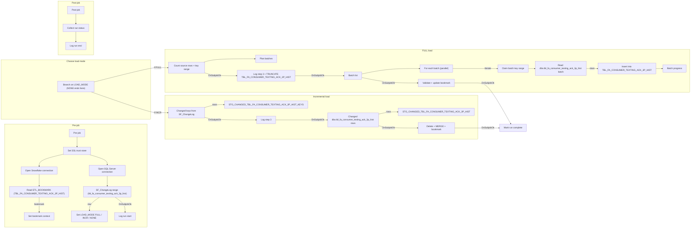

# Talend Job: Tbl_Fa_Consumer_Texting_Ack_3p_Hist_Load

## Overview

`Tbl_Fa_Consumer_Texting_Ack_3p_Hist_Load` is one of the FAMIGRATION incremental loader jobs (branch `feature/bidata_incremental_changes`). It keeps the Snowflake table `EDWPRODHH.BIDATA.TBL_FA_CONSUMER_TEXTING_ACK_3P_HIST` in step with the SQL Server table `dbo.tbl_fa_consumer_texting_ack_3p_hist`, which holds the history of acknowledgements returned by a third-party texting provider: the phone number texted, the agency/consumer/notice it relates to, sent status and success flag, sent time, error code text, carrier and line-type lookups, and the provider run id and file name it arrived in. Every run starts by reading this table's bookmark (`LAST_CHANGE_ID`) from `BIDATA.ETL_BOOKMARK` and looking at the SQL Server change log `dbo.SF_ChangeLog` for rows with `target_table = 'tbl_fa_consumer_texting_ack_3p_hist'` and a higher `change_id`. It then picks one of three load modes: **FULL** if the bookmark is still 0 (first run) or the new change-log range contains a full-reload marker (`change_operation = 'F'`); **NONE** if there are no new change-log rows; otherwise **INCR**. A FULL load truncates the target and reloads all 21 columns in parallel key-range batches, then checks the result before moving the bookmark. An INCR load stages only the changed keys and rows in Snowflake and applies them with a single delete + `MERGE` (insert new keys, update rows whose `ROW_HASH` changed, delete keys that no longer exist in the source). Every run is logged step by step in `BIDATA.ETL_JOB_RUN_LOG` and `BIDATA.ETL_JOB_RUN_STEP`.

## Detail Table

| Field | Value |
|---|---|
| Job name | Tbl_Fa_Consumer_Texting_Ack_3p_Hist_Load |
| Version | 0.1 |
| Project | FAMIGRATION |
| Job type | Standard |
| Author | rshaikh@harriscollect.com |
| Created | 2026-09-21T13:23:35.862+0530 |
| Last Modified | 2026-09-21T20:32:40.538+0530 |

## Step-by-Step Data Flow

**Pre-job (runs first, every time)**

1. **Secure connections** - `tPrejob_1` starts `tSetKeystore_1`, which sets the SSL trust store from the `keystorePath` context variable. It then opens two shared connections: `tDBConnection_1` to Snowflake (account `xca26579.us-east-1`, database `EDWPRODHH`, schema `BIDATA`, warehouse `COMPUTE_WH`, role `DATALOADER`) and `tDBConnection_2` to SQL Server (`10.1.40.7:1433`, database `snowflake`, schema `dbo`).
2. **Read the bookmark** - `tDBInput_2` reads `LAST_CHANGE_ID` and `LAST_RUN_DTTM` from `EDWPRODHH.BIDATA.ETL_BOOKMARK` where `TABLE_NAME = 'TBL_FA_CONSUMER_TEXTING_ACK_3P_HIST'`. `tJavaRow_1` copies them into context variables; if no bookmark row comes back, the defaults (0 and 1900-01-01) stay in place.
3. **Size the change window** - `tDBInput_3` asks `dbo.SF_ChangeLog` for the number of rows, the highest `change_id`, and the highest full-reload (`'F'`) marker for `target_table = 'tbl_fa_consumer_texting_ack_3p_hist'` above the bookmark. `tJavaRow_2` fixes `MAX_CHANGE_ID` for this run (so changes arriving mid-run are left for the next run) and sets `LOAD_MODE` to FULL, INCR or NONE as described in the Overview.
4. **Open the run log** - `tDBRow_3` inserts a `RUNNING` row into `ETL_JOB_RUN_LOG` (Talend `pid`, job name, table, load mode, change-id range, change-log row count and the current target row count), records step 1 *Check changes* as DONE in `ETL_JOB_RUN_STEP`, and opens step 2.

**Main job - branch on load mode (`tJava_1`)**

5. **NONE** - `tJava_1` prints "nothing to load" and marks the run complete. No data or bookmark is touched.
6. **FULL** (`If "FULL".equals(context.LOAD_MODE)`):
   - `tDBInput_6` counts the source rows and gets the min/max `text_id`; `tJavaRow_3` divides that key range into `ceil(rows / BATCH_SIZE)` equal key ranges (default `BATCH_SIZE` 5,000,000) and sets up a thread-safe batch counter.
   - `tDBRow_5` logs step 3 *Load target* with the planned row and batch totals, then runs `TRUNCATE TABLE EDWPRODHH.BIDATA."TBL_FA_CONSUMER_TEXTING_ACK_3P_HIST"`.
   - `tDBInput_7` produces one row per batch; `tFlowToIterate_1` iterates over them **in parallel** (`PARALLEL_BATCHES`, default 4). For each iteration `tJava_4` claims the next batch number and key range, `tDBInput_1` reads `dbo.tbl_fa_consumer_texting_ack_3p_hist` rows `WHERE text_id BETWEEN <from> AND <to>` (with `ROW_HASH` converted to 64-character hex), and `tDBOutput_1` inserts them into `TBL_FA_CONSUMER_TEXTING_ACK_3P_HIST`. After each batch, `tDBRow_6` bumps `BATCH_NO` and refreshes `ROWS_DONE` in the run log.
   - `tDBRow_2` validates the load and fails the job if: not every batch finished; the target holds fewer than 99.5% of the source row count; or `TEXT_ID` is not unique in the target. If all checks pass it, in one transaction, moves the bookmark to `MAX_CHANGE_ID`, records the row counts in the run log, and marks step 4 *Update bookmark* DONE.
7. **INCR** (`If "INCR".equals(context.LOAD_MODE)`):
   - `tDBInput_4` reads the distinct non-null `key_value`s from `SF_ChangeLog` in the fixed range and `tDBOutput_3` writes them to `STG_CHANGED_TBL_FA_CONSUMER_TEXTING_ACK_3P_HIST_KEYS` (truncated first). `tDBRow_8` closes step 2 and opens step 3 *Stage changed rows*.
   - `tDBInput_5` reads the current `dbo.tbl_fa_consumer_texting_ack_3p_hist` rows whose `text_id` is in that change range and `tDBOutput_2` writes them to `STG_CHANGED_TBL_FA_CONSUMER_TEXTING_ACK_3P_HIST` (truncated first).
   - `tDBRow_1` opens step 4 *Merge into target* and, in one transaction: counts inserts/updates/unchanged rows; deletes target rows whose key was in the change log but is no longer in the source; `MERGE`s `STG_CHANGED_TBL_FA_CONSUMER_TEXTING_ACK_3P_HIST` into `TBL_FA_CONSUMER_TEXTING_ACK_3P_HIST` on `TEXT_ID` (insert new keys, update only where `ROW_HASH` differs); moves the bookmark to `MAX_CHANGE_ID`; and writes the counts to the run log. Any error rolls the whole transaction back.
8. **Mark complete** - after either branch finishes, `tJava_3` sets `RUN_COMPLETED`.

**Post-job (always runs)**

9. **Close the run log** - `tJava_2` sets the run status to SUCCESS only if `RUN_COMPLETED` was set; otherwise FAILED, with the first `*_ERROR_MESSAGE` found in Talend's `globalMap` (truncated to 4,000 characters and quote-escaped). `tDBRow_4` writes the status, error message, end time and duration to `ETL_JOB_RUN_LOG` and closes any still-RUNNING step in `ETL_JOB_RUN_STEP`.

## Settings

### Source connection: SQL Server (component `tDBConnection_2`, type `tMSSqlConnection`; reused by `tDBInput_3`-`tDBInput_7`)

| Setting | Value | What it means |
|---|---|---|
| HOST | 10.1.40.7 | Network address of the SQL Server that holds the source data. |
| PORT | 1433 | SQL Server's default port. |
| DBNAME | snowflake | The SQL Server database name. Per the BIDATA DDL header ("Frost MSSQL snowflake.dbo.*") this is the real name of the source database on SQL Server, not the Snowflake warehouse. |
| SCHEMA_DB | dbo | Source schema. |
| USER | svc_talend | SQL Server login used by the job. |
| PASS | ***REDACTED*** | SQL Server password (redacted). |
| PROPERTIES | `trustServerCertificate=True` | The JDBC driver accepts the server's TLS certificate without validating it. |
| ENCODING | ISO-8859-15 | Character set used when reading text. |

### Source: batched full read of `dbo.tbl_fa_consumer_texting_ack_3p_hist` (component `tDBInput_1`, type `tMSSqlInput`, FULL mode only)

| Setting | Value | What it means |
|---|---|---|
| TABLE | tbl_fa_consumer_texting_ack_3p_hist | Source table. |
| QUERY | Selects all 21 columns, with `CONVERT(VARCHAR(64), ROW_HASH, 2)` as `ROW_HASH`, `WHERE text_id BETWEEN` the batch's key range | Reads one key-range batch per iteration; the range comes from a per-thread variable set by `tJava_4`. |
| USE_EXISTING_CONNECTION | false | Opens its own SQL Server connection (needed because batches run in parallel threads). |
| Columns | `text_id`, `phone_number`, `customer_agency_id`, `consumer_number`, `notice_id`, `sent_status`, `success`, `sent_time`, `error_code_text`, `count`, `business_unit_id`, `lookup_line_type`, `lookup_carrier`, `upsrt_dttm`, `is_new`, `is_new_Renkim`, `RUN_ID`, `FILE_NAME`, plus `SYSTEM_SOURCE`, `EXTRACT_DTTM`, `ROW_HASH` | Fields copied to Snowflake. |

### Source: change log (components `tDBInput_3` and `tDBInput_4`, type `tMSSqlInput`)

| Setting | Value | What it means |
|---|---|---|
| tDBInput_3 QUERY | `COUNT(*)`, `MAX(change_id)`, `MAX(CASE WHEN change_operation = 'F' THEN change_id END)` from `dbo.SF_ChangeLog` where `target_table = 'tbl_fa_consumer_texting_ack_3p_hist' AND change_id > LAST_CHANGE_ID` | Measures the pending change window and detects a requested full reload. |
| tDBInput_4 QUERY | `SELECT DISTINCT key_value` from `dbo.SF_ChangeLog` for `'tbl_fa_consumer_texting_ack_3p_hist'`, `key_value IS NOT NULL`, `change_id` between the bookmark (exclusive) and `MAX_CHANGE_ID` (inclusive) | The keys touched since the last run (INCR only). |
| tDBInput_5 QUERY | Same columns as `tDBInput_1`, `WHERE text_id IN (SELECT key_value FROM dbo.SF_ChangeLog ...same range...)` | Current source version of every changed row (INCR only). |

### Bookmark read (component `tDBInput_2`, type `SnowflakeInput`)

| Setting | Value | What it means |
|---|---|---|
| sqlQuery | `SELECT TO_VARCHAR(LAST_CHANGE_ID), TO_VARCHAR(LAST_RUN_DTTM, 'YYYY-MM-DD HH24:MI:SS.FF3') FROM EDWPRODHH.BIDATA.ETL_BOOKMARK WHERE TABLE_NAME = 'TBL_FA_CONSUMER_TEXTING_ACK_3P_HIST'` | Where this table's load left off. |
| USE_EXISTING_CONNECTION / CONNECTION | true / tDBConnection_1 | Reuses the shared Snowflake connection. |

### Target: Snowflake table `TBL_FA_CONSUMER_TEXTING_ACK_3P_HIST` (component `tDBOutput_1`, type `SnowflakeOutput`, FULL mode only)

| Setting | Value | What it means |
|---|---|---|
| account / database / dbSchema | xca26579.us-east-1 / EDWPRODHH / BIDATA | Where the target lives. |
| warehouse / role | COMPUTE_WH / DATALOADER | Compute and security role used for the load. |
| tableName | TBL_FA_CONSUMER_TEXTING_ACK_3P_HIST | Final target table. |
| tableAction | NONE | The component does not create or clear the table; the truncate is done earlier by `tDBRow_5`. |
| dataAction | INSERT | Plain inserts of each batch. |
| upsertKeyColumn | TEXT_ID | Only used for UPSERT; inert with INSERT. |
| convertColumnsAndTableToUppercase | true | Source column names are upper-cased to match Snowflake. |
| dieOnError | true | Any rejected row aborts the job. |
| USE_EXISTING_CONNECTION | not set | Opens its own Snowflake connection per parallel batch. |
| Authentication | ***REDACTED*** | Snowflake credentials / key details are redacted in the metadata. |

### Staging targets (components `tDBOutput_3` and `tDBOutput_2`, type `SnowflakeOutput`, INCR mode only)

| Setting | Value | What it means |
|---|---|---|
| tDBOutput_3 tableName | STG_CHANGED_TBL_FA_CONSUMER_TEXTING_ACK_3P_HIST_KEYS | Changed key values (`KEY_VALUE`). |
| tDBOutput_2 tableName | STG_CHANGED_TBL_FA_CONSUMER_TEXTING_ACK_3P_HIST | Current source rows for the changed keys (same layout as `TBL_FA_CONSUMER_TEXTING_ACK_3P_HIST`). |
| tableAction | TRUNCATE (both) | Each staging table is emptied before this run's rows are written. |
| dataAction | INSERT (both) | Plain inserts. |
| upsertKeyColumn | KEY_VALUE / TEXT_ID | Inert with INSERT. |
| USE_EXISTING_CONNECTION / CONNECTION | true / tDBConnection_1 | Reuse the shared Snowflake connection. |
| dieOnError | true | Any error aborts the job. |

### Snowflake SQL steps (type `SnowflakeRow`, all on `tDBConnection_1`)

| Component | Label | What the SQL does | dieOnError |
|---|---|---|---|
| tDBRow_3 | Log run start | Inserts the RUNNING run-log row (with `TARGET_ROWS_BEFORE` = current target count) and step rows 1-2. | true |
| tDBRow_5 | Start load + truncate | Logs step 3 and totals, then `TRUNCATE TABLE EDWPRODHH.BIDATA."TBL_FA_CONSUMER_TEXTING_ACK_3P_HIST"`. | true |
| tDBRow_6 | Batch progress | `BATCH_NO + 1`, `ROWS_DONE` = current target count. | false |
| tDBRow_2 | Update bookmark + run log | Validates FULL load (all batches done; rows >= 99.5% of source; `TEXT_ID` unique - errors -20001/-20002/-20003), then in a transaction updates `ETL_BOOKMARK.LAST_CHANGE_ID` and run-log counts. | true |
| tDBRow_8 | Step: stage changed rows | Closes step 2 with the changed-key count, opens step 3, sets `ROWS_TOTAL`. | true |
| tDBRow_1 | Merge changes + bookmark | In a transaction: delete vanished keys, `MERGE` `STG_CHANGED_TBL_FA_CONSUMER_TEXTING_ACK_3P_HIST` into `TBL_FA_CONSUMER_TEXTING_ACK_3P_HIST` on `TEXT_ID` with `ROW_HASH IS DISTINCT FROM` change detection, update bookmark and run-log counts (inserted / updated / unchanged / deleted). | true |
| tDBRow_4 | Log run end | Writes SUCCESS/FAILED, error message, end time and duration. | false |

### Parallel batch loop (component `tFlowToIterate_1` -> `tJava_4`)

| Setting | Value | What it means |
|---|---|---|
| ENABLE_PARALLEL | true | Batches run concurrently. |
| NUMBER_PARALLEL | `context.PARALLEL_BATCHES` (default 4) | How many batches load at once. |

## Dependencies & Configuration

**Other jobs**: no `tRunJob` component; the job runs on its own trigger/schedule, which is not visible in the extracted metadata. The BIDATA control and staging tables must exist first - they are created by `Snowflake_BIDATA_Schema_Change.sql` (which the DDL header says can also be run by the Talend job `BIDATA_Schema_Deploy`). The SQL Server change log `dbo.SF_ChangeLog` must be populated by something outside this job (Unable to determine from metadata - verify with team).

**Control and staging tables**

| Table | System | Read / Written | Purpose |
|---|---|---|---|
| `dbo.SF_ChangeLog` | SQL Server | Read | Change log; rows with `target_table = 'tbl_fa_consumer_texting_ack_3p_hist'` drive mode choice and INCR keys. |
| `BIDATA.ETL_BOOKMARK` | Snowflake | Read + updated (row `TBL_FA_CONSUMER_TEXTING_ACK_3P_HIST`) | `LAST_CHANGE_ID` = last change-log id applied. Moved only after a successful FULL validation or INCR merge. |
| `BIDATA.ETL_JOB_RUN_LOG` | Snowflake | Inserted + updated | One row per run: mode, status, change range, row counts, progress, errors. |
| `BIDATA.ETL_JOB_RUN_STEP` | Snowflake | Inserted + updated | One row per step of a run. |
| `BIDATA.STG_CHANGED_TBL_FA_CONSUMER_TEXTING_ACK_3P_HIST_KEYS` | Snowflake (transient) | Truncated + written | Changed keys (INCR). |
| `BIDATA.STG_CHANGED_TBL_FA_CONSUMER_TEXTING_ACK_3P_HIST` | Snowflake (transient) | Truncated + written | Changed rows (INCR). |

**Context variables** (built-in to the job unless noted)

| Variable | Default | Used for |
|---|---|---|
| keystorePath | `C:/Users/svc_talend_prd/.ssl/keystore.p12` (repository context) | Trust store loaded by `tSetKeystore_1`. |
| LAST_CHANGE_ID | 0 | Bookmark read from `ETL_BOOKMARK`; lower bound of the change window. |
| LAST_RUN_DTTM | 1900-01-01 00:00:00 | Bookmark timestamp; only printed to the log by this job. |
| MAX_CHANGE_ID | 0 | Upper bound of the change window, fixed in the pre-job; becomes the new bookmark. |
| LOAD_MODE | FULL | Set to FULL / INCR / NONE in the pre-job; drives the `If` branches. |
| BATCH_SIZE | 5000000 | Target rows per FULL-load batch. |
| PARALLEL_BATCHES | 4 | Concurrent FULL-load batches. |

## Glossary

| Component type | What it does |
|---|---|
| tPrejob / tPostjob | Run before / after the main job (the post-job runs even when the job fails). |
| tSetKeystore | Configures the SSL/TLS trust store and key store for encrypted connections. |
| SnowflakeConnection | Opens a shared Snowflake connection. |
| tMSSqlConnection | Opens a shared SQL Server connection. |
| SnowflakeInput | Reads rows from Snowflake with a query. |
| tMSSqlInput | Reads rows from SQL Server with a query. |
| SnowflakeOutput | Writes rows into a Snowflake table. |
| SnowflakeRow | Runs a SQL statement or Snowflake Scripting block. |
| tJava | Runs a block of Java code once (used here for branching, batch claiming and status). |
| tJavaRow | Runs Java code for each row passing through (used here to set context from query results). |
| tFlowToIterate | Turns each incoming row into one loop iteration (here run in parallel). |

## Issues Observed

- **Target is empty or partial during (and after a failed) FULL load.** `tDBRow_5` runs `TRUNCATE TABLE ... "TBL_FA_CONSUMER_TEXTING_ACK_3P_HIST"` as its own auto-committed statement before the batches load, so readers see an empty or partly loaded table until `tDBRow_2` succeeds. A failed FULL run leaves it that way; the bookmark is not moved, so the next run retries FULL, but the gap is visible to downstream users.
- **Unused upsert keys.** `upsertKeyColumn` is set on all three `SnowflakeOutput` components but `dataAction` is `INSERT`, so it has no effect.
- **Key store path mismatch.** `tSetKeystore_1` takes the trust store from `context.keystorePath` (`C:/Users/svc_talend_prd/.ssl/keystore.p12`) but has the key store hard-coded as `C:/Users/svc_talend_prd/ssl/keystore.p12` (no dot). `NEED_CLIENT_AUTH` is redacted in the extracted metadata but is `true` in the raw `.item` file, so the hard-coded path is in use; if only the `.ssl` folder exists on the run host, client authentication would fail - verify with team which path is correct.
- **Stale template schemas on output components.** The Snowflake output components carry extra LOOKUP/MERGE schemas labelled `account` (columns such as `DEBTOR_IDX`, `BALANCE_DIMDEBTOR`, `CLOSE_DATE`) that do not belong to this table. They are not on the data flow, but they appear to be left over from copying the `Account` loader and make the job harder to read.
- **Runs that fail very early are not logged.** The `ETL_JOB_RUN_LOG` row is only inserted by `tDBRow_3` after the bookmark and change-log reads succeed. If a connection or either of those reads fails, the post-job `UPDATE` finds no row, so the failure is visible only in the Talend log.
- **Query timeout not active.** `QUERY_TIMEOUT_IN_SECONDS = 30` is set on every `tMSSqlInput`, but `SET_QUERY_TIMEOUT = false`, so no timeout applies.
- **Hard-coded connection details.** SQL Server host, port and login and the Snowflake account/warehouse/role are typed into the components (via repository connections), not context variables.
- **Sensitive data.** This table includes `phone_number` (consumer phone numbers) together with `consumer_number` and `notice_id`. Confirm that `BIDATA` access controls are appropriate for consumer contact data.
