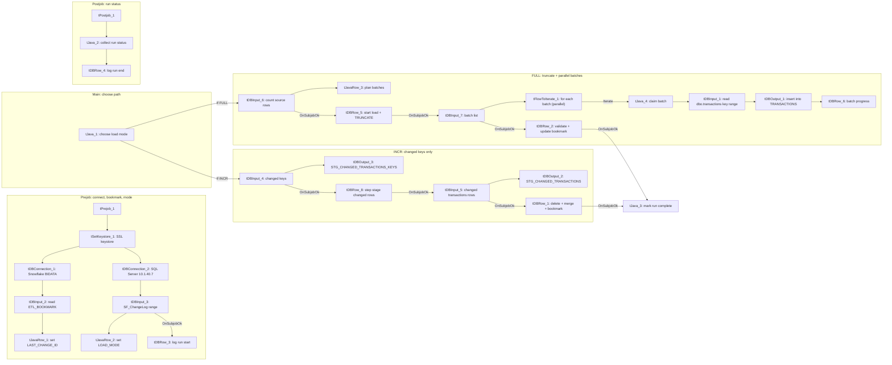

# Talend Job: Transactions_Load

## Overview

`Transactions_Load` loads the financial transaction ledger (payments, adjustments, commissions, NSFs, payment source and channel flags, desk/campaign links) from the `dbo.transactions` table in the Frost SQL Server database (`10.1.40.7`, database `snowflake`) into `EDWPRODHH.BIDATA.TRANSACTIONS` in Snowflake. This version (branch `feature/bidata_incremental_changes`) is no longer a simple truncate-and-reload: at start-up it reads the table's bookmark (`LAST_CHANGE_ID`) from `BIDATA.ETL_BOOKMARK` and checks the SQL Server change log `dbo.SF_ChangeLog` for rows with `target_table = 'transactions'` above that bookmark. It runs a **FULL** reload when the bookmark is 0 (first run) or the new change-log range contains a full-load marker (`change_operation = 'F'`); an **INCR** (incremental) load when there are ordinary change rows; and does **NONE** when nothing has changed. FULL truncates `TRANSACTIONS` and reloads it in parallel key-range batches, then validates the row counts; INCR stages only the changed keys and rows and applies them with a `DELETE` + `MERGE` keyed on `TRANS_ID` that only updates rows whose `ROW_HASH` changed. Either way the bookmark is advanced in the same transaction as the final apply step, and every run is logged step by step in `BIDATA.ETL_JOB_RUN_LOG` and `BIDATA.ETL_JOB_RUN_STEP`.

## Detail Table

| Field | Value |
|---|---|
| Job name | Transactions_Load |
| Version | 0.1 |
| Project | FAMIGRATION |
| Author | jmach@harriscollect.com |
| Created | 2026-08-10T13:05:21.340-0500 |
| Last Modified | 2026-10-25T22:54:42.528+0530 |

## Step-by-Step Data Flow

1. **Startup and connections (prejob)** - `tPrejob_1` triggers `tSetKeystore_1`, which sets up the SSL keystore/truststore (PKCS12; truststore path from `context.keystorePath`). It then opens the shared Snowflake connection `tDBConnection_1` (account `xca26579.us-east-1`, warehouse `COMPUTE_WH`, database `EDWPRODHH`, schema `BIDATA`, role `DATALOADER`, auto-commit on) and the shared SQL Server connection `tDBConnection_2` (`10.1.40.7:1433`, database `snowflake`, schema `dbo`, login `svc_talend`).
2. **Read the bookmark (prejob)** - `tDBInput_2` ("ETL_BOOKMARK") reads `LAST_CHANGE_ID` and `LAST_RUN_DTTM` from `EDWPRODHH.BIDATA.ETL_BOOKMARK WHERE TABLE_NAME = 'TRANSACTIONS'`. `tJavaRow_1` ("Set bookmark context") copies them into `context.LAST_CHANGE_ID` (0 if null) and `context.LAST_RUN_DTTM`. If no bookmark row exists, the context defaults stay in place (`LAST_CHANGE_ID = 0`).
3. **Read the change-log range (prejob)** - `tDBInput_3` ("SF_ChangeLog range") asks SQL Server for `COUNT(*)`, `MAX(change_id)` and the highest full-load marker `MAX(CASE WHEN change_operation = 'F' THEN change_id END)` from `dbo.SF_ChangeLog` where `target_table = 'transactions' AND change_id > LAST_CHANGE_ID`.
4. **Choose the load mode (prejob)** - `tJavaRow_2` ("Set load mode") fixes this run's upper bound `context.MAX_CHANGE_ID` (the max change_id found, or the old bookmark if none) and sets `context.LOAD_MODE`:
   - **FULL** if `LAST_CHANGE_ID = 0` (first run / reset bookmark) **or** a full-load (`F`) marker exists in the range;
   - **NONE** if there are no new change-log rows;
   - **INCR** otherwise.
   It also stores the change-row count in `globalMap` (`CHANGE_LOG_ROWS`).
5. **Open the run log (prejob)** - `tDBRow_3` ("Log run start") inserts a `RUNNING` row into `ETL_JOB_RUN_LOG` (Talend `pid`, job name, table `TRANSACTIONS`, load mode, change-id range, change-log row count, `TARGET_ROWS_BEFORE` = current `COUNT(*)` of `TRANSACTIONS`, `STEPS_TOTAL` = 4, or 2 for NONE). It writes step 1 "Check changes" as `DONE` to `ETL_JOB_RUN_STEP` and opens step 2 as `RUNNING` ("Count source" for FULL, "Stage changed keys" for INCR, "Nothing to load" for NONE).
6. **Branch (main job)** - `tJava_1` ("Choose load mode") branches on `context.LOAD_MODE` with two `Run if` triggers: `"FULL".equals(context.LOAD_MODE)` goes to the FULL path, `"INCR".equals(context.LOAD_MODE)` goes to the INCR path. For NONE it just sets `RUN_COMPLETED = true` and the job goes straight to the postjob; the bookmark is not touched.
7. **FULL path - batched, parallel reload**
   1. `tDBInput_6` ("Count source rows") reads `COUNT_BIG(*)`, `MIN(TRANS_ID)` and `MAX(TRANS_ID)` from `dbo.transactions`.
   2. `tJavaRow_3` ("Plan batches") works out `BATCHES_TOTAL = ceil(rows / BATCH_SIZE)` (default 5,000,000 rows per batch) and splits the `TRANS_ID` range into equal key ranges (`KEY_STEP`). It creates a shared atomic batch counter and a per-thread holder for each batch's key range.
   3. `tDBRow_5` ("Start load + truncate") closes step 2, opens step 3 "Load target", records `ROWS_TOTAL` / `BATCHES_TOTAL` in the run log, and then runs `TRUNCATE TABLE EDWPRODHH.BIDATA."TRANSACTIONS"`.
   4. `tDBInput_7` ("Batch list") generates one row per batch on SQL Server (number generator over `sys.all_objects`); `tFlowToIterate_1` ("For each batch") iterates over them **in parallel** (`context.PARALLEL_BATCHES`, default 4 threads).
   5. For each iteration `tJava_4` ("Claim batch") takes the next batch number from the atomic counter and computes its `TRANS_ID` range; `tDBInput_1` reads the 61 columns of `dbo.transactions` (including `ROW_HASH`, converted to a hex string) `WHERE TRANS_ID BETWEEN` that range; `tDBOutput_1` inserts the rows into `TRANSACTIONS`; then `tDBRow_6` ("Batch progress") increments `BATCH_NO` and refreshes `ROWS_DONE` in the run log.
   6. `tDBRow_2` ("Update bookmark + run log") validates the load and raises an error if: not every batch finished (`BATCH_NO < BATCHES_TOTAL`); the target has fewer than 99.5% of the source rows counted in step 7.1; or `TRANS_ID` is not unique in the target. If the checks pass, in a single transaction it advances `ETL_BOOKMARK.LAST_CHANGE_ID` to `MAX_CHANGE_ID`, fills the run-log counts (`SOURCE_ROWS`, `ROWS_INSERTED`, `ROWS_DELETED` = previous target rows, `TARGET_ROWS_AFTER`) and closes step 4 "Update bookmark".
8. **INCR path - changed keys only**
   1. `tDBInput_4` ("Changed keys") reads `SELECT DISTINCT key_value` from `dbo.SF_ChangeLog` for `target_table = 'transactions'` and `LAST_CHANGE_ID < change_id <= MAX_CHANGE_ID`; `tDBOutput_3` writes them to `BIDATA.STG_CHANGED_TRANSACTIONS_KEYS` (truncated first).
   2. `tDBRow_8` ("Step: stage changed rows") closes step 2, opens step 3 "Stage changed rows" and records the key count as `ROWS_TOTAL`.
   3. `tDBInput_5` ("Changed TRANSACTIONS rows") reads the current version of those rows from `dbo.transactions` (`WHERE TRANS_ID IN (SELECT key_value FROM dbo.SF_ChangeLog ...)` with the same change-id range); `tDBOutput_2` writes them to `BIDATA.STG_CHANGED_TRANSACTIONS` (truncated first).
   4. `tDBRow_1` ("Merge changes + bookmark") closes step 3 and opens step 4 "Merge into target", then in a single transaction: counts inserted / updated (`ROW_HASH IS DISTINCT FROM`) / unchanged rows; **deletes** from `TRANSACTIONS` keys that were in the change log but no longer exist in the source; **merges** `STG_CHANGED_TRANSACTIONS` into `TRANSACTIONS` on `TRANS_ID` (update only when `ROW_HASH` differs, insert when not matched); advances `ETL_BOOKMARK.LAST_CHANGE_ID` to `MAX_CHANGE_ID`; writes `CHANGED_KEYS`, `SOURCE_ROWS`, `ROWS_INSERTED/UPDATED/UNCHANGED/DELETED` and `TARGET_ROWS_AFTER` to the run log; and closes step 4. Any error rolls the whole transaction back.
9. **Mark completion** - after either path finishes successfully (`OnSubjobOk` from `tDBRow_2` or `tDBRow_1`), `tJava_3` ("Mark run complete") sets `RUN_COMPLETED = true`.
10. **Postjob - final status** - `tPostjob_1` runs `tJava_2` ("Collect run status"): `RUN_STATUS` is `SUCCESS` only if `RUN_COMPLETED` was set, otherwise `FAILED`; the first `*_ERROR_MESSAGE` found in `globalMap` (or "Run did not reach its last step") is escaped and truncated to 4,000 characters. `tDBRow_4` ("Log run end") then marks any still-`RUNNING` step as `DONE`/`FAILED` and sets `STATUS`, `ERROR_MESSAGE`, `END_DTTM`, `DURATION_SEC` on the run-log row.

**Error handling:** every SnowflakeRow / SnowflakeOutput on the load path has `dieOnError = true`, so a failure stops the job; the postjob still runs and records `FAILED`. Because the bookmark only moves inside the final transaction, a failed run leaves `LAST_CHANGE_ID` unchanged and the next run re-processes the same change-log range (and re-runs FULL if FULL was chosen).

## Settings

### Shared Snowflake connection (component `tDBConnection_1`, type `SnowflakeConnection`, label "BIDATA")

| Setting | Value | What it means |
|---|---|---|
| configuration.account | xca26579.us-east-1 | The Snowflake account (region-qualified) the job connects to. |
| configuration.warehouse | COMPUTE_WH | The virtual warehouse that runs all queries. |
| configuration.database / dbSchema | EDWPRODHH / BIDATA | Database and schema holding the target, staging and control tables. |
| configuration.role | DATALOADER | Snowflake role the service account assumes. |
| configuration.autoCommit | true | Each statement commits on its own unless the SQL opens an explicit transaction (the apply steps do). |
| configuration.snowflakeAuth.* | ***REDACTED*** | Authentication type, user, key alias and grant type are redacted in the metadata. |

Used (`USE_EXISTING_CONNECTION = true`) by `tDBInput_2`, all `SnowflakeRow` components, and the two staging outputs `tDBOutput_3` / `tDBOutput_2`.

### Shared SQL Server connection (component `tDBConnection_2`, type `tMSSqlConnection`, label "BIDATA")

| Setting | Value | What it means |
|---|---|---|
| HOST / PORT | 10.1.40.7 / 1433 | Address of the Frost SQL Server source. |
| DBNAME / SCHEMA_DB | snowflake / dbo | Source database and schema (the SQL Server database is literally named `snowflake`). |
| USER / PASS | svc_talend / ***REDACTED*** | SQL Server service login. |
| PROPERTIES | trustServerCertificate=True | Accept the server's TLS certificate without validating it. |
| ENCODING | ISO-8859-15 | Character set used when reading text. |

Used by `tDBInput_3`, `tDBInput_4`, `tDBInput_5`, `tDBInput_6` and `tDBInput_7`. `tDBInput_1` (the FULL batch reader) does **not** use it (`USE_EXISTING_CONNECTION = false`), so each parallel batch opens its own SQL Server connection with the same host/database/login.

### Bookmark read (component `tDBInput_2`, type `SnowflakeInput`, label "ETL_BOOKMARK")

| Setting | Value | What it means |
|---|---|---|
| sqlQuery | `SELECT TO_VARCHAR(LAST_CHANGE_ID) ..., TO_VARCHAR(LAST_RUN_DTTM, ...) FROM EDWPRODHH.BIDATA.ETL_BOOKMARK WHERE TABLE_NAME = 'TRANSACTIONS'` | Reads this table's last applied change id and last run time. |
| Output | LAST_CHANGE_ID, LAST_RUN_DTTM | Passed to `tJavaRow_1`, which sets the context variables. |

### Change-log readers (type `tMSSqlInput`)

| Component | Label | Query (summary) |
|---|---|---|
| tDBInput_3 | SF_ChangeLog range | `COUNT(*)`, `MAX(change_id)`, max `F` marker from `dbo.SF_ChangeLog` where `target_table = 'transactions'` and `change_id > LAST_CHANGE_ID`. |
| tDBInput_4 | Changed keys | `SELECT DISTINCT key_value` for the same table, `key_value IS NOT NULL`, `LAST_CHANGE_ID < change_id <= MAX_CHANGE_ID`. |
| tDBInput_5 | Changed TRANSACTIONS rows | All 61 columns of `dbo.transactions` (with `CONVERT(VARCHAR(64), ROW_HASH, 2)`) where `TRANS_ID IN` the change-log keys in the same range. |
| tDBInput_6 | Count source rows | `COUNT_BIG(*)`, `MIN(TRANS_ID)`, `MAX(TRANS_ID)` from `dbo.transactions`. |
| tDBInput_7 | Batch list (one row per batch) | `SELECT TOP (BATCHES_TOTAL)` row numbers from `sys.all_objects` cross join, giving `BATCH_NO`, `KEY_FROM`, `KEY_TO`. |
| tDBInput_1 | `__TABLE__` | All 61 columns of `dbo.transactions` `WHERE TRANS_ID BETWEEN` the batch's key range (read from the thread-local `BATCH_RANGE`). |

All six have `QUERY_TIMEOUT_IN_SECONDS = 30` but `SET_QUERY_TIMEOUT = false` (so no timeout is applied) and `TRIM_ALL_COLUMN = true`: leading/trailing spaces are trimmed from every string column read from SQL Server.

### Staging target: changed keys (component `tDBOutput_3`, type `SnowflakeOutput`)

| Setting | Value | What it means |
|---|---|---|
| configuration.dataSet.tableName | STG_CHANGED_TRANSACTIONS_KEYS | Transient staging table holding the distinct changed keys (`KEY_VALUE NUMBER(38,0)` per the BIDATA DDL). |
| tableAction | TRUNCATE | Emptied before each INCR run. |
| dataAction | INSERT | Plain insert. |
| upsertKeyColumn | KEY_VALUE | Not used (dataAction is INSERT). |
| dieOnError | true | Any write error stops the job. |
| USE_EXISTING_CONNECTION | true (`tDBConnection_1`) | Reuses the shared Snowflake connection. |

### Staging target: changed rows (component `tDBOutput_2`, type `SnowflakeOutput`)

| Setting | Value | What it means |
|---|---|---|
| configuration.dataSet.tableName | STG_CHANGED_TRANSACTIONS | Transient copy of `TRANSACTIONS` (created `LIKE TRANSACTIONS` in the DDL) holding the current source version of changed rows. |
| tableAction | TRUNCATE | Emptied before each INCR run. |
| dataAction | INSERT | Plain insert; the merge into the real table is done by `tDBRow_1`. |
| upsertKeyColumn | TRANS_ID | Not used (dataAction is INSERT). |
| convertColumnsAndTableToUppercase | true | Column/table names upper-cased to match Snowflake. |
| dieOnError | true | Any write error stops the job. |

### Final target (component `tDBOutput_1`, type `SnowflakeOutput`, label "TRANSACTIONS") - FULL path only

| Setting | Value | What it means |
|---|---|---|
| account / warehouse / role | xca26579.us-east-1 / COMPUTE_WH / DATALOADER | Snowflake account, compute and role used for the batch writes. |
| database / dbSchema | EDWPRODHH / BIDATA | Location of the target table. |
| configuration.dataSet.tableName | TRANSACTIONS | The table this job maintains. |
| tableAction | NONE | The component itself does not clear the table - the truncate is done once by `tDBRow_5` before the batches start. |
| dataAction | INSERT | Each batch appends its rows. |
| upsertKeyColumn | TRANS_ID | Not used (dataAction is INSERT). |
| dieOnError | true | A failed batch stops the job (no bookmark update). |
| USE_EXISTING_CONNECTION | not set | Opens its own Snowflake connection per batch (needed for parallel iteration). |

### Control / apply SQL (type `SnowflakeRow`, all on `tDBConnection_1`)

| Component | Label | dieOnError | What the SQL does |
|---|---|---|---|
| tDBRow_3 | Log run start | true | Inserts the `RUNNING` row into `ETL_JOB_RUN_LOG` (mode, change-id range, `TARGET_ROWS_BEFORE`), writes step 1 "Check changes" and opens step 2. |
| tDBRow_5 | Start load + truncate | true | FULL: closes step 2, opens step 3 "Load target", sets `ROWS_TOTAL` / `BATCHES_TOTAL`, then `TRUNCATE TABLE ... "TRANSACTIONS"`. |
| tDBRow_6 | Batch progress | false | FULL: after each batch, `BATCH_NO + 1` and `ROWS_DONE = COUNT(*)` of `TRANSACTIONS` in the run log. |
| tDBRow_2 | Update bookmark + run log | true | FULL: Snowflake Scripting block with three custom exceptions (`incomplete_load`, `too_few_rows` below 99.5% of source, `duplicate_keys` on `TRANS_ID`); then, in one transaction, updates `ETL_BOOKMARK`, run-log counts and step 4; `ROLLBACK` + re-raise on any error. |
| tDBRow_8 | Step: stage changed rows | true | INCR: closes step 2 with the key count, opens step 3, sets `ROWS_TOTAL`. |
| tDBRow_1 | Merge changes + bookmark | true | INCR: one transaction that deletes vanished keys, `MERGE`s `STG_CHANGED_TRANSACTIONS` into `TRANSACTIONS` on `TRANS_ID` with `ROW_HASH` change detection, updates `ETL_BOOKMARK` and the run-log / step counts; `ROLLBACK` + re-raise on error. |
| tDBRow_4 | Log run end | false | Postjob: closes the open step and sets final `STATUS`, `ERROR_MESSAGE`, `END_DTTM`, `DURATION_SEC`. |

### Java logic (types `tJavaRow` / `tJava`)

| Component | Label | What it does |
|---|---|---|
| tJavaRow_1 | Set bookmark context | Sets `context.LAST_CHANGE_ID` / `LAST_RUN_DTTM` from the bookmark row. |
| tJavaRow_2 | Set load mode | Sets `MAX_CHANGE_ID` and `LOAD_MODE` (FULL / INCR / NONE). |
| tJava_1 | Choose load mode | Branch point; for NONE sets `RUN_COMPLETED`. |
| tJavaRow_3 | Plan batches | Computes `BATCHES_TOTAL`, `KEY_MIN`, `KEY_MAX`, `KEY_STEP`; creates the atomic batch counter and thread-local range holder. |
| tJava_4 | Claim batch | Gives each parallel thread the next batch number and its `TRANS_ID` range. |
| tJava_3 | Mark run complete | Sets `RUN_COMPLETED = true` after a successful FULL or INCR apply. |
| tJava_2 | Collect run status | Derives `RUN_STATUS` and an escaped `RUN_ERROR_SQL` for the postjob log. |

## Dependencies & Configuration

**Other jobs**: none. There is no `tRunJob` component; the job runs standalone on its own schedule (not visible in the extracted metadata - verify in Talend Management Console).

**Source tables (SQL Server `10.1.40.7`, database `snowflake`, schema `dbo`)**: `dbo.transactions` (data) and `dbo.SF_ChangeLog` (change log; filtered on `target_table = 'transactions'`, using `change_id`, `change_operation` and `key_value`). How `SF_ChangeLog` is populated is not part of this job - Unable to determine from metadata - verify with team.

**Snowflake tables (`EDWPRODHH.BIDATA`)**

| Table | Access | Purpose |
|---|---|---|
| TRANSACTIONS | Truncate + insert (FULL); delete + merge (INCR) | The target table. |
| STG_CHANGED_TRANSACTIONS_KEYS | Truncate + insert | INCR staging of changed keys. |
| STG_CHANGED_TRANSACTIONS | Truncate + insert | INCR staging of changed rows. |
| ETL_BOOKMARK | Read at start; updated at the end of FULL/INCR | Row `TABLE_NAME = 'TRANSACTIONS'` holds `LAST_CHANGE_ID` / `LAST_RUN_DTTM`. |
| ETL_JOB_RUN_LOG | Insert, update | One row per run (keyed by Talend `pid` + job name): mode, change-id range, progress, row counts, status, error. |
| ETL_JOB_RUN_STEP | Insert, update | One row per step of the run (up to 4 steps). |

**Context variables** (the `context_groups` list in the extracted metadata is empty; names and defaults below are from the job's `.item` file):

| Variable | Type | Default | Why it is used |
|---|---|---|---|
| keystorePath | String | C:/Users/svc_talend_prd/.ssl/keystore.p12 | Truststore file for `tSetKeystore_1` (from a repository context group). |
| LAST_CHANGE_ID | Long | 0 | Last applied `SF_ChangeLog.change_id`, loaded from `ETL_BOOKMARK`. 0 forces a FULL load. |
| LAST_RUN_DTTM | Date | 1900-01-01 00:00:00 | Last run time from `ETL_BOOKMARK`; only printed to the log in this job. |
| MAX_CHANGE_ID | Long | 0 | Upper bound of the change-log range processed in this run; becomes the new bookmark. |
| LOAD_MODE | String | FULL | FULL, INCR or NONE; set in the prejob, drives the `Run if` branches and log text. |
| BATCH_SIZE | Integer | 5000000 | Target rows per batch in a FULL load. |
| PARALLEL_BATCHES | Integer | 4 | Number of FULL batches loaded at the same time (parallel iterate). |

The job also uses Talend built-ins `pid` and `jobName` to key the run-log rows, and `globalMap` keys such as `CHANGE_LOG_ROWS`, `ROWS_TOTAL`, `BATCHES_TOTAL`, `RUN_COMPLETED`, `RUN_STATUS` and `RUN_ERROR_SQL` to pass values between steps.

## Glossary

| Component type | What it does |
|---|---|
| tPrejob / tPostjob | Run first / last in the job; the postjob runs even when the main job fails, so it is used for final status logging. |
| tSetKeystore | Configures the SSL/TLS key store and trust store used for encrypted connections. |
| SnowflakeConnection | Opens a Snowflake connection that other components can share. |
| tMSSqlConnection | Opens a Microsoft SQL Server connection that other components can share. |
| SnowflakeInput | Runs a query in Snowflake and returns the rows (here: the bookmark). |
| tMSSqlInput | Runs a query against SQL Server and returns the rows. |
| SnowflakeOutput | Writes rows into a Snowflake table (with optional truncate before loading). |
| SnowflakeRow | Runs an arbitrary SQL statement or Snowflake Scripting block (logging, truncate, merge, bookmark update). |
| tJavaRow | Runs Java code once for each incoming row (used to copy query results into context variables). |
| tJava | Runs a block of Java code once (branching, batch claiming, status collection). |
| tFlowToIterate | Turns each incoming row into one loop iteration; here the iterations run in parallel. |

## Issues Observed

- **FULL load empties the target before reloading it.** `tDBRow_5` runs `TRUNCATE TABLE EDWPRODHH.BIDATA."TRANSACTIONS"` with auto-commit, before any batch is written. Readers of `TRANSACTIONS` see an empty or partial table for the whole FULL load, and if the job fails the table stays partial until the next run (which will repeat the FULL load because the bookmark was not advanced).
- **Row-count tolerance in FULL validation.** `tDBRow_2` only fails when the target has fewer than `rows_total * 99.5 / 100` rows, so up to 0.5% of source rows can be missing without failing the run. Also, `tDBInput_1` filters `TRANS_ID BETWEEN` key ranges, so any source rows with a NULL `TRANS_ID` (the column is nullable in the Talend schema) are counted in `ROWS_TOTAL` but never loaded. Whether the tolerance is intended - Unable to determine from metadata - verify with team.
- **Keystore path mismatch.** `tSetKeystore_1` has a hardcoded `SSL_KEYSTORE = "C:/Users/svc_talend_prd/ssl/keystore.p12"`, while `context.keystorePath` (used for the truststore) defaults to `C:/Users/svc_talend_prd/.ssl/keystore.p12` (`ssl` vs `.ssl`). Whether the keystore part is actually active cannot be determined because `NEED_CLIENT_AUTH` is redacted - verify with team.
- **Hardcoded source connection details.** `10.1.40.7:1433`, database `snowflake`, login `svc_talend` and `trustServerCertificate=True` are set on `tDBConnection_2` and repeated on every `tMSSqlInput`; `tDBInput_1` uses them directly because it opens its own connection. A server move needs edits in each job. The SQL Server database name `snowflake` is also easy to confuse with the Snowflake target.
- **Inert / misleading upsert key.** All three `SnowflakeOutput` components use `dataAction = INSERT`, so `upsertKeyColumn` is never used. On `STG_CHANGED_TRANSACTIONS` and `TRANSACTIONS` it is set to `TRANS_ID`, which matches the real business key (`TRANS_ID`) but has no effect.
- **Final status step does not stop on error.** `tDBRow_4` ("Log run end") has `dieOnError = false`; if that update fails, the run-log row stays `RUNNING` with no error recorded. `tDBRow_6` ("Batch progress") is also `dieOnError = false`, which only affects progress figures.
- **Query timeout configured but not enabled.** All `tMSSqlInput` components show `QUERY_TIMEOUT_IN_SECONDS = 30` with `SET_QUERY_TIMEOUT = false`, so source queries have no timeout. This is probably intended for the multi-million-row batch reads, but the 30-second value is misleading.
- **Unused values.** `context.LAST_RUN_DTTM` is read from the bookmark but only printed (no query uses it), and the `KEY_FROM` / `KEY_TO` columns produced by `tDBInput_7` are ignored - `tJava_4` recomputes each range from the atomic counter.
- **SQL built by string concatenation.** All `SnowflakeRow` statements embed `pid`, `jobName`, context values and `globalMap` values directly in the SQL text. The values come from Talend or the databases (the error message is escaped), so the risk is low, but bind variables would be safer and easier to maintain.
