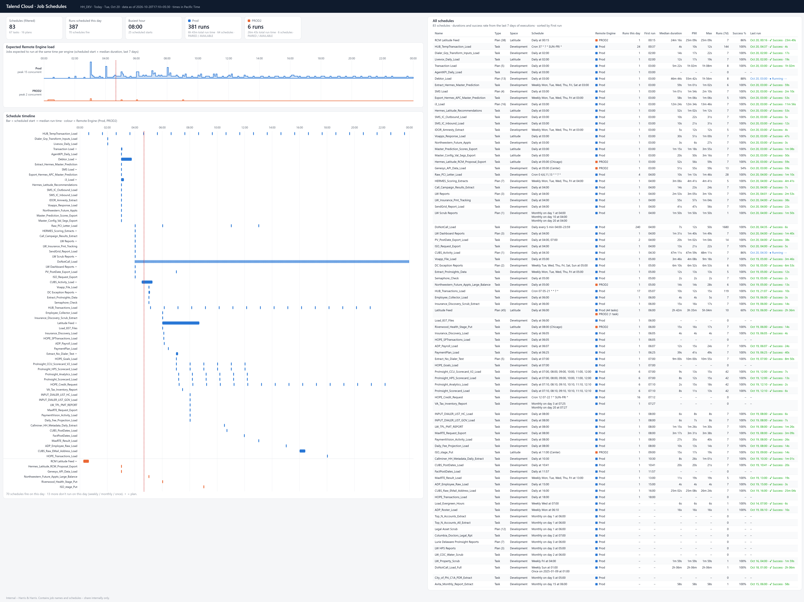

# Talend Job Schedules – HH_DEV – Tue, Oct 20

> Generated from Talend Cloud (read-only API). Data as of **2026-10-20T17:10+05:30**. All times are **Pacific Time** (America/Los_Angeles).
> Durations, success % and last run come from the last 7 days of executions. Bar length / duration = median successful run time.

_Image: `Talend_Job_Schedules_HH_DEV_2026-10-20_Tue-Oct-20.png` – keep it in the same folder as this file. Click it to open full size._

## Summary

| Metric | Value |
| --- | --- |
| Schedules | 83 (67 tasks · 16 plans) |
| Schedules that fire on this day | 70 |
| Runs scheduled on this day | 387 |

## Remote Engines

| Engine | Status | Schedules | Runs | Total run time | Peak concurrent |
| --- | --- | ---: | ---: | ---: | --- |
| Prod | PAIRED / AVAILABLE | 77 | 381 | 6h 43m | 15 at 03:00 |
| PROD2 | PAIRED / AVAILABLE | 6 | 6 | 26m 43s | 2 at 03:00 |

## Scheduled starts per hour

| Hour | Prod | PROD2 | Total |
| --- | ---: | ---: | ---: |
| 00:00 | 1 | 1 | 2 |
| 01:00 | 1 | 0 | 1 |
| 02:00 | 3 | 0 | 3 |
| 03:00 | 16 | 2 | 18 |
| 04:00 | 24 | 0 | 24 |
| 05:00 | 18 | 1 | 19 |
| 06:00 | 23 | 1 | 24 |
| 07:00 | 23 | 0 | 23 |
| 08:00 | 25 | 0 | 25 |
| 09:00 | 19 | 1 | 20 |
| 10:00 | 21 | 0 | 21 |
| 11:00 | 21 | 0 | 21 |
| 12:00 | 19 | 0 | 19 |
| 13:00 | 17 | 0 | 17 |
| 14:00 | 15 | 0 | 15 |
| 15:00 | 16 | 0 | 16 |
| 16:00 | 16 | 0 | 16 |
| 17:00 | 15 | 0 | 15 |
| 18:00 | 16 | 0 | 16 |
| 19:00 | 15 | 0 | 15 |
| 20:00 | 15 | 0 | 15 |
| 21:00 | 15 | 0 | 15 |
| 22:00 | 14 | 0 | 14 |
| 23:00 | 13 | 0 | 13 |

## Schedules on Prod

| Name | Type | Space | Schedule | Runs at (PT) | Median | P90 | Max | Success 7d | Last run |
| --- | --- | --- | --- | --- | ---: | ---: | ---: | ---: | --- |
| HUB_TempTransaction_Load | Task | Development | Cron 37 * ? * SUN-FRI * | 00:37, 01:37, 02:37 … 23:37 (24×) | 4s | 10s | 12s | 100% | Oct 20, 04:37 ✅ |
| Dialer_Grp_Transform_Inputs_Load | Task | Development | Daily at 02:00 | 02:00 | 14s | 17s | 22s | 100% | Oct 20, 02:00 ✅ |
| Livevox_Daily_Load | Task | Latitude | Daily at 02:00 | 02:00 | 12s | 17s | 19s | 100% | Oct 20, 02:00 ✅ |
| AgentKPI_Daily_Load | Task | Development | Daily at 03:00 | 03:00 | – | – | – | – | – |
| Debtor_Load | Plan (13 tasks) | Development | Daily at 03:00 | 03:00 | 46m 44s | 55m 42s | 1h 56m | 88% | Oct 20, 03:00 ⏳ |
| Export_Hermes_APC_Master_Prediction | Task | Development | Weekly Mon, Tue, Wed, Thu, Fri at 03:00 | 03:00 | 58s | 1m 06s | 1m 06s | 100% | Oct 20, 03:00 ✅ |
| Extract_Hermes_Master_Prediction | Task | Development | Weekly Mon, Tue, Wed, Thu, Fri, Sat at 03:00 | 03:00 | 59s | 1m 01s | 1m 02s | 100% | Oct 20, 03:00 ✅ |
| Hermes_Latitude_Recommendations | Task | Latitude | Daily at 03:00 | 03:00 | 52s | 1m 02s | 1m 12s | 100% | Oct 20, 03:00 ✅ |
| i3_Load | Plan (16 tasks) | Development | Daily at 03:00 | 03:00 | 12m 24s | 12m 34s | 13m 46s | 100% | Oct 20, 03:00 ✅ |
| IDOR_Amnesty_Extract | Task | Development | Weekly Mon, Tue, Wed, Thu, Fri at 03:00 | 03:00 | 5s | 12s | 12s | 100% | Oct 20, 03:00 ✅ |
| Master_Config_Val_Segs_Export | Task | Latitude | Daily at 03:00 | 03:00 | 20s | 50s | 3m 16s | 100% | Oct 20, 03:00 ✅ |
| Master_Prediction_Scores_Export | Task | Latitude | Daily at 03:00 | 03:00 | 1m 15s | 1m 18s | 3m 55s | 100% | Oct 20, 03:00 ✅ |
| Northwestern_Future_Appts | Task | Development | Daily at 03:00 | 03:00 | 3s | 6s | 27s | 100% | Oct 20, 03:00 ✅ |
| SMS Load | Plan (4 tasks) | Development | Daily at 03:00 | 03:00 | 1m 01s | 1m 54s | 2m 10s | 100% | Oct 20, 03:00 ✅ |
| SMS_IC_Inbound_Load | Task | Development | Daily at 03:00 | 03:00 | 10s | 21s | 31s | 100% | Oct 20, 03:00 ✅ |
| SMS_IC_Outbound_Load | Task | Development | Daily at 03:00 | 03:00 | 10s | 22s | 31s | 100% | Oct 20, 03:00 ✅ |
| Transaction Load | Plan (5 tasks) | Development | Daily at 03:00 | 03:00 | 5m 22s | 1h 02m | 1h 08m | 100% | Oct 20, 03:00 ✅ |
| Voapps_Response_Load | Task | Latitude | Daily at 03:00 | 03:00 | 30s | 51s | 1m 00s | 100% | Oct 20, 03:00 ✅ |
| Call_Campaign_Results_Extract | Task | Development | Daily at 04:00 | 04:00 | 14s | 23s | 24s | 100% | Oct 20, 04:00 ✅ |
| DoNotCall_Load | Task | Development | Daily every 5 min 04:00–23:59 | 04:00, 04:05, 04:10 … 23:55 (240×) | 7s | 12s | 50s | 100% | Oct 20, 04:35 ✅ |
| HERMES_Scoring_Extracts | Plan (7 tasks) | Development | Weekly Mon, Tue, Wed, Thu, Fri at 04:00 | 04:00 | 3m 06s | 4m 41s | 4m 41s | 100% | Oct 20, 04:00 ✅ |
| ISO_Request_Export | Task | Development | Daily at 04:00 | 04:00 | 13s | 21s | 22s | 100% | Oct 20, 04:00 ✅ |
| LW Dashboard Reports | Plan (3 tasks) | Development | Daily at 04:00 | 04:00 | 1m 31s | 1m 40s | 1m 49s | 100% | Oct 20, 04:00 ✅ |
| LW Reports | Plan (3 tasks) | Development | Daily at 04:00 | 04:00 | 2m 53s | 3m 05s | 3m 10s | 100% | Oct 20, 04:01 ✅ |
| LW Scrub Reports | Plan (1 task) | Development | Monthly on day 1 at 04:00; Monthly on day 10 at 04:00; Monthly on day 20 at 04:00 | 04:00 | 1m 50s | 1m 50s | 1m 50s | 100% | Oct 20, 04:00 ✅ |
| LW_Insurance_Pmt_Tracking | Task | Development | Daily at 04:00 | 04:00 | 55s | 57s | 1m 04s | 100% | Oct 20, 04:00 ✅ |
| PV_PostDate_Export_Load | Task | Development | Daily at 04:00, 07:00 | 04:00, 07:00 | 20s | 1m 02s | 1m 04s | 100% | Oct 20, 04:00 ✅ |
| Raw_PCI_Letter_Load | Task | Development | Cron 0 4,6,11,13 * * ? * | 04:00, 06:00, 11:00, 13:00 | 10s | 1m 13s | 1m 46s | 100% | Oct 20, 04:00 ✅ |
| SendGrid_Report_Load | Task | Development | Daily at 04:00 | 04:00 | 41s | 47s | 56s | 100% | Oct 20, 04:00 ✅ |
| CUBS_Activity_Load | Plan (1 task) | Development | Daily at 04:30 | 04:30 | 47m 11s | 47m 59s | 48m 11s | 86% | Oct 20, 04:30 ⏳ |
| DC Exception Reports | Plan (2 tasks) | Development | Weekly Tue, Wed, Thu, Fri, Sat, Sun at 05:00 | 05:00 | 6m 10s | 6m 52s | 6m 53s | 100% | Oct 18, 05:00 ✅ |
| Extract_ProInsights_Data | Task | Development | Weekly Mon, Tue, Wed, Thu, Fri at 05:00 | 05:00 | 12s | 13s | 13s | 100% | Oct 19, 05:00 ✅ |
| Semaphore_Check | Task | Development | Daily at 05:00 | 05:00 | 2s | 2s | 2s | 100% | Oct 19, 05:00 ✅ |
| Voapp_File_Load | Task | Development | Daily at 05:00 | 05:00 | 3m 46s | 4m 08s | 9m 18s | 100% | Oct 19, 05:00 ✅ |
| HUB_Transactions_Load | Task | Development | Cron 07 05-21 * * ? * | 05:07, 06:07, 07:07 … 21:07 (17×) | 10s | 12s | 15s | 100% | Oct 19, 21:07 ✅ |
| Employee_Collector_Load | Task | Development | Daily at 06:00 | 06:00 | 4s | 4s | 5s | 100% | Oct 19, 06:00 ✅ |
| Insurance_Discovery_Scrub_Extract | Task | Development | Daily at 06:00 | 06:00 | 15s | 16s | 17s | 100% | Oct 19, 06:00 ✅ |
| Latitude Feed (1 task on PROD2) | Plan (45 tasks) | Latitude | Daily at 06:00 | 06:00 | 2h 42m | 3h 35m | 5h 04m | 60% | Oct 19, 06:00 ✅ |
| Load_837_Files | Task | Development | Daily at 06:00 | 06:00 | – | – | – | – | – |
| HOPE_SPTransactions_Load | Task | Development | Daily at 06:05 | 06:05 | – | – | – | – | – |
| Insurance_Discovery_Load | Task | Development | Daily at 06:05 | 06:05 | 4s | 4s | 4s | 100% | Oct 19, 06:05 ✅ |
| ADP_Payroll_Load | Task | Development | Daily at 06:07 | 06:07 | 12s | 15s | 24s | 100% | Oct 19, 06:07 ✅ |
| PaymentPlan_Load | Task | Development | Daily at 06:25 | 06:25 | 39s | 41s | 49s | 100% | Oct 19, 06:25 ✅ |
| Extract_No_Dialer_Test | Plan (5 tasks) | Development | Daily at 07:00 | 07:00 | 9m 00s | 10m 00s | 10m 55s | 100% | Oct 19, 07:00 ✅ |
| HOPE_Goals_Load | Task | Development | Daily at 07:00 | 07:00 | – | – | – | – | – |
| ProInsight_CCU_Scorecard_V2_Load | Task | Development | Daily at 07:00, 08:00, 09:00, 10:00, 11:00, 12:00 | 07:00, 08:00, 09:00, 10:00, 11:00, 12:00 | 9s | 13s | 15s | 100% | Oct 19, 12:00 ✅ |
| ProInsight_HPS_Scorecard_Load | Task | Development | Daily at 07:00, 08:00, 09:00, 10:00, 11:00, 12:00 | 07:00, 08:00, 09:00, 10:00, 11:00, 12:00 | 8s | 12s | 15s | 100% | Oct 19, 12:00 ✅ |
| ProInsight_Analytics_Load | Task | Development | Daily at 07:10, 08:10, 09:10, 10:10, 11:10, 12:10 | 07:10, 08:10, 09:10, 10:10, 11:10, 12:10 | 2s | 15s | 18s | 100% | Oct 19, 12:10 ✅ |
| ProInsight_Scorecard_Load | Task | Development | Daily at 07:10, 08:10, 09:10, 10:10, 11:10, 12:10 | 07:10, 08:10, 09:10, 10:10, 11:10, 12:10 | 8s | 11s | 13s | 100% | Oct 19, 12:10 ✅ |
| HOPE_Credit_Request | Task | Development | Cron 12 07-22 ? * SUN-FRI * | 07:12, 08:12, 09:12 … 22:12 (16×) | – | – | – | – | – |
| VA_Tax_Inventory_Report | Task | Development | Monthly on day 3 at 07:25; Monthly on day 20 at 07:27 | 07:27 | – | – | – | – | – |
| Daily_Fee_Projection_Load | Task | Development | Daily at 08:00 | 08:00 | 10s | 13s | 14s | 100% | Oct 19, 08:00 ✅ |
| INPUT_DIALER_LIST_GOV_Load | Task | Development | Daily at 08:00 | 08:00 | 6s | 7s | 8s | 100% | Oct 19, 08:00 ✅ |
| INPUT_DIALER_LIST_HC_Load | Task | Development | Daily at 08:00 | 08:00 | 6s | 8s | 8s | 100% | Oct 19, 08:00 ✅ |
| LW_TPL_PMT_REPORT | Task | Development | Daily at 08:00 | 08:00 | 1m 15s | 1m 26s | 1m 30s | 100% | Oct 19, 08:00 ✅ |
| MaxRTE_Request_Export | Task | Development | Daily at 08:00 | 08:00 | 3m 17s | 3m 31s | 3m 38s | 100% | Oct 19, 08:00 ✅ |
| PaymentVision_Activity_Load | Task | Development | Daily at 08:00 | 08:00 | 27s | 35s | 40s | 100% | Oct 19, 08:00 ✅ |
| Callminer_HH_Metadata_Daily_Extract | Task | Development | Daily at 10:30 | 10:30 | 8s | 26s | 1m 01s | 100% | Oct 19, 10:30 ✅ |
| CUBS_PostDates_Load | Task | Development | Daily at 10:41 | 10:41 | 20s | 20s | 21s | 100% | Oct 19, 10:41 ✅ |
| FactPostDates_Load | Task | Development | Daily at 11:57 | 11:57 | – | – | – | – | – |
| MaxRTE_Result_Load | Task | Development | Weekly Mon, Tue, Wed, Thu, Fri at 13:00 | 13:00 | 11s | 19s | 19s | 100% | Oct 19, 13:00 ✅ |
| ADP_Employee_Raw_Load | Task | Development | Daily at 15:00 | 15:00 | 4s | 4s | 4s | 100% | Oct 19, 15:00 ✅ |
| CUBS_Raw_EMail_Address_Load | Task | Development | Daily at 16:00 | 16:00 | 25m 02s | 25m 08s | 26m 24s | 100% | Oct 19, 16:00 ✅ |
| HOPE_Transactions_Load | Task | Development | Daily at 18:00 | 18:00 | – | – | – | – | – |

## Schedules on PROD2

| Name | Type | Space | Schedule | Runs at (PT) | Median | P90 | Max | Success 7d | Last run |
| --- | --- | --- | --- | --- | ---: | ---: | ---: | ---: | --- |
| RCM Latitude Feed | Plan (38 tasks) | Latitude | Daily at 00:15 | 00:15 | 24m 16s | 25m 09s | 25m 09s | 86% | Oct 20, 00:16 ✅ |
| Genesys_API_Data_Load | Task | Development | Daily at 05:00 (Center) | 03:00 | 51s | 55s | 59s | 54% | Oct 20, 03:00 ✅ |
| Hermes_Latitude_RCM_Proposal_Export | Task | Latitude | Daily at 05:00 (Chicago) | 03:00 | 52s | 56s | 59s | 100% | Oct 20, 03:00 ✅ |
| Northwestern_Future_Appts_Large_Balance | Task | Development | Daily at 05:00 | 05:00 | 14s | 14s | 28s | 100% | Oct 19, 05:00 ✅ |
| Riverwood_Health_Stage_Put | Task | Latitude | Daily at 08:00 (Chicago) | 06:00 | 15s | 16s | 17s | 100% | Oct 19, 06:00 ✅ |
| ISO_stage_Put | Task | Latitude | Daily at 11:00 (Center) | 09:00 | 15s | 17s | 19s | 100% | Oct 19, 09:00 ✅ |

## Not running on this day

Weekly, monthly or one-off schedules that don't fire on this day.

| Name | Type | Remote Engine | Schedule |
| --- | --- | --- | --- |
| ADP_Roster_Load | Task | Prod | Weekly Mon at 06:10 |
| Avita_Monthly_Report_Extract | Task | Prod | Monthly on day 15 at 06:00 |
| City_of_Phi_C1A_PDR_Extract | Task | Prod | Monthly on day 5 at 05:00 |
| Columbia_Doctors_Legal_Rpt | Task | Prod | Monthly on day 2 at 07:00 |
| DoNotCall_Load_Full | Task | Prod | Weekly Sun at 01:00; Once on 2025-01-09 at 01:00 |
| Legal Asset Scrub | Plan | Prod | Monthly on day 1 at 06:00 |
| Load_Evergreen_Hours | Task | Prod | Weekly Wed at 07:00 |
| Lurie Delaware ProInsight Reports | Plan | Prod | Monthly on day 3 at 06:00 |
| LW HPS Reports | Plan | Prod | Monthly on day 3 at 05:00 |
| LW_COC_Water_Scrub | Task | Prod | Monthly on day 2 at 06:00 |
| LW_Property_Scrub | Task | Prod | Weekly Fri at 04:00 |
| Top_N_Accounts_All_Extract | Task | Prod | Monthly on day 1 at 06:00 |
| Top_N_Accounts_Extract | Task | Prod | Monthly on day 1 at 06:00 |

---
_Internal – Harris & Harris. Contains job names and schedules; keep the repository private._
