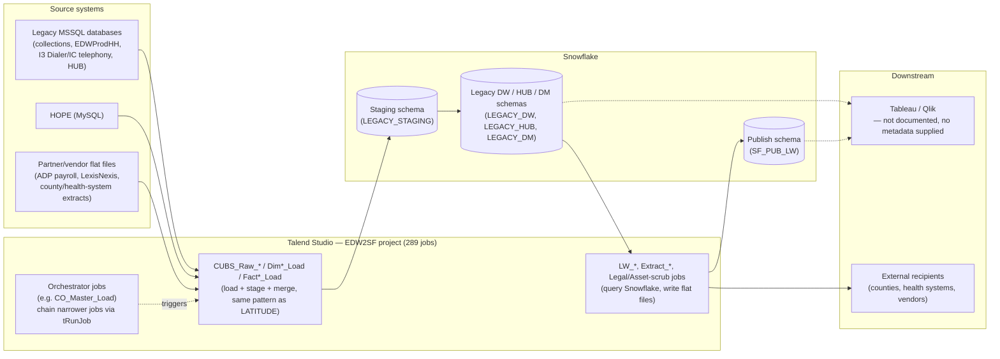

# System Architecture Document — EDW2SF Project

## Overview

EDW2SF is a much larger, more mature Talend project than LATITUDE: 289 jobs pulling from a mix of legacy MSSQL databases (per subsystem: a general collections database, the "EDWProdHH" operational database, two call-center telephony databases, an HR/timekeeping "HUB" database), a MySQL-based "HOPE" system, and existing Snowflake data, consolidating it all into a Snowflake enterprise data warehouse (multiple logical schemas: a staging area, the main legacy-modeled warehouse, a "HUB" mart, and a "DM" data mart), then republishing curated subsets to a separate Snowflake "publish" schema for reporting (`SF_PUB_LW`) and to flat files for a long tail of external partners, counties, health systems, and internal report consumers. Unlike LATITUDE, this project uses genuine job-to-job orchestration: a handful of "Master_Load"/orchestrator jobs (see `06_dependency_matrix.md`) call chains of narrower jobs via `tRunJob`, most visibly a full per-site pipeline in `CO_Master_Load` (client data → debtor data → transactions → dimensions). No Qlik Cloud metadata was supplied for this generation run either, so any Qlik/Tableau consumption of these Snowflake tables is not documented here beyond noting that a `TableauVariables` context group and a single `TableauOutput` component exist.

## Detail table

| Item | Value |
|---|---|
| Project / tenant name | EDW2SF |
| Total Talend jobs | 289 |
| Total DB connections (Talend repository) | 9 — `EDWProdHH_0.1`, `EDWStage_0.1`, `HOPE_0.1`, `HUB_0.1`, `I3_Dialer_40_0.1`, `I3_GBHQ_0.1`, `I3_IC_40_0.1`, `SnowflakeJDBC_0.1`, `TalendLog_0.1` — all 9 have blank host/port/database/schema in the repository entry itself, same pattern as LATITUDE's `TalendLog_0.1` |
| Total context/variable groups | 23 (see `06_dependency_matrix.md` for which jobs use which) |
| Total Qlik apps | Unable to determine from metadata — verify with team (no `qlik_metadata.json` was supplied) |

As with LATITUDE, the 9 repository connection *entries* are placeholders — every actual connection a job opens is a component labeled by hand with a logical name (e.g. `LEGACY_DW`, `LEGACY_STAGING`, `MSSQL_CXN`, `HERMES`), and that logical name's real account/host/credentials live in a same- or similarly-named context group, not in the 9 blank repository rows above. The labels actually used across the 289 jobs' connection components are:

| Connection label (as set on the component) | Type | Jobs using it |
|---|---|---|
| `LEGACY_STAGING` | Snowflake | 100 |
| `SF_CXN` | Snowflake | 44 |
| `LEGACY_DW` | Snowflake | 38 |
| `MSSQL_CXN` | MSSQL | 30 |
| `SF_PUB_LW` | Snowflake | 21 |
| `EDWProdHH` | MSSQL | 12 |
| `I3_Dialer_40` | MSSQL | 7 |
| `HERMES` | Snowflake | 7 |
| `HUB` | MSSQL | 6 |
| `LEGACY_HUB` | Snowflake | 6 |
| `I3_IC_40` | MSSQL | 6 |
| `PUB_JCHANG` | Snowflake | 5 |
| `HOPE` | MySQL | 4 |
| `LEGACY_HOPE` | Snowflake | 3 |
| `LEGACY_DM` | Snowflake | 3 |
| `DIALER_I3` | Snowflake | 2 |
| `SnowflakeJDBC` | JDBC (generic) | 1 |
| `SF_STG_CXN`, `DEDOR_DW`, `SF_Equabli`, `SF_Equabli_2`, `SF_DW`, `DW` | Snowflake | 1 each |

`SF_Equabli`/`SF_Equabli_2` and `PUB_JCHANG` stand out as likely one-off or individual-owned connections (a named external partner and what looks like a personal developer schema) rather than shared platform infrastructure — worth confirming whether these should still be in production use.

## Data flow

## Glossary

| Term | Plain-English meaning |
|---|---|
| Orchestrator / Master_Load job | A job whose only real job is to run other jobs in sequence (and sometimes in parallel) via `tRunJob`, so a whole multi-step pipeline can be kicked off from one place. `CO_Master_Load` is the clearest example — it runs 10 other jobs in a defined order. |
| CUBS | The name embedded in most load-job names (`CUBS_Raw_*`) — appears to be the legacy collections system this warehouse is built from; not otherwise defined in the metadata. |
| Site code (CHI / CO / DC / HH / PRE / TOL) | A recurring suffix/infix on many job names (e.g. `CUBS_Raw_CO_Debtor_Load`) that appears to identify a business unit, office, or client portfolio whose data is loaded through an otherwise-identical job template. Not spelled out anywhere in the metadata — verify the exact meaning with the team. |
| Staging schema | Same concept as LATITUDE: a landing table that's cleared and reloaded every run, holding only the latest extract. |
| Publish schema (`SF_PUB_LW`) | A separate Snowflake schema that curated reporting jobs (the `LW_*` scorecards/audits) write into — likely the schema a BI tool queries, separate from the raw/staging warehouse. |
| Context group | Same concept as LATITUDE: a named bundle of settings a job reads at run time. This project has 23, vs. LATITUDE's 2 — see `06_dependency_matrix.md`. |
| Reload task / Space (Qlik) | Not documented here — no Qlik metadata was supplied. |
