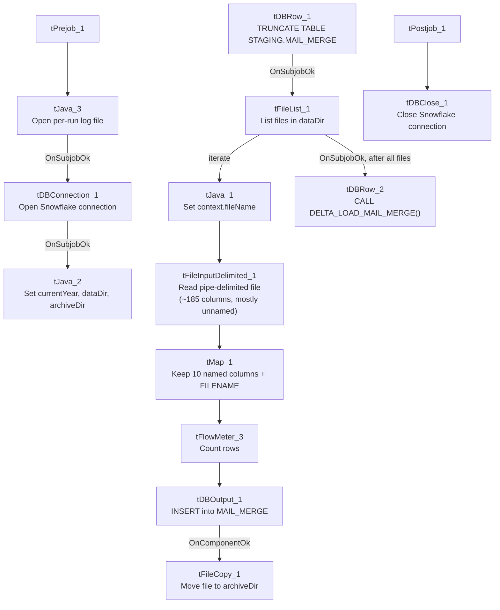

# Talend Job: Mail_Merge_Load

## Overview

Loads a wide, mostly-anonymous-column delimited extract file (one row per debtor/letter, with debtor number, logon, letter form/ID, ZIP, a RevSpring mail-vendor ID, and roughly 180 additional pipe-delimited positional columns most of which were never given business names) into the Snowflake `MAIL_MERGE` staging table, then calls a delta-load stored procedure to merge the new rows into a downstream table. The source data appears to be a mail-merge/letter-vendor export (the presence of `LETTER_FORM`, `LETTER_ID`, and `REVSPRING_ID` columns — RevSpring is a mail-fulfillment/print vendor — supports this), but most of the file's actual business content is not documented in the schema itself.

## Detail table

| Field | Value |
|---|---|
| Job name | Mail_Merge_Load |
| Version | 0.1 |
| Project | EDW2SF |
| Author | jmach@harriscollect.com |
| Created | 2022-04-19T13:55:59.321-0700 |
| Last Modified | 2022-06-10T10:39:07.578-0700 |

## Step-by-step data flow

**Setup subjob:** `tPrejob_1` → `tJava_3` opens a per-run log file at `context.logDir + jobName + "_" + <timestamp> + ".log"` and redirects `System.out`/`System.err` to it → on subjob-ok, `tDBConnection_1` opens the Snowflake connection → on subjob-ok, `tJava_2` computes `context.currentYear`, then derives `context.dataDir` and `context.archiveDir` as subfolders of `context.rootDir` (`<rootDir>/<currentYear>` and `<rootDir>/<currentYear>/archive`).

**Main subjob:**

1. `tDBRow_1` runs `TRUNCATE TABLE STAGING.MAIL_MERGE;` (note the explicit `STAGING.` schema prefix, unlike some other jobs in this project).
2. On success, `tFileList_1` lists files in `context.dataDir` (`EXCLUDEFILEMASK` of `*.txt` is configured but `IFEXCLUDE=false`, so the exclusion is not actually applied).
3. For each file, `tJava_1` sets `context.fileName` from the current file path and prints a "Processing file" message.
4. `tFileInputDelimited_1` reads the file (pipe-delimited `|`, header row present, `DIE_ON_ERROR=true`) against a repository schema with ~185 columns, most positionally named (`Column2`, `Column6`, `_0`, `_1`, `_3`, `_9`, `_01`...`_98`, etc.) rather than business names — only `DEBTORNUMBER`, `LOGON`, `LETTER_FORM`, `LETTER_ID`, `ZIP`, `REVSPRING_ID`, `DATE_TEXT`, `PL_GROUP`, `CDN`, and `CLIENT` have meaningful names.
5. `tMap_1` maps down to an 11-column output schema (`DEBTORNUMBER`, `LOGON`, `LETTER_FORM`, `LETTER_ID`, `ZIP`, `REVSPRING_ID`, `DATE_TEXT`, `PL_GROUP`, `CDN`, `CLIENT`, `FILENAME`) — i.e., only the meaningfully-named columns (plus a `FILENAME` audit column) survive into the target; the ~175 unnamed positional columns are dropped at this step. `DIE_ON_ERROR=true`.
6. `tFlowMeter_3` counts rows passing through (labeled "MyLabel", not renamed for this job).
7. `tDBOutput_1` inserts the rows into Snowflake table `MAIL_MERGE` (`INSERT`, no table-recreate action).
8. On component-ok, `tFileCopy_1` copies the source file to `context.archiveDir` (`REMOVE_FILE=true`, i.e. moves rather than copies-and-keeps; `REPLACE_FILE=true`, `CREATE_DIRECTORY=true`).
9. Separately, once `tFileList_1`'s whole loop finishes (`OnSubjobOk`, not per-file), `tDBRow_2` runs `CALL DELTA_LOAD_MAIL_MERGE();` — this merge call runs once after all files are processed, not once per file.

**Teardown subjob:** `tPostjob_1` → `tDBClose_1` closes the Snowflake connection.

## Settings tables

### Source: `tFileInputDelimited_1`

| Setting | Value | What it means |
|---|---|---|
| FILENAME | `context.fileName` | The current file from `tFileList_1`'s iteration. |
| FIELDSEPARATOR / HEADER | `|` / 1 header row | Pipe-delimited, not comma — distinct from most other file-load jobs in this project. |
| SCHEMA | Repository schema (~185 columns, mostly `Column2`/`_NN` positional placeholders) | Only 10 columns have business names; the rest were never mapped to meaningful labels in the Talend repository — see Issues observed. |
| TEMP_DIR | `"C:/Talend-Studio-20211109_1610-V8.0.1/workspace"` | Hardcoded developer-workstation path — same project-wide risk documented in `05_operational_runbook.md`. |
| DIE_ON_ERROR | `true` | A malformed row fails the job outright. |
| Reject flow | Not wired | No `tDie_ON_ERROR=false`/reject-schema pattern is used here; a bad row simply fails the whole job rather than being isolated. |

### Target: `tDBOutput_1` (`tSnowflakeOutput`)

| Setting | Value | What it means |
|---|---|---|
| Table | `MAIL_MERGE` | Destination staging table. |
| Output action | `INSERT` | Appends rows; relies on the earlier `TRUNCATE TABLE STAGING.MAIL_MERGE;` to prevent duplicate accumulation across runs. |
| Table action | `NONE` | Table is not recreated/altered by this job. |

### Merge step: `tDBRow_2` (`tSnowflakeRow`)

| Setting | Value | What it means |
|---|---|---|
| Query | `CALL DELTA_LOAD_MAIL_MERGE();` | Calls a stored procedure (not shown in this metadata) presumably merging the freshly loaded `MAIL_MERGE` staging rows into a final table — note this naming convention (`DELTA_LOAD_<table>`) differs from both `MERGE_INTO_<table>` (`ADP_Payroll_Load`) and `MERGE_TXT_INTO_<table>` (LATITUDE) patterns seen elsewhere. |
| Result handling | Not captured | Unlike `ADP_Payroll_Load` or `CO_Master_Load`, this job does not capture the procedure's return value or branch on success/failure — a failed merge produces no job-specific message. |

## Dependencies & configuration

- **Triggers/depends on other jobs:** none — no `tRunJob` links found.
- **Context variables used:** `rootDir`, `currentYear` (derived internally), `dataDir` (derived internally, `rootDir/currentYear`), `archiveDir` (derived internally, `rootDir/currentYear/archive`), `fileName`, `logDir`.
- **2 hardcoded developer-workstation paths**: `tFileInputDelimited_1.TEMP_DIR` and `tFileCopy_1.SOURCE_DERECTORY` (both `C:/Talend-Studio-20211109_1610-V8.0.1/workspace`) — same portability risk documented project-wide in `05_operational_runbook.md`.

## Glossary

| Component type | Plain-English meaning |
|---|---|
| `tFileList` | Lists files in a directory for the job to iterate over one at a time. |
| `tFileInputDelimited` | Reads a delimited (CSV/pipe-style) text file according to a schema. |
| `tMap` | Maps/transforms columns from one schema to another — here used to drop ~175 unnamed columns from the source. |
| `tFlowMeter` | Counts rows passing through a point in the flow, for logging/monitoring. |
| `tSnowflakeOutput` / `tSnowflakeRow` / `tSnowflakeConnection` / `tSnowflakeClose` | Write rows to a Snowflake table / run an arbitrary SQL statement or stored-procedure call against Snowflake / open and close the Snowflake connection used throughout the job. |
| `tFileCopy` | Moves or copies a processed file to another location (here, to the year-based archive folder, removing the original). |
| `tJava` | Runs custom Java code — used here to derive folder paths, set the current filename, and redirect log output. |

## Issues observed

- **~175 of the ~185 source columns have no business name** (`Column2`, `Column6`, `Column7`, `Column8`, `_0` through `_98`, `_01`/`_001`/`_011` variants, etc.) — this repository schema appears to have been reverse-engineered from a fixed-width or highly repetitive positional file format without anyone assigning meaningful names to most fields. Since `tMap_1` only carries forward the 10 named columns (plus `FILENAME`) into `MAIL_MERGE`, whatever business data lives in those ~175 unnamed columns is read from the file but never loaded anywhere — permanently discarded on each run unless the source file itself is archived (which it is, via `tFileCopy_1`). Unable to determine from metadata whether this is intentional (only 10 fields are actually needed downstream) or a case where useful data is being silently dropped; verify with the team what the full column layout represents.
- **The merge stored procedure `DELTA_LOAD_MAIL_MERGE()` is called once after the entire file loop completes (`OnSubjobOk` from `tFileList_1`), not per file**, and its result is not captured or checked. If the procedure fails, this job would show no job-specific failure indicator — only a generic Talend execution error, if the Talend engine even surfaces one for an uncaptured `CALL` failure. This is a materially different failure-handling posture than `ADP_Payroll_Load` or `CO_Master_Load`, both of which check the merge result and branch to `tWarn`/`tDie`.
- **`TEMP_DIR` and `SOURCE_DERECTORY` are hardcoded to a specific developer's Talend Studio install path** (`C:/Talend-Studio-20211109_1610-V8.0.1/workspace`), the same project-wide risk noted in `05_operational_runbook.md` — moving this job to a different install path or a non-Windows runner would very likely break it.
- **No reject flow or row-count-based alerting**: a malformed row in the source file fails the whole job (`DIE_ON_ERROR=true` on both `tFileInputDelimited_1` and `tMap_1`) rather than being isolated and logged, and there is no `tWarn`/`tDie`/`tSendMail` reacting to `tFlowMeter_3`'s count — a silent drop in expected row volume would not be flagged.
