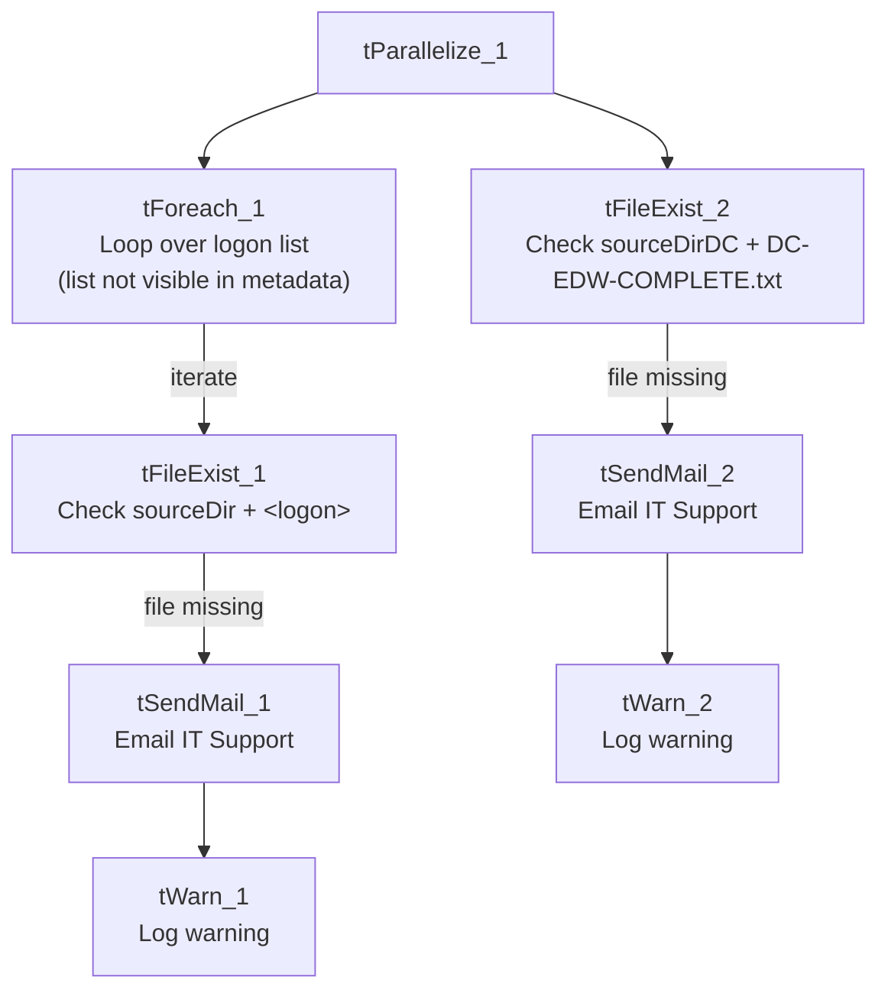

# Talend Job: Semaphore_Check

## Overview

This is a gatekeeper/alert job, the EDW2SF equivalent of LATITUDE's `Export_File_Check`: it doesn't load any data itself. It checks whether the upstream "CUBS extract" process has dropped its completion marker ("semaphore") files by 7am Central Time, and emails IT Support if one is missing — once for a general/looped set of client logons, and once specifically for the "DC" site.

## Detail table

| Field | Value |
|---|---|
| Job name | Semaphore_Check |
| Version | 0.1 |
| Project | EDW2SF |
| Author | jmach@harriscollect.com |
| Created | 2024-04-15T09:43:12.473-0700 |
| Last Modified | 2026-08-10T09:15:54.488-0700 |

## Step-by-step data flow

The job runs two independent checks in parallel (`tParallelize_1`):

1. **General logon check.** `tForeach_1` loops over a list of values (labeled "ForEachLogon" — the actual list of logon names isn't captured in this metadata, see Issues observed). For each value, `tFileExist_1` checks whether a file named `context.sourceDir + <the current logon value>` exists. If it does **not** exist, `tSendMail_1` emails `ITSupport@harriscollect.com` (cc: `jmach@harriscollect.com`, `bireporting@harriscollect.com`) with the subject "Missing CUBS Extract Semaphore File", naming the specific missing file, then `tWarn_1` logs "CUBS Extract job not completed on time." (severity 42) — a warning, not a job failure.
2. **DC-specific check.** `tFileExist_2` checks whether `context.sourceDirDC + "DC-EDW-COMPLETE.txt"` exists. If not, `tSendMail_2` emails the same recipients with the subject "Missing CUBS DC Extract Semaphore File", then `tWarn_2` logs "CUBS Extract job for DC not completed on time." (severity 42).

Neither branch fails the job outright (`tWarn`, not `tDie`) — a missing semaphore file produces an email and a warning-level log entry, and the job otherwise completes normally.

## Settings tables

### Check 1: `tFileExist_1` / `tSendMail_1` / `tWarn_1`

| Setting | Value | What it means |
|---|---|---|
| FILE_NAME (`tFileExist_1`) | `context.sourceDir + <current logon value>` | Looks for a per-logon semaphore file in the shared source directory; which logon names are checked comes from `tForeach_1`'s list, not visible in this metadata. |
| SUBJECT / MESSAGE (`tSendMail_1`) | "Missing CUBS Extract Semaphore File" / names the specific missing file and says it hasn't appeared "as of 7am Central Time" | Tells the recipient exactly which extract to check. |
| TO / CC | `ITSupport@harriscollect.com` / `jmach@harriscollect.com, bireporting@harriscollect.com` | Goes to a shared IT support inbox, not just one person — an improvement over LATITUDE's single-recipient alert pattern. |
| `tWarn_1` message | "CUBS Extract job not completed on time." (severity 42) | Logged after the email, regardless of whether the email succeeded — a warning, not a job failure. |

### Check 2: `tFileExist_2` / `tSendMail_2` / `tWarn_2`

| Setting | Value | What it means |
|---|---|---|
| FILE_NAME (`tFileExist_2`) | `context.sourceDirDC + "DC-EDW-COMPLETE.txt"` | A fixed, DC-specific semaphore filename — unlike the general check, this one isn't looped, it's a single hardcoded file. |
| SUBJECT / MESSAGE (`tSendMail_2`) | "Missing CUBS DC Extract Semaphore File" / same 7am Central Time framing, DC-specific wording | |
| `tWarn_2` message | "CUBS Extract job for DC not completed on time." (severity 42) | |

## Dependencies & configuration

- **Triggers/depends on other jobs:** none — no `tRunJob` links found.
- **Context variables used:** `context.sourceDir` (likely from `StandardFolders_0.1`, the project's shared-paths group — see `06_dependency_matrix.md`) and `context.sourceDirDC`, a DC-specific path variable not confirmed against any documented context group in `_shared_context.json`.
- **This job exists to *watch* the CUBS extract process** referenced throughout the project's `CUBS_Raw_*` jobs — it doesn't call them or get called by them directly, but it's operationally tied to whatever process actually produces the semaphore files it's checking for.

## Glossary

| Component type | Plain-English meaning |
|---|---|
| `tForeach` | Loops over a fixed list of values (defined in the component's own configuration), running the same downstream steps once per value. |
| `tFileExist` | Checks whether a specific file exists on disk, without reading its contents — used here purely as a yes/no completion signal. |
| `tParallelize` | Runs its downstream branches at the same time rather than one after another — here, the general logon check and the DC-specific check run concurrently. |
| `tSendMail` | Sends an email — used here purely as an alert, same as LATITUDE's `Export_File_Check`. |
| `tWarn` | Logs a warning without failing the job — used here so a missing semaphore file is recorded but doesn't stop this checker job itself from completing. |

## Issues observed

- **The actual list of logon names `tForeach_1` iterates over is not captured in this metadata** — Talend stores a `tForeach`'s value list in a way this extraction didn't retain (only its label, "ForEachLogon", survived). Unable to determine from metadata how many logons are checked or which ones; verify directly in Talend Studio.
- **The DC check is hardcoded and separate from the general loop**, rather than DC simply being one more value in the `tForeach_1` list. This may be intentional (DC's semaphore file has a different, fixed name pattern — `DC-EDW-COMPLETE.txt` vs. a per-logon filename), but it does mean adding a similar dedicated check for another site would require copying this pattern rather than just adding a value to a list.
- **Both branches only warn, never fail the job** — appropriate for a monitoring job that shouldn't itself show as "failed" in a scheduler, but it means detection relies entirely on someone reading the email or the job's warning-level log output; there's no escalation if the email itself silently fails to send (unlike `tSendMail` jobs elsewhere in this project that set `DIE_ON_ERROR` to stop the job on a mail failure — this job does set `DIE_ON_ERROR=true` on both `tSendMail` components, so a failed send would in fact fail the job at that point, which is worth knowing since it's not obvious from the warning-only framing above).
