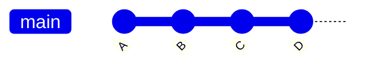
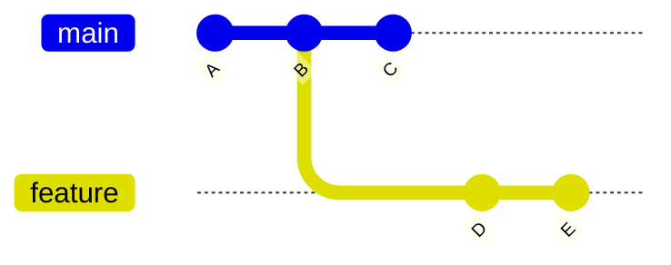
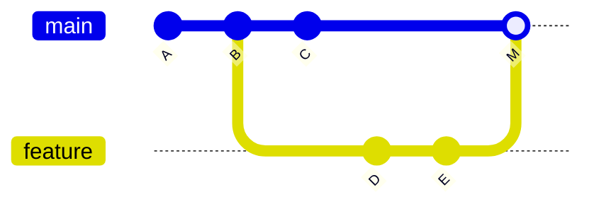
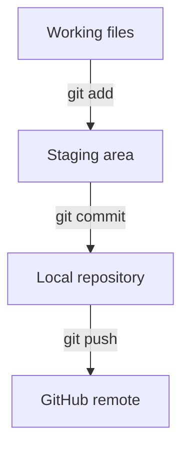

# Git & GitHub

## A Concise Developer Guide to Version Control, Collaboration, and the Everyday Workflow

> **Goal:** Understand the mental model behind Git, then learn the small
> set of commands needed for safe day-to-day development.

## What This Guide Covers

-   Why version control matters and how Git records history
-   Git vs. GitHub
-   Commits, hashes, branches, and pull requests
-   Working directory, staging area, local repository, and remote
    repository
-   A practical feature-branch workflow and core commands
-   Team practices that prevent common mistakes

### Mental Model in One Sentence

**Git** records snapshots of your project locally; **GitHub** hosts
shared Git repositories and adds collaboration controls such as pull
requests, reviews, permissions, and branch protection.

------------------------------------------------------------------------

# 1. Why Git Is Helpful

Git is a distributed version-control system. It gives developers a
durable history of a codebase and makes parallel development manageable.

-   **History:** See what changed, when, and by whom.
-   **Recovery:** Restore earlier versions instead of relying on manual
    copies such as `app_final_v7.py`.
-   **Parallel work:** Developers can work on separate branches without
    constantly overwriting one another.
-   **Review:** Isolate a set of changes so teammates can inspect it
    before it reaches the protected branch.
-   **Traceability:** Connect a production change to the exact commits
    and pull request that introduced it.

## Git vs. GitHub

| Git | GitHub |
| --- | --- |
| Version-control software that runs on your computer. | A hosted platform for Git repositories and team collaboration. |
| Creates commits, branches, diffs, merges, and local history. | Adds pull requests, code review, issues, permissions, Actions, CODEOWNERS, and branch/ruleset controls. |
| Works without GitHub and can work offline. | Uses Git underneath; GitHub is not a replacement for Git. |

## How Git Tracks Changes

A **commit** is a snapshot of the tracked project plus metadata such as
the author, timestamp, message, and parent commit. Git identifies each
commit with a cryptographic object ID, commonly displayed as a shortened
hash.



Each commit points to its parent, forming a history. Because the commit
ID is derived from Git object contents and relationships, changing
history produces different IDs. You can therefore refer to an exact
state of the project with an identifier such as `bed500b`.

> **Important nuance:** Git does not simply store a list of edited
> lines. Conceptually, commits represent project snapshots, while Git
> efficiently stores and reuses underlying objects.

------------------------------------------------------------------------

# 2. Branches: Safe, Parallel Lines of Work

A **branch** is a movable name that points to a commit. Creating a
branch gives you a separate line of development without copying the
whole project.



In this example, `feature` was created from commit B. New commits D and
E advance the feature branch while `main` can continue independently to
C.

-   Use short-lived feature branches for a feature, fix, or focused
    change.
-   Keep the protected branch, often `main` or `master`, stable.
-   Regularly incorporate upstream changes when a feature branch lives
    long enough to drift behind.

## Common Branch Commands

```bash
git branch                 # List local branches
git branch feature/login   # Create a branch
git switch feature/login   # Switch to it
git switch -c feature/api  # Create + switch in one command
```

------------------------------------------------------------------------

# 3. Pull Requests: Review Before Integration

A **pull request (PR)** is a GitHub collaboration workflow that proposes
merging changes from one branch into another. The PR shows the diff,
commit history, automated checks, discussion, and approvals in one
place.



After review, the feature can be integrated into the protected branch.
The exact history depends on whether the repository uses a merge commit,
squash merge, or rebase merge.

-   **Review:** Another developer can catch defects, security issues,
    and maintainability problems.
-   **Discussion:** Rationale and feedback stay attached to the change.
-   **Quality gates:** Tests, required approvals, CODEOWNERS, and
    rulesets can block unsafe merges.
-   **Audit trail:** The organization can see why and how a change
    reached the protected branch.

------------------------------------------------------------------------

# 4. The Four Places to Keep Straight

Most Git confusion comes from mixing up where a change currently exists.

| Area | What It Means | Typical Command |
| --- | --- | --- |
| **Working directory** | Files as they currently exist on your computer, including uncommitted edits. | `git diff` |
| **Staging area (index)** | The exact changes selected for the next commit. | `git add` |
| **Local repository** | Commits stored in your local `.git` database. | `git commit` |
| **Remote repository** | Shared repository hosted elsewhere, commonly GitHub. | `git push` / `git pull` |



> **Key idea:** A commit is local until you push it. Editing a file does
> not automatically stage it, and staging a file does not automatically
> commit it.

## Inspect Before You Act

-   `git status` --- Your best first command; shows branch, staged
    changes, unstaged changes, and untracked files.
-   `git diff` --- Shows unstaged changes. Use `git diff --staged` to
    inspect what will enter the next commit.
-   `git log --oneline --graph --decorate` --- Shows a compact history
    with branch structure.

------------------------------------------------------------------------

# 5. Recommended Everyday Workflow

The safest habit is: **update the protected branch → create a feature
branch → make small commits → push the branch → open a PR → review →
merge → update locally → clean up the feature branch.**

## 1. Start from an up-to-date protected branch

```bash
git switch main
git pull
```

> If your organization uses `master` instead of `main`, substitute
> `master` throughout these examples.

## 2. Create a feature branch

```bash
git switch -c feature/descriptive-name
```

## 3. Edit and inspect

```bash
git status
git diff
```

## 4. Stage only what belongs in the commit

```bash
git add path/to/file
git diff --staged
```

## 5. Commit with a useful message

```bash
git commit -m "Add validation for payment input"
```

## 6. Push the branch to GitHub

```bash
git push -u origin feature/descriptive-name
```

The `-u` option sets the remote branch as the upstream for your local
branch, so later `git push` and `git pull` commands can usually omit the
branch name.

## 7. Open a pull request

In GitHub:

1.  Open a PR from `feature/descriptive-name` into `main`.
2.  Review the diff and automated checks.
3.  Request or obtain required approvals.
4.  Address review comments as needed.

## 8. Merge after approval, then update your local protected branch

After the PR has been approved and merged in GitHub:

```bash
git switch main
git pull
```

This returns you to the protected branch and updates your local copy
with the newly merged changes.

## 9. Clean up the feature branch

After confirming the PR was successfully merged, remove the feature
branch locally:

```bash
git branch -d feature/descriptive-name
```

Then remove the remote feature branch from GitHub if GitHub did not
already delete it automatically:

```bash
git push origin --delete feature/descriptive-name
```

`git branch -d` is the safer local deletion command because Git will
normally refuse to delete a branch whose work has not been merged.
`git branch -D` forces deletion and should be used only when you
intentionally want to discard the branch.

> **Before every commit:** Run `git status` and inspect
> `git diff --staged`. This simple habit prevents many accidental
> commits.

------------------------------------------------------------------------

# 6. Core Command Reference

| Command | Purpose |
| --- | --- |
| `git status` | Show the current branch and the state of tracked/untracked changes. |
| `git log` | Show commit history. Add `--oneline --graph --decorate` for a compact view. |
| `git add <file>` | Stage a file or change for the next commit. `git add .` stages broadly, so inspect carefully. |
| `git diff` | Show unstaged changes. Use `--staged` for staged changes. |
| `git restore <file>` | Discard unstaged changes in a working file. Use cautiously because those edits are lost. |
| `git commit -m "..."` | Create a local commit from the staged snapshot. |
| `git push` | Send local commits or branch updates to the remote. |
| `git pull` | Bring remote changes into the current local branch; conceptually, fetch + integrate. |
| `git branch` | List or create branches. |
| `git switch <branch>` | Move to another branch. `-c` creates and switches to a new branch. |

## Also Worth Knowing

-   `git clone <url>` --- Create a local copy of an existing remote
    repository.
-   `git fetch` --- Download remote branch/history updates without
    immediately integrating them into your current branch.
-   `git remote -v` --- Show configured remotes such as `origin`.

------------------------------------------------------------------------

# 7. Team Practices That Make Git Work Well

-   **Protect the main/master branch.** Require pull requests, passing
    checks, and appropriate approvals instead of direct pushes.
-   **Keep commits focused.** A commit should represent one coherent
    change and have a message that explains its intent.
-   **Keep PRs reasonably small.** Smaller diffs are easier and faster
    to review accurately.
-   **Do not commit secrets.** Passwords, API keys, tokens, private
    keys, and sensitive configuration should stay out of Git history.
-   **Use a `.gitignore`.** Exclude generated files, local environments,
    caches, secrets files, and other machine-specific artifacts that
    should not be versioned.
-   **Resolve conflicts deliberately.** A merge conflict means Git needs
    a human to decide how overlapping changes should be combined; it is
    not inherently an error.
-   **Prefer feature branches.** Avoid doing normal development directly
    on the protected branch, even if you technically have permission.

## A Simple Troubleshooting Sequence

When something looks wrong, start with:

```bash
git status
git diff
git log --oneline --graph --decorate -10
```

Those three commands answer most first-level questions:

-   **Where am I?**
-   **What changed?**
-   **What happened recently?**

> **Rule of thumb:** Before using a destructive or history-rewriting
> command you do not recognize, stop and inspect the repository state.
> Git usually gives you multiple safe ways to recover, but the correct
> command depends on whether changes are unstaged, staged, committed, or
> already pushed.

------------------------------------------------------------------------

# Quick Recap

-   **Git** is the version-control engine; **GitHub** is a collaboration
    and hosting platform built around Git.
-   A **commit** is an identified snapshot in history; a **branch** is a
    movable pointer to a line of commits.
-   A **pull request** is the review-and-integration workflow around a
    branch change.
-   Know which state your change is in: **working directory → staging
    area → local commit → remote**.
-   A normal team workflow is: **pull → branch → edit → stage → commit →
    push → PR → merge → pull → delete branch**.
-   Use `git status` constantly. Inspect before staging, committing,
    restoring, pulling, or pushing.
