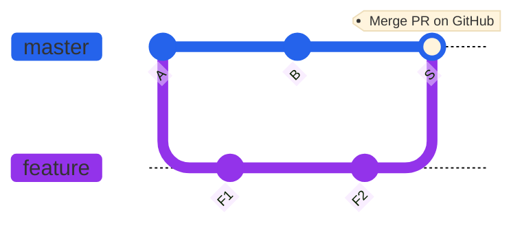
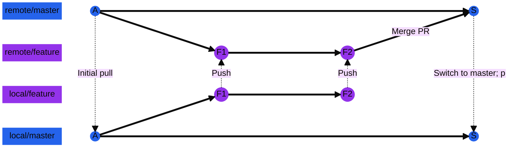
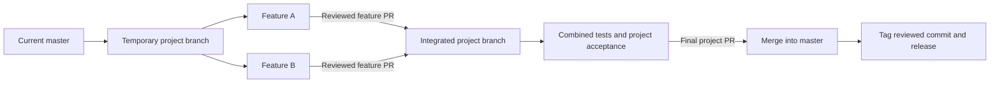

# Git workflow

Use Git to keep changes reviewable, traceable, and recoverable. Our delivery unit is a completed project or agreed project milestone; releases do not require a sprint or calendar schedule.

Examples assume the shared remote is `origin` and the default branch is `master`. Substitute the repository's actual names where needed. Commands run from the repository directory; example filenames, branch names, and commit IDs must be replaced for your work.

## Core practices

- **Start from current master.** Pull `master` before creating a new independent feature or project branch. Keep local `master` aligned with `origin/master`.
- **Work in branches.** Use a short-lived branch for one coherent change. Keep `master` ready for release and integrate changes through pull requests.
- **Commit deliberately.** Each commit should represent a logical change. Separate unrelated fixes and large formatting changes; include related tests and documentation with the implementation.
- **Review what you stage.** Check `git status`, `git diff`, and `git diff --staged`. Stage specific files or use `git add -p` rather than blindly staging everything.
- **Write useful messages.** Describe the result, such as `fix: prevent duplicate address loads`, and explain the reason in the commit body when necessary. Reference the project or issue where useful.
- **Keep repository contents appropriate.** Exclude credentials, local settings, generated files, and sensitive datasets. Use `.gitignore` for untracked files; it does not remove files already committed.
- **Push working branches regularly.** Share progress and open draft PRs early. Mark incomplete work clearly and keep it out of release-ready branches.
- **Protect shared history.** Configure protection for `master` and shared project/release branches: required PR review, applicable checks, resolved discussions, and no routine direct or force pushes.

## Pull requests and branching

### Why we use them

A branch isolates a change while other work continues. A pull request (PR) makes the proposed difference visible and records its purpose, review, and validation. Together they let us catch mistakes before integration and understand or reverse a change later.

### How they work

**Separate features into a branch:** The feature branch isolates the proposed change so it can be more easily reviewed, tested, and version-controlled.



**Develop locally, approved in the remote:** local and remote branches share the same commits after each push. Merges to master happen exclusively in Github - so after the PR is approved, local master must pull down the remote master to realize the changes to master locally.

Neither local nor remote copies of the feature branch are needed at this point. See #3 below for more details.



### 1. Start a feature branch

Ensure master is up to date with remote before creating new feature branch off of master.

```bash
git status
git switch master
git pull --ff-only origin master
git switch -c feature/address-validation
```


### 2. Commit and push the change

Commit changes locally on feature branch before pushing feature branch to remote.

```bash
git add path/to/changed-file
git commit -m "feat: add address validation"
git push -u origin feature/address-validation
```

If master has changed since initially creating feature branch, fetch changes to master from remote, merge those updates into feature branch locally, then push these updates up to remote.

```bash
git switch feature/address-validation
git fetch origin
git merge origin/master
# Resolve any conflicts, then stage the resolved files and complete the merge.
# Re-run the relevant checks before pushing.
git push
```

To resolve a merge conflict:
```bash
# Start with a clean working tree before merging so recovery is straightforward.
# If a merge stops with conflicts, edit the conflicted files, then stage each resolved file.
git add path/to/resolved-file
git merge --continue

# Alternatively, abandon the in-progress merge.
git merge --abort
```

See the [Git merge reference](https://git-scm.com/docs/git-merge).

### 3. Open, review, and merge the PR

In GitHub, create a PR with **base: master** and **compare: feature/address-validation**. Include the problem, resulting behavior, project/issue link, validation performed, and any migration, deployment, or rollback considerations. Reviewers should assess correctness and operational impact, not just formatting.

After feedback, push follow-up commits to the same branch.

The PR approver will approve the change then merge the feature to master in Github. This updated master branch is not on any local branch; see next step.


### 4. Clean up after the PR is merged

Pull down merged branch from remote than delete feature branch both locally and in remote.

```bash
git switch master
git pull --ff-only origin master
git push origin -d feature/address-validation
git branch -d feature/address-validation
```

## Combining work into project-based releases

A **commit** records a change, a **branch** organizes ongoing work, and a **release** identifies a tested snapshot for delivery. One release can contain many commits and merged PRs. Combining work into a release does not require squashing the entire project into one commit.

Agree on the release scope, owner, acceptance criteria, dependencies, and deployment plan at project kickoff. Associate the project's PRs with a common issue, project board, or milestone. Release when that scope is accepted and the combined result is validated.

### Choose the simplest integration approach

| Situation | Approach |
| --- | --- |
| Features can safely land independently | Create each feature from current `master`, merge through focused PRs, and tag the accepted combined snapshot when the project is ready. Use feature flags or backward-compatible changes for incomplete functionality. |
| Several dependent features must land together | Create a temporary `project/address-modernization` branch from current `master`. Target the related feature PRs at that project branch, then merge one final project PR into `master`. |
| A release needs stabilization while new work continues | Cut `release/address-modernization-1.0` from the agreed candidate commit. Admit only reviewed release fixes and carry every fix back to `master`. Delete the release branch after delivery unless it supports a maintained version. |

A release contains **everything reachable from its tagged commit**. If unrelated work on `master` is not ready to ship, do not tag its latest tip without checking scope. Choose an appropriate candidate and isolate future work earlier. Cherry-picking selected commits is an exception for deliberate backports or assembling a constrained release; account for dependencies, duplicate history, and repeat integration testing.

### Integrate a multi-feature project



Create the shared project branch:

```bash
git switch master
git pull --ff-only origin master
git switch -c project/address-modernization
git push -u origin project/address-modernization
```

For this coordinated workflow, dependent features intentionally branch from the updated project branch rather than directly from `master`:

```bash
git fetch origin
git switch -c feature/address-normalization origin/project/address-modernization
# Make and commit the change.
git push -u origin feature/address-normalization
```

Open the feature PR into `project/address-modernization`. Keep that shared project branch current with `master` through reviewed synchronization PRs, and test after integration. Keep project branches limited to their project; avoid a permanent branch per developer or sprint.

Once all feature PRs are merged, review the complete project diff and run end-to-end checks. Merge the final **project branch -> master** PR using a merge commit to preserve ancestry. If repository policy requires squash merging instead, retire the project branch immediately afterward and start subsequent work from the updated `master`.

Feature branches can be deleted after they merge into the project branch; confirm that target when checking integration. After the final project PR merges, pull `master` and delete the project branch using the same cleanup pattern above, substituting its branch name.

### Mark and deliver one release

Record the accepted scope, included PRs, configuration/schema changes, migration order, test evidence, and rollback plan in the release notes. Tag the exact reviewed commit; do not assume the latest `master` still points to it. Revalidate the final integrated candidate if it changed after testing.

```bash
git fetch origin --tags
git log --oneline --decorate origin/master
git show --stat REVIEWED_COMMIT_SHA
git tag -a v1.0.0 REVIEWED_COMMIT_SHA -m "Address modernization: initial release"
git push origin v1.0.0
```

Replace `REVIEWED_COMMIT_SHA` with the accepted full commit ID and use an unused version tag. Annotated tags attach a message and metadata to a release point; see the [Git tag reference](https://git-scm.com/docs/git-tag). Publish release notes against that tag and deploy an artifact built from that commit. A tag or PR merge only deploys software if the repository's automation is configured to do so.

Keep published tags fixed. Deliver corrections under a new version. For projects spanning repositories, maintain a release manifest listing each repository's tag/commit, artifact version, dependencies, and deployment order so the coordinated release is reproducible.

## History cleanup and recovery

Use feature-PR squash merging to combine small working commits. Interactive rebase is optional for cleaning up your own unpublished commits before review:

```bash
git rebase -i HEAD~3
```

Keep the first relevant commit as `pick` and mark subsequent commits `squash` or `fixup`; review the resulting history and re-run checks. Do not rewrite shared `master`, project, or release history. Rewriting a published personal feature branch requires coordination with anyone using it; if necessary, use `git push --force-with-lease`, never an unconditional force push.

For a faulty integrated change, create a fix/revert branch from current `master` and submit a PR. `git revert COMMIT_SHA` creates a compensating commit for an ordinary or squash commit; reverting a merge requires selecting its mainline parent and planning for any later reintroduction. Git rollback also does not automatically reverse deployed schema or data changes, so follow the release's operational rollback plan.
